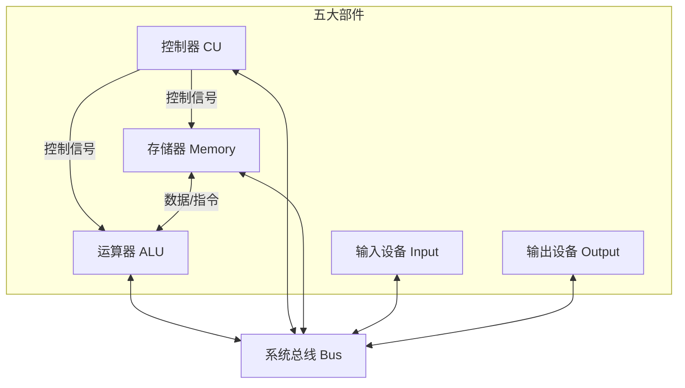
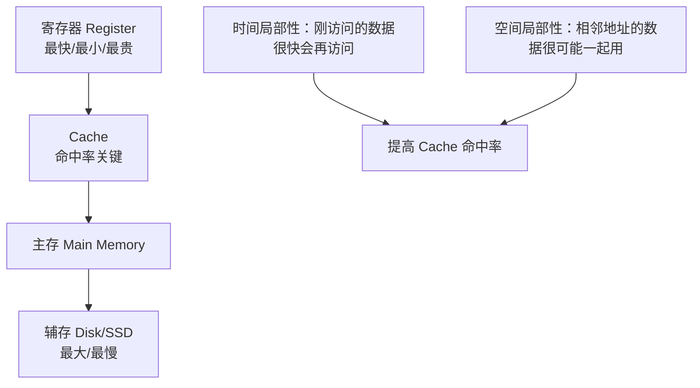
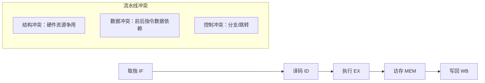
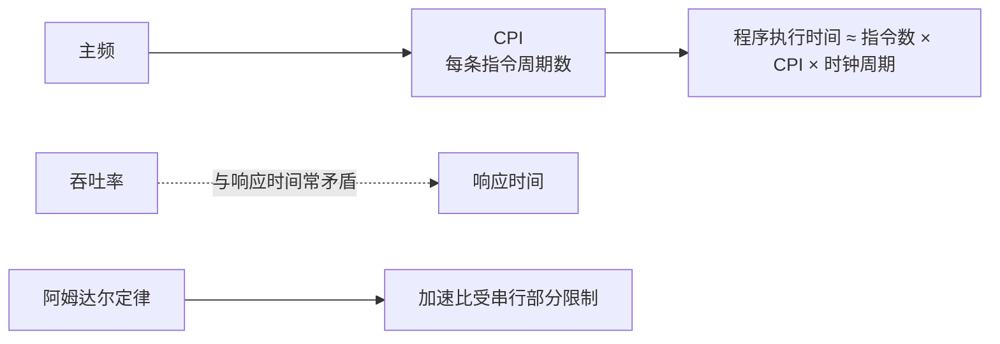

# W01｜计算机组成原理

> 周期：2026-11-23 至 2026-11-29  
> 本周主题：计算机组成原理（CPU、指令、存储层次、性能指标）  
> 建议投入：10–15 小时（基准 12 小时）  
> 对应知识文档：[计算机组成原理](../02_综合知识/计算机系统/计算机组成原理.md)

## 本周目标（可勾选）

- [ ] 掌握计算机系统五大部件与总线关系，能画出冯·诺依曼结构简图并说明数据流。
- [ ] 理解指令执行过程、寻址方式，以及流水线的吞吐提升与三类冲突。
- [ ] 建立存储层次（寄存器 → Cache → 主存 → 辅存）与局部性原理的联系，能计算平均访问时间。
- [ ] 区分吞吐率、响应时间、CPI、主频的关系，能用阿姆达尔定律做简单性能估算。
- [ ] 完成至少 60–80 道综合知识题，记录正确率与错题。
- [ ] 完成 2 道案例题（重点：识别硬件/性能约束对架构方案的影响）。
- [ ] 输出一份真实项目（或明确标注的模拟项目）背景 + 本人职责素材。
- [ ] 完成周复盘，写出本周最薄弱的 3 个知识点及下周补救动作。

## 核心知识框架与联系（帮助记忆）

### 1. 计算机系统整体结构

**记忆点**：控制器指挥，运算器计算，存储器存程序与数据，I/O 与外界交互，总线是通道。

### 2. 存储层次与局部性原理（高频考点）

**关键公式**：
- 平均访问时间 ≈ 命中时间 + (1 − 命中率) × 缺失代价
- 命中率越高，平均访问时间越接近 Cache 速度

### 3. 指令执行与流水线

**架构师视角**：流水线提升吞吐，但冲突会引入气泡；软件层面可通过指令调度、分支预测、乱序执行缓解。

### 4. 性能指标关系（易混）

**易混点**：
- 提高主频 ≠ 线性提高性能（还受 CPI、指令数、存储层次影响）
- 吞吐率高不代表单任务响应时间一定短

---

## 每日执行细节（可按工作节奏微调）

| 时间 | 具体任务 | 重点知识点 | 验收输出 |
|------|----------|------------|----------|
| **周一 1.5h** | 精读知识文档 + 大纲对应条目 | 五大部件、总线、指令格式与寻址 | 手绘/文字版系统结构图 + 3 个核心概念卡片 |
| **周二 2h** | 案例训练：案例题结构与基础架构识别 | 如何从题干识别性能/硬件约束 | 2 道案例独立答案（含需求/约束/方案/决策/质量属性）+ 得分点对比 |
| **周三 1.5h** | 专题选择题 40–50 道 + 错题回看 | 存储层次、流水线、性能计算 | 题量、正确率、错题清单（链接到 05_错题） |
| **周四 2h** | 论文/项目素材 | 项目背景、本人职责、系统规模与约束 | 完成《项目背景与职责》初稿（真实优先，模拟需标注） |
| **周五 1h** | 回顾易混点 + 英文术语 | 吞吐 vs 响应、命中率、CPI、局部性 | 本周易错点清单（至少 5 条） |
| **周六 3h** | 综合训练 | 上午知识补强 1h + 案例 1h + 论文/项目 1h | 再完成 20–30 道题 + 1 道案例 + 项目背景修改 |
| **周日 1h** | 周复盘 | 三科完成度、薄弱点诊断 | 填写下方复盘表 + 下周调整建议 |

> 时间紧张时优先保证：周一知识输入、周二案例、周三刷题、周四项目素材、周日复盘。

---

## 案例分析训练（本周重点）

**训练目标**：学会从题干中识别与硬件/性能相关的约束，并据此影响架构方案选择。

**标准答题五步**：
1. 识别需求（业务目标 + 质量属性）
2. 识别约束（硬件、性能、已有系统、预算等）
3. 比较备选方案
4. 给出决策及理由
5. 论证对性能、可用性、可维护性等质量属性的影响

**本周练习建议**：
- 至少完成 2 道完整案例（可从历年真题中选与性能、存储、并发相关的基础题）。
- 每道题记录：题目来源、题干关键约束、自己的答案、参考得分点、遗漏点、改进动作。

---

## 论文与模拟项目（本周交付物）

**本周必须输出**：项目背景与本人职责素材（约 400–600 字）。

**内容要求**：
- 项目业务背景与建设目标
- 系统大致规模（用户量、数据量、峰值等，真实即可，不夸大）
- 本人在项目中的具体职责（设计/开发/架构相关部分）
- 当时面临的主要技术或业务约束

**注意**：
- 优先使用真实参与过的项目。
- 若使用贯穿备考的「大型电商平台架构升级」模拟项目，必须在文档开头明确标注「模拟项目」，不得伪装成个人真实履历。

建议文件位置：`04_论文/项目素材/01-项目背景与职责.md`（新建后同步更新索引）。

---

## 本周验收清单（完成即勾选）

**知识掌握**
- [ ] 能独立画出冯·诺依曼结构并说明数据与控制流向
- [ ] 能解释存储层次每一层的作用及局部性原理如何提升命中率
- [ ] 能说明流水线如何提高吞吐，以及三类冲突的含义
- [ ] 能区分吞吐率、响应时间、CPI、主频的关系，并做简单性能估算

**训练产出**
- [ ] 综合知识题量 ≥ 60 道，正确率已记录
- [ ] 完成 ≥ 2 道案例题，并写了得分点对比与错因
- [ ] 完成《项目背景与职责》素材初稿
- [ ] 本周易错点清单 ≥ 5 条，已归档到 [05_错题与薄弱点](../05_错题与薄弱点/README.md)

**复盘**
- [ ] 填写下方周复盘表
- [ ] 明确写出本周最薄弱的 3 个知识点及下周补救动作

---

## 周复盘（学习后填写）

| 指标 | 本周记录 |
|------|----------|
| 实际学习时长 |  |
| 综合知识题量 / 正确率 |  |
| 案例完成数 / 主要遗漏点 |  |
| 论文或项目产出 |  |
| 本周最薄弱的 3 个知识点 | 1.  2.  3.  |
| 下周补救动作 |  |
| 其他调整 |  |

---

## 与后续周的衔接

- W02 将进入**操作系统**（进程、线程、并发、死锁、存储管理），本周建立的「存储层次 + 性能视角」会直接复用。
- 项目背景素材是后续所有论文的基础，务必本周完成初稿。

---

[返回 24 周总计划](../2027-personal-study-plan.md) · [知识库首页](../../README.md) · [本周知识文档](../02_综合知识/计算机系统/计算机组成原理.md)
