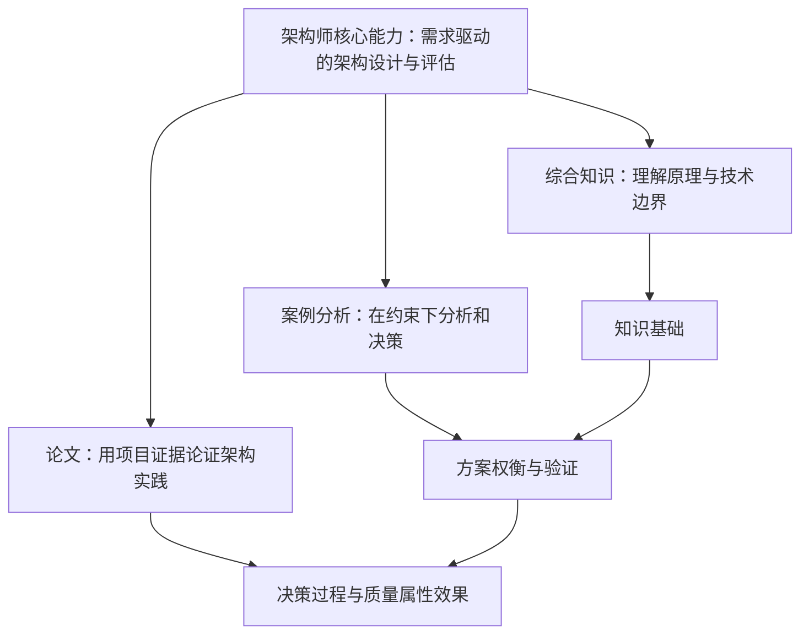

# 系统架构设计师考试｜全景概览

> 这张图只展示考试能力结构，不替代官方考试说明和完整大纲。

## 三科之间的关系

| 科目 | 核心任务 | 学习产出 |
|---|---|---|
| 综合知识 | 建立完整知识基础 | 概念体系、原理理解、易混点 |
| 案例分析 | 把知识用于具体场景 | 需求约束分析、方案比较、质量属性论证 |
| 论文 | 证明具备工程实践与表达能力 | 项目背景、架构决策、实施证据、效果复盘 |

## 备考主线

**理解原理 → 识别约束 → 做出架构决策 → 评估质量属性 → 形成工程证据。**

> 考试科目、时长及形式以官方考试大纲和当次考试通知为准。本页不固化可能调整的政策细节。
