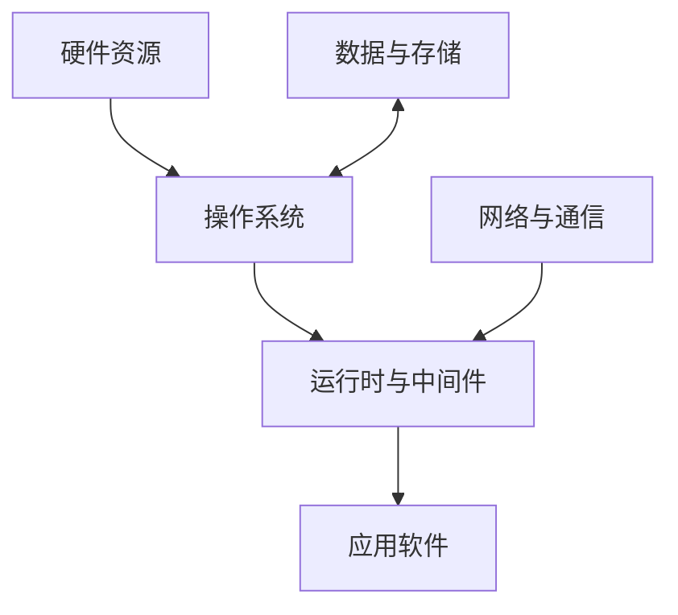
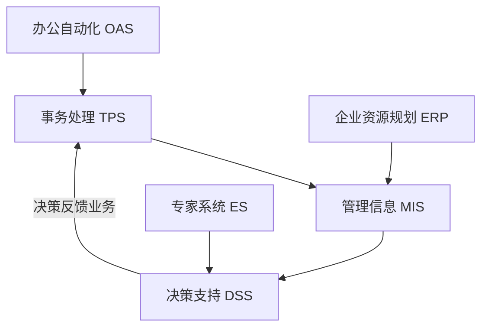
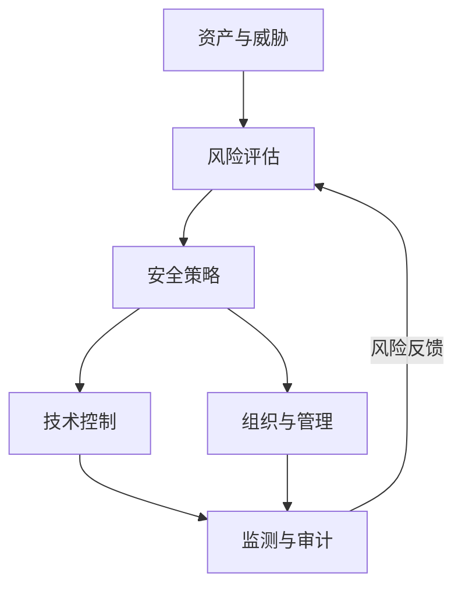
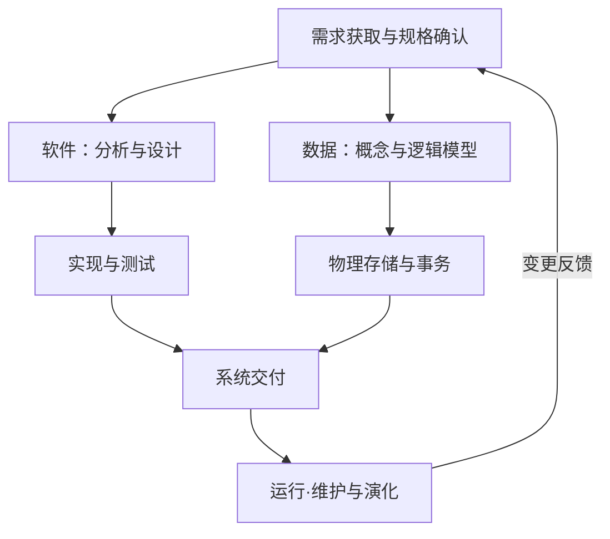
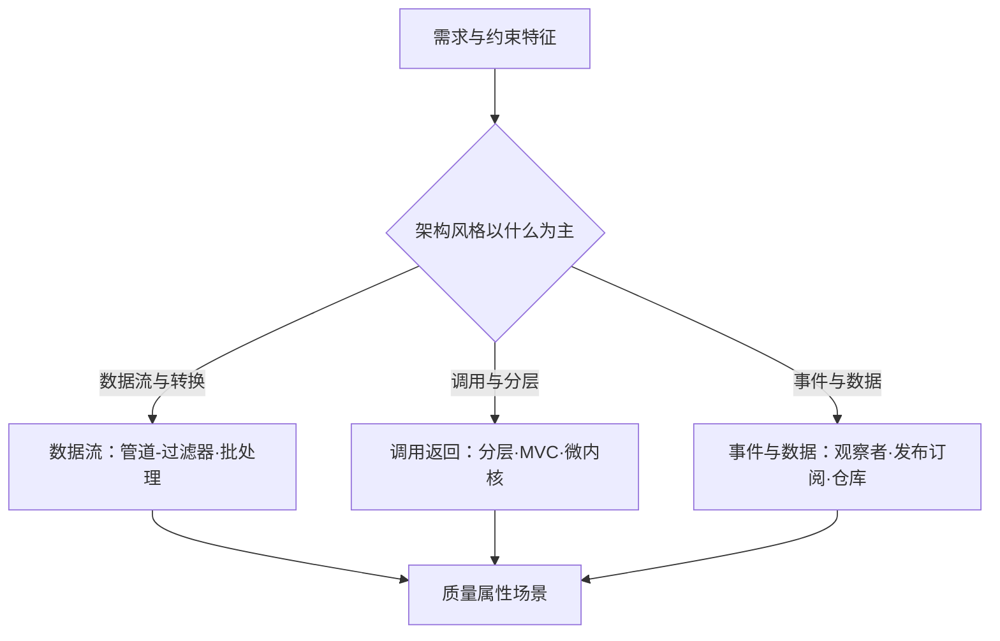
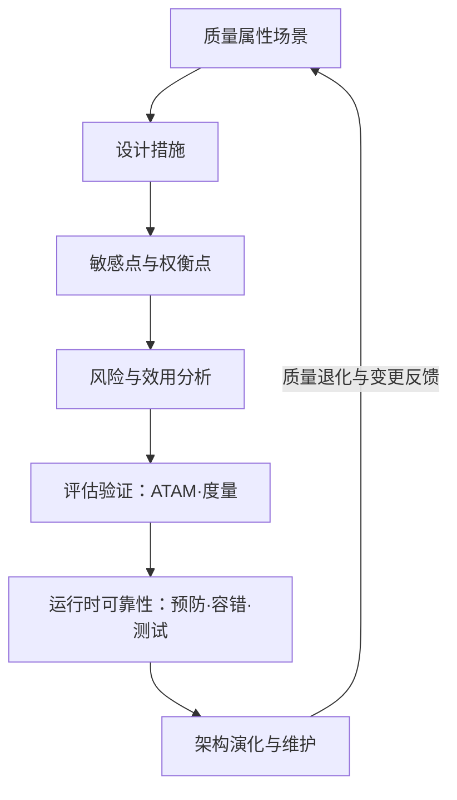
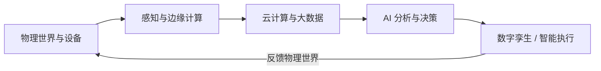

# 综合知识｜核心概念体系概览

> 本页用于建立综合知识的整体认知地图，不是官方大纲逐条图示。完整考点请查阅[官方考试大纲](./系统架构设计师考试大纲.md)中“考试科目1：系统架构设计综合知识”。
>
> 制图规范以仓库根目录 [AGENTS.md](../../../AGENTS.md)《Mermaid 知识概览图规范（强制）》为唯一依据。每张图只回答一个问题；节点少于考点数量是有意取舍，不代表删减考试范围。
>
> 本页 7 张图在整体知识层次中的位置，见 [知识概览图索引 · 体系总图](./脑图索引.md)。

## 1. 计算机系统：从硬件资源到软件服务

*考纲映射：考试科目1 · [第 1 章 计算机系统基本知识](./系统架构设计师考试大纲.md#1-计算机系统基本知识)（1.2 计算机硬件、1.3 计算机软件、1.5 计算机网络、1.9 系统性能）。*

**关系提示：** 硬件提供计算与存储资源，操作系统管理资源，中间件提供通用运行能力，应用实现业务；网络和数据贯穿各层。硬件考点（冯·诺依曼结构、CPU/GPU/DSP/FPGA、CISC/RISC、存储层次、总线分类）属记忆型，重点在软件各层如何调用底座资源。

## 2. 信息系统：从业务数据到决策支持

*考纲映射：考试科目1 · [第 2 章 信息系统基础知识](./系统架构设计师考试大纲.md#2-信息系统基础知识)（2.2 TPS、2.3 MIS、2.4 DSS、2.5 ES、2.6 OAS、2.7 ERP）。*

**关系提示：** 信息系统沿“记录事实 → 管理分析 → 辅助决策”逐级上移。TPS 是数据基础，MIS 面向管理，ERP 打通跨部门流程，DSS 面向决策；ES 以规则和知识推理支撑判断，属于独立分支而非某一级的附属。

## 3. 信息安全：风险驱动的治理闭环

*考纲映射：考试科目1 · [第 3 章 信息安全技术基础知识](./系统架构设计师考试大纲.md#3-信息安全技术基础知识)（3.3 系统组成框架、3.4 加密、3.5 密钥管理、3.6 访问控制与数字签名、3.7 抗攻击、3.8 保障体系与评估）。*

**关系提示：** 加密、密钥管理、访问控制、数字签名和抗攻击技术是控制手段，需由组织制度和持续评估支撑。答题时要连成“威胁—控制—责任主体—审计证据—残余风险”，而不是单点罗列技术名。

## 4. 软件与数据：从需求到可运行系统

*考纲映射：考试科目1 · [第 4 章 软件工程基础知识](./系统架构设计师考试大纲.md#4-软件工程基础知识)（4.1 软件工程、4.2 需求工程、4.3 系统分析与设计、4.4 软件测试、4.7 软件项目管理）与[第 5 章 数据库设计基础知识](./系统架构设计师考试大纲.md#5-数据库设计基础知识)（5.3 数据库设计、5.4 用户访问数据库的标准接口、5.5 NoSQL 数据库系统）。*

**关系提示：** 开发链（需求—设计—实现—测试）与数据链（概念—逻辑—物理—访问）在“系统交付”处汇合，再进入运行维护，并由变更反馈回需求。两条链的交叉点是案例高频场景：需求变更如何影响模型、模型变更如何影响性能与事务设计。

## 5. 架构风格选型：按需求特征定风格

*考纲映射：考试科目1 · [第 6 章 系统架构设计基础知识](./系统架构设计师考试大纲.md#6-系统架构设计基础知识)（6.1 软件架构概念、6.2 ABSD、6.3 软件架构风格、6.4 架构的复用技术、6.5 DSSA）。*

**关系提示：** 风格不是按“先进/常用”选，而是由数据处理形态、调用耦合方式和并发模型决定。选型完成后进入质量属性权衡（见下节）。案例题要求写清“选了什么风格、为什么适合本题约束、代价是什么”，而不是只写风格名称。

## 6. 质量保障闭环：从设计到演化的同一条链

*考纲映射：考试科目1 · [第 7 章 系统质量属性与架构评估](./系统架构设计师考试大纲.md#7-系统质量属性与架构评估)（7.1 质量属性、7.2 架构评估、7.3 ATAM 方法实践）、[第 8 章 软件可靠性技术](./系统架构设计师考试大纲.md#8-软件可靠性技术)（8.2 建模、8.4 设计、8.5 测试、8.6 评估）、[第 9 章 软件架构的演化和维护](./系统架构设计师考试大纲.md#9-软件架构的演化和维护)（9.2 演化过程、9.3 演化分类、9.5 演化评估、9.7 维护）。*

**关系提示：** 质量属性是需求侧的场景表达，设计措施是架构侧的回答，敏感点与权衡点是二者的交汇，评估验证给出结论，可靠性设计保障运行期，演化与维护应对变化。考场上这条链要能反向走：从“可用性要求”推出“冗余与故障切换”，再说明代价和失效模式。

## 7. 新兴技术体系：感知—计算—智能的协同

*考纲映射：考试科目1 · [第 10 章 未来信息综合技术](./系统架构设计师考试大纲.md#10-未来信息综合技术)（10.1 CPS、10.2 AI、10.3 机器人、10.4 边缘计算、10.5 数字孪生、10.6 云计算和大数据）。*

**关系提示：** CPS、机器人、边缘计算、数字孪生、AI 和云大数据并非孤立名词，而是感知、计算、建模和执行协同的技术体系。案例题若考“边云协同”“数字孪生落地”，答案要沿这条链回答数据在哪算、如何回传、如何闭环。

---

## 不单独成图的三个章节

以下三章考点以记忆和辨析为主，画成流程链不会增加理解，只会把线性清单伪装成结构图。完整考点以官方大纲为准，本页只提供定位与入口。

| 大纲章节 | 体系总图中的位置 | 不单独成图的原因 | 完整考点 |
|---|---|---|---|
| 11 标准化与知识产权 | 方法论层 | 考点是标准分类、标准化生命周期、标准化机构与专利著作权权属，属清单型，画流程无增量 | [官方大纲 · 第 11 章](./系统架构设计师考试大纲.md#11-标准化与知识产权) |
| 12 应用数学 | 基础支撑层 | 考点是概率统计、图论、组合分析、算法选择、运筹方法与数学建模共 6 类方法的适用题型，画通用建模流程图不增加信息 | [官方大纲 · 第 12 章](./系统架构设计师考试大纲.md#12-应用数学) |
| 13 专业英语 | 基础支撑层 | 大纲仅两条要求（高级工程师英文阅读水平、掌握本领域术语），无过程可画 | [官方大纲 · 第 13 章](./系统架构设计师考试大纲.md#13-专业英语) |

> 学习方式：这三章以大纲条目为清单，配合对应练习题与错题卡巩固，不占用脑图。

---

## 如何使用本页

1. 先看体系总图，确认每个主题落在哪一层，再决定投入顺序。
2. 按图讲出节点间的关系（“这条箭头为什么存在”），讲不出来就回到大纲和知识文档。
3. 阅读官方大纲和对应知识文档，补齐定义、公式、标准和细节考点。
4. 做题后把易混点、错题和跨章节联系补充到知识文档，不把图重新扩成考点清单。
