# 综合知识｜核心概念体系概览

> 本页用于建立综合知识的整体认知地图，不是官方大纲逐条图示。完整考点请查阅[官方考试大纲](./系统架构设计师考试大纲.md)中“考试科目1：系统架构设计综合知识”。每张图只呈现核心关系，节点少于考点数量是有意取舍。

## 1. 计算机系统：从硬件资源到软件服务

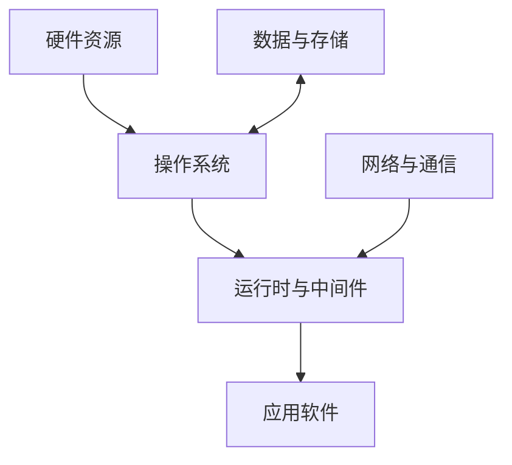

**关系提示：** 硬件提供计算与存储资源，操作系统管理资源，中间件提供通用运行能力，应用实现业务；网络和数据贯穿各层。

## 2. 信息系统：业务处理到决策支持

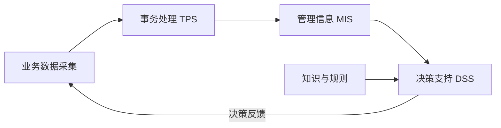

**关系提示：** 信息系统从记录业务事实，逐步走向管理分析和辅助决策；ERP 等综合系统连接跨部门业务流程。

## 3. 信息安全：目标、控制与治理

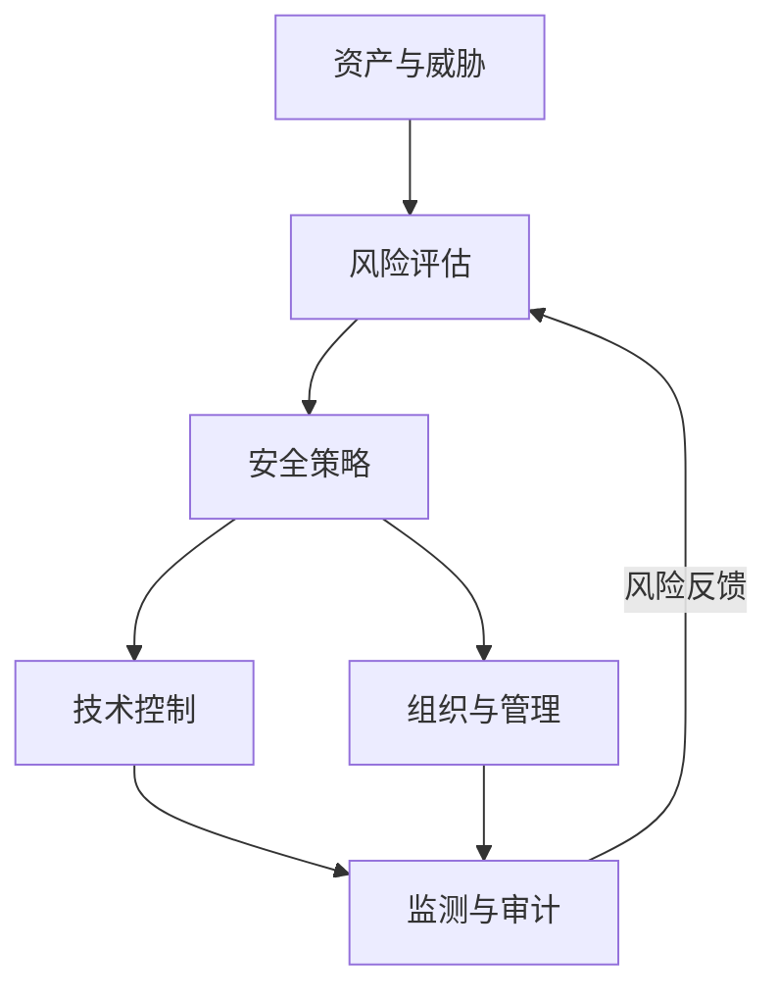

**关系提示：** 加密、密钥管理、访问控制、数字签名和抗攻击技术是控制手段，需由组织制度和持续评估支撑。

## 4. 软件工程：需求驱动的开发闭环

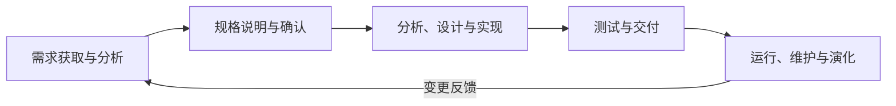

**关系提示：** 过程模型决定活动如何组织；需求追踪、配置管理、测试和项目管理贯穿生命周期。

## 5. 数据库：从业务语义到可靠访问

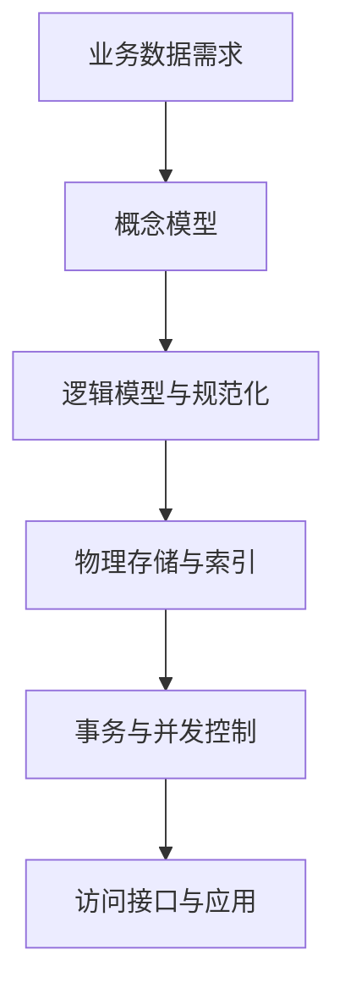

**关系提示：** 数据库设计从语义建模开始，逐层落实结构、存储和访问；关系数据库、NoSQL 与分布式方案应按数据特征选择。

## 6. 软件架构：把需求组织成可实现的结构

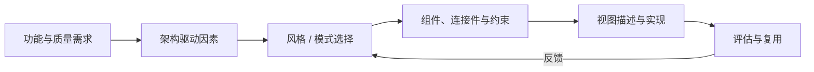

**关系提示：** ABSD、DSSA 和架构复用等方法帮助形成结构；架构描述要让不同干系人理解关键决策。

## 7. 质量属性与架构评估：用场景检验设计

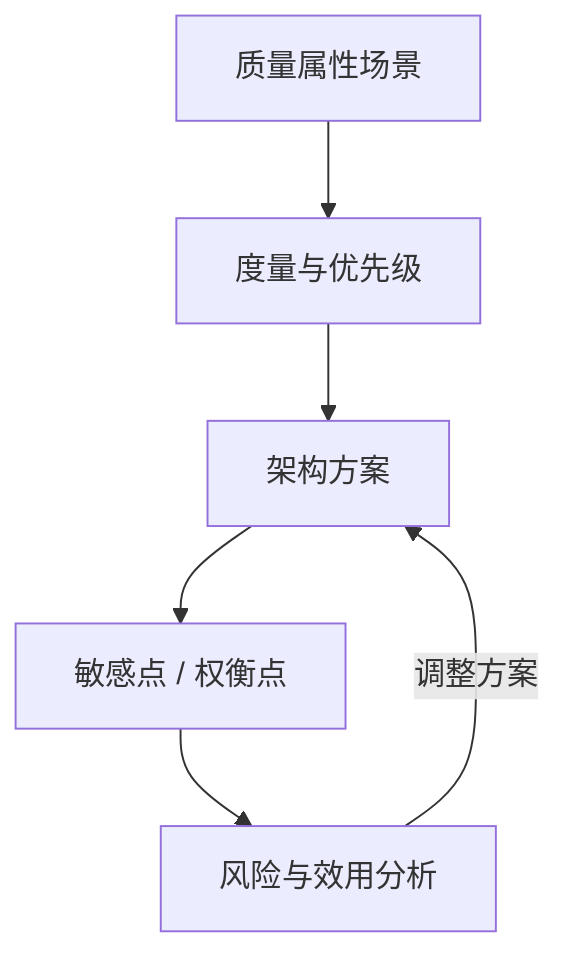

**关系提示：** 性能、安全、可用性、可修改性等属性会相互影响；ATAM 等评估方法帮助暴露风险和权衡。

## 8. 软件可靠性：预防、容错到验证

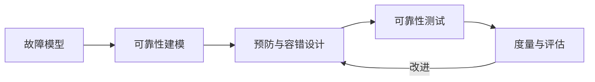

**关系提示：** 可靠性不是单一测试结果，而是由模型、设计、管理、测试和评估共同构成的工程活动。

## 9. 架构演化与维护：控制变化风险

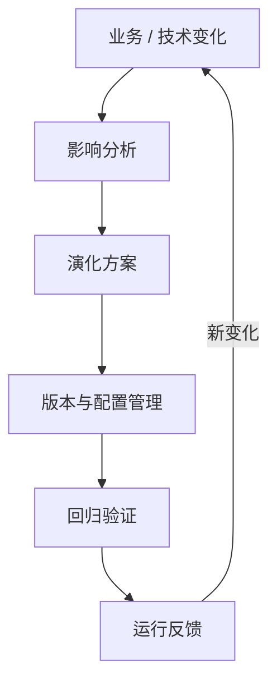

**关系提示：** 静态演化、动态演化和维护活动都需要控制依赖、版本和质量退化风险。

## 10. 未来信息技术：感知、计算与智能融合

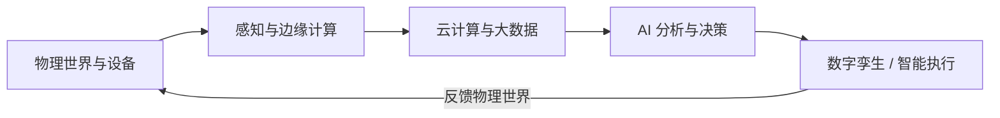

**关系提示：** CPS、机器人、边缘计算、数字孪生、AI 和云大数据并非孤立名词，而是感知、计算、建模和执行协同的技术体系。

## 11. 标准化与知识产权：约束创新与成果使用

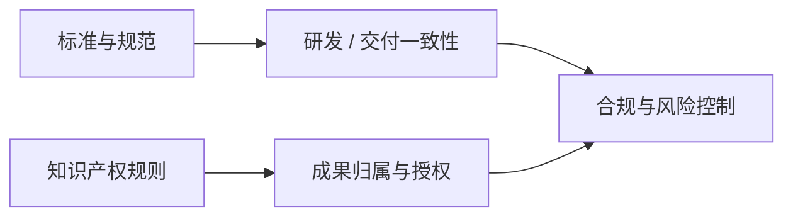

**关系提示：** 标准化关注互操作、质量和一致性；知识产权关注成果权属、许可和合规使用。

## 12. 应用数学：把工程问题转化为模型

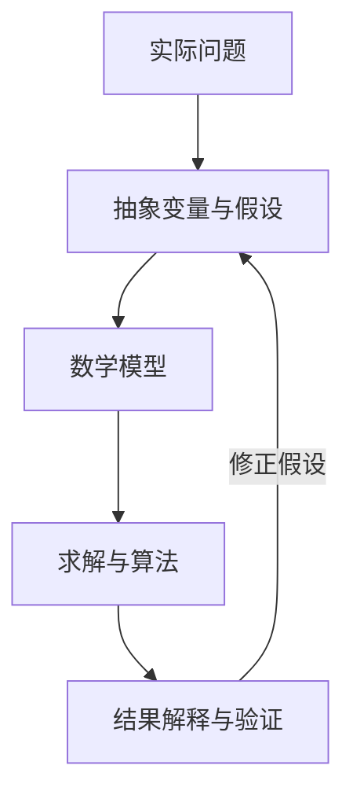

**关系提示：** 概率统计、图论、组合分析、运筹优化和模拟等方法服务于估算、规划、预测和决策。

## 13. 专业英语：从术语识别到技术理解

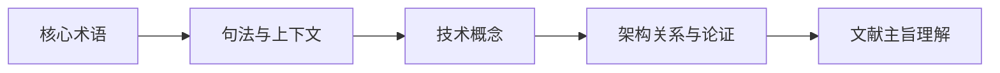

**关系提示：** 阅读重点不是逐词翻译，而是识别术语、技术关系、因果和作者论证。

---

## 如何使用本页

1. 首轮学习先看图，尝试口头讲出节点间关系。
2. 再阅读官方大纲和对应知识文档，补齐定义、公式、标准和细节考点。
3. 做题后把易混点、错题和跨章节联系补充到知识文档，不把图重新扩成考点清单。
