# 综合知识大纲｜模块化知识图

按官方章节和二级主题拆解为多个小型模块图。孤立的一级知识点合并为章节总览图；包含子知识点的主题单独展开。节点显式设置浅色填充和深色文字，适配深色/浅色屏幕背景。

## 内容导航

1. [内容导航](#part-1)
2. [1. 计算机系统基本知识](#part-2)
3. [2. 信息系统基础知识](#part-3)
4. [3. 信息安全技术基础知识](#part-4)
5. [4. 软件工程基础知识](#part-5)
6. [5. 数据库设计基础知识](#part-6)
7. [6. 系统架构设计基础知识](#part-7)
8. [7. 系统质量属性与架构评估](#part-8)
9. [8. 软件可靠性技术](#part-9)
10. [9. 软件架构的演化和维护](#part-10)
11. [10. 未来信息综合技术](#part-11)
12. [11. 标准化与知识产权](#part-12)
13. [12. 应用数学](#part-13)
14. [13. 专业英语](#part-14)

---

<a id="part-1"></a>

## 内容导航

<a id="part-2"></a>

## 1. 计算机系统基本知识

### 1.1 计算机系统概述


### 1.2 计算机硬件

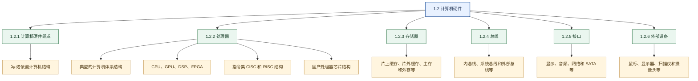

### 1.3 计算机软件

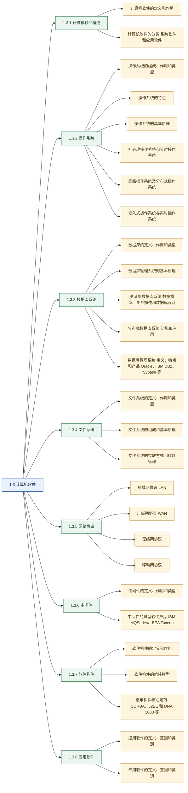

### 1.4 嵌入式系统及软件

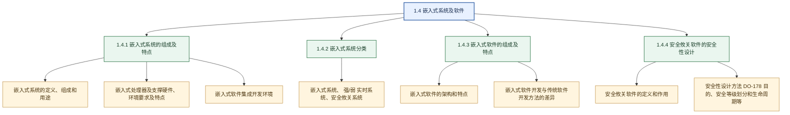

### 1.5 计算机网络

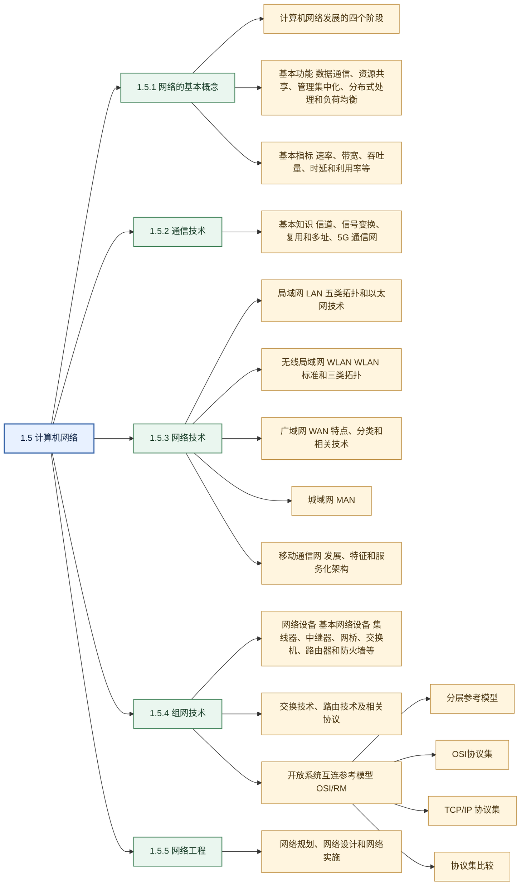

### 1.6 计算机语言

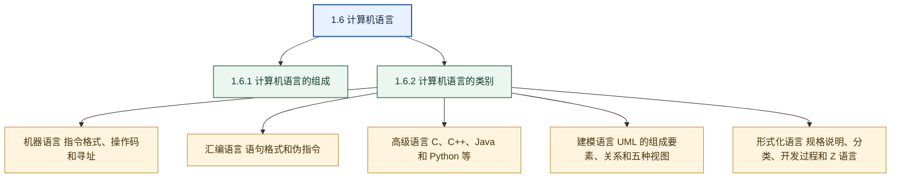

### 1.7 多媒体

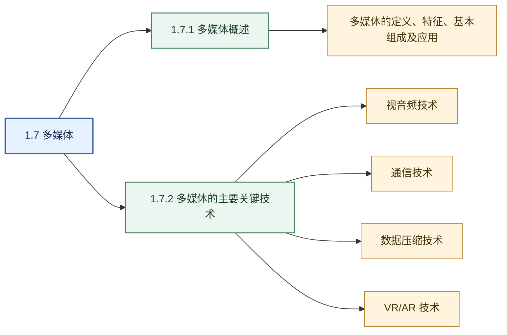

### 1.8 系统工程

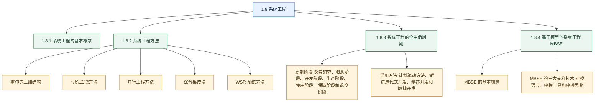

### 1.9 系统性能

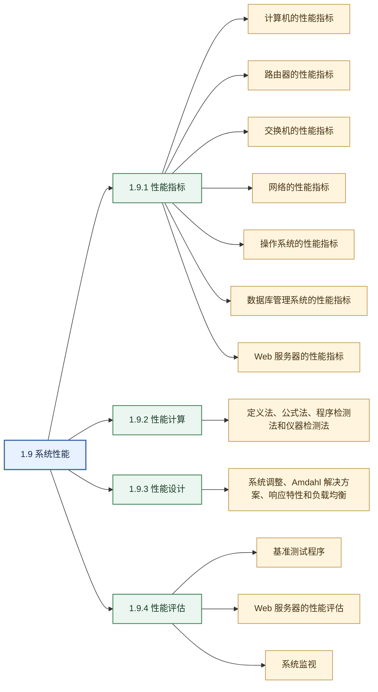

<a id="part-3"></a>

## 2. 信息系统基础知识

### 核心知识点总览


### 2.1 信息系统概述

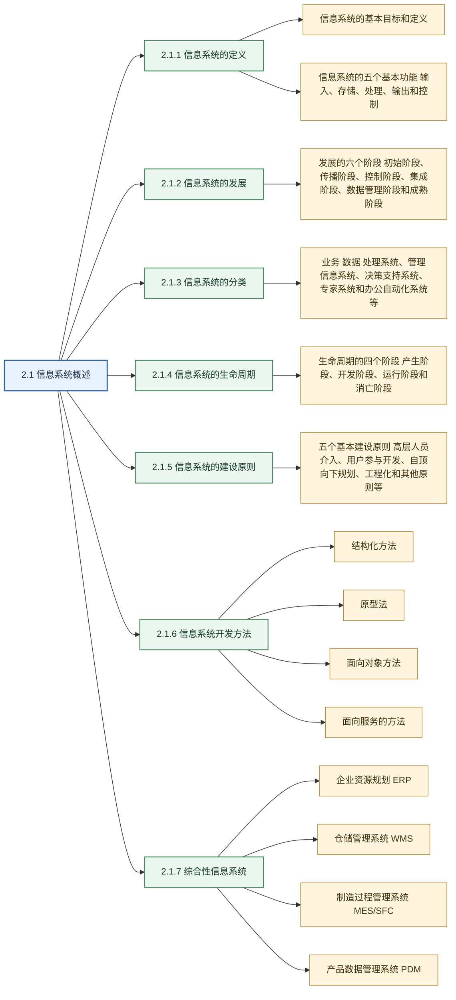

### 2.2 业务处理系统 TPS

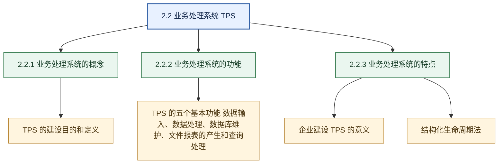

### 2.3 管理信息系统 MIS

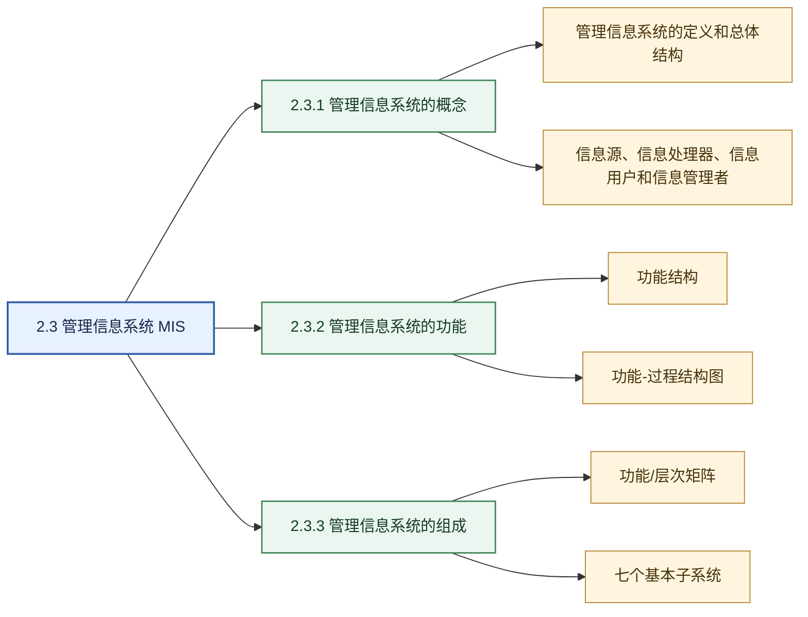

### 2.4 决策支持系统 DSS

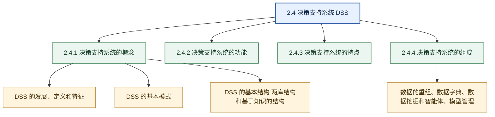

### 2.5 专家系统 ES

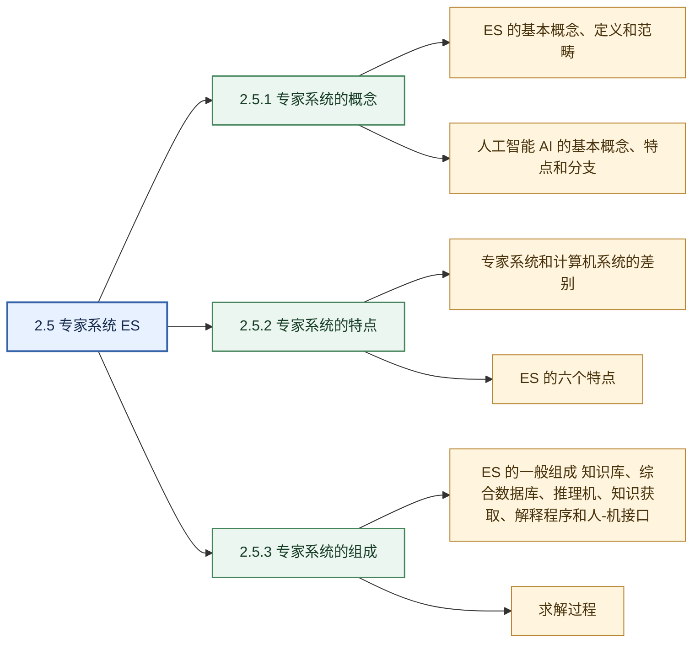

### 2.6 办公自动化系统 OAS

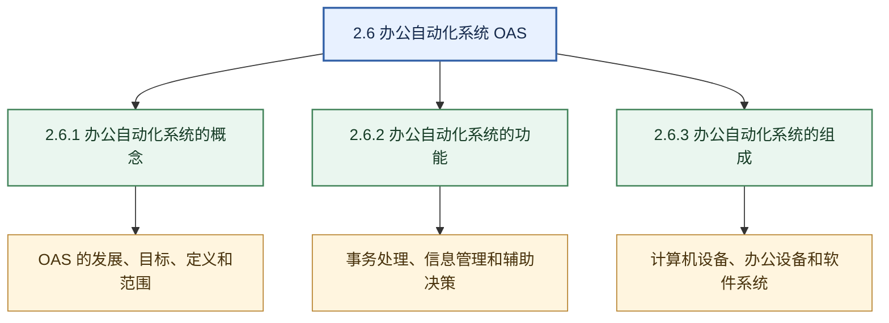

### 2.7 企业资源规划 ERP

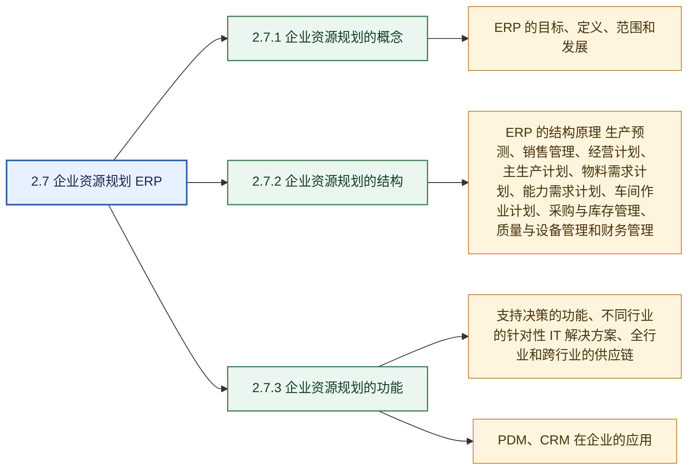

### 2.8 典型信息系统架构模型

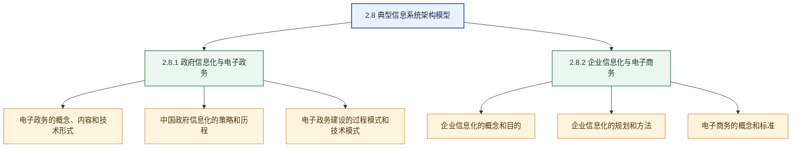

### 信息系统生命周期（状态图）


<a id="part-4"></a>

## 3. 信息安全技术基础知识

### 3.1 信息安全基础知识

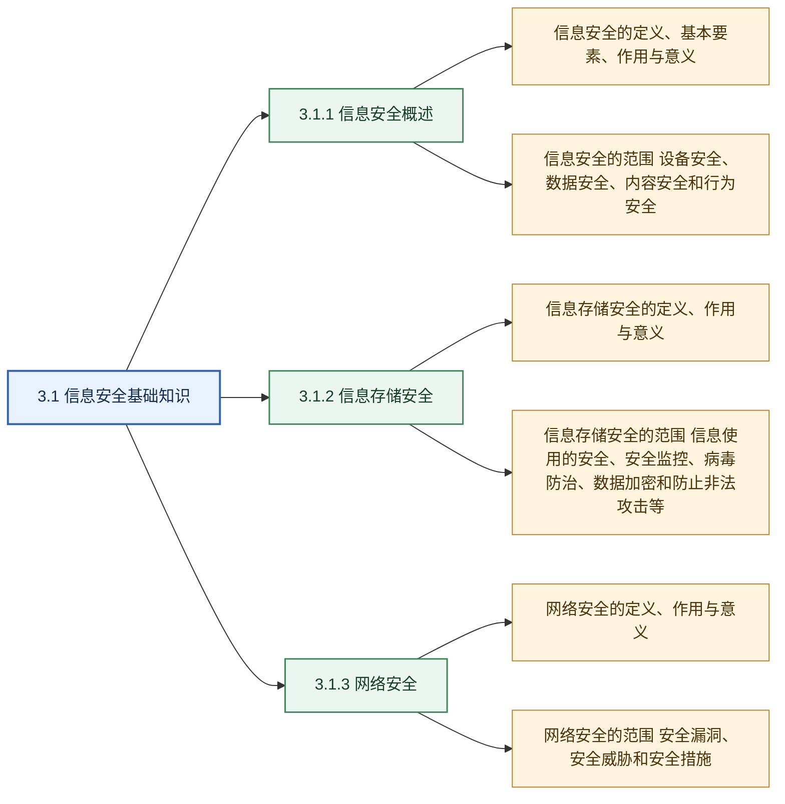

### 3.2 信息系统安全的作用与意义

```mermaid
flowchart TD
  R["3.2 信息系统安全的作用与意义"]
  classDef root fill:#e8f1ff,stroke:#3563a8,color:#172b4d,stroke-width:2px;
  classDef group fill:#eaf6ef,stroke:#43845b,color:#173d27,stroke-width:1.5px;
  classDef item fill:#fff5df,stroke:#b7832f,color:#49330d,stroke-width:1px;
  class R root;
  N1["国家安全与信息化领导小组的职能"]
  R --> N1
  class N1 group;
  N2["国家对信息安全的相关要求和标准"]
  R --> N2
  class N2 group;
```

### 3.3 信息安全系统的组成框架

```mermaid
flowchart LR
  R["3.3 信息安全系统的组成框架"]
  classDef root fill:#e8f1ff,stroke:#3563a8,color:#172b4d,stroke-width:2px;
  classDef group fill:#eaf6ef,stroke:#43845b,color:#173d27,stroke-width:1.5px;
  classDef item fill:#fff5df,stroke:#b7832f,color:#49330d,stroke-width:1px;
  class R root;
  N1["3.3.1 技术体系"]
  R --> N1
  class N1 group;
  N2["技术体系组成 基础安全设备、计算机网络安全、操作系统安全、数据库安全和终端设备安全"]
  N1 --> N2
  class N2 item;
  N3["3.3.2 组织机构体系"]
  R --> N3
  class N3 group;
  N4["组织机构组成 决策层、管理层和执行层"]
  N3 --> N4
  class N4 item;
  N5["3.3.3 管理体系"]
  R --> N5
  class N5 group;
  N6["管理体系组成 法律管理、制度管理和培训管理"]
  N5 --> N6
  class N6 item;
```

### 3.4 信息加解密技术

```mermaid
flowchart TD
  R["3.4 信息加解密技术"]
  classDef root fill:#e8f1ff,stroke:#3563a8,color:#172b4d,stroke-width:2px;
  classDef group fill:#eaf6ef,stroke:#43845b,color:#173d27,stroke-width:1.5px;
  classDef item fill:#fff5df,stroke:#b7832f,color:#49330d,stroke-width:1px;
  class R root;
  N1["3.4.1 数据加密"]
  R --> N1
  class N1 group;
  N2["数据加密的作用、意义和内涵"]
  N1 --> N2
  class N2 item;
  N3["保密通信模型"]
  N1 --> N3
  class N3 item;
  N4["3.4.2 对称密钥加密算法"]
  R --> N4
  class N4 group;
  N5["对称加密算法基本原理"]
  N4 --> N5
  class N5 item;
  N6["三种加密算法 DES、IDEA 和 AES"]
  N4 --> N6
  class N6 item;
  N7["3.4.3 非对称密钥加密算法"]
  R --> N7
  class N7 group;
  N8["非对称加密算法基本原理"]
  N7 --> N8
  class N8 item;
  N9["一种公钥加密算法 RSA"]
  N7 --> N9
  class N9 item;
```

### 3.5 密钥管理技术

```mermaid
flowchart LR
  R["3.5 密钥管理技术"]
  classDef root fill:#e8f1ff,stroke:#3563a8,color:#172b4d,stroke-width:2px;
  classDef group fill:#eaf6ef,stroke:#43845b,color:#173d27,stroke-width:1.5px;
  classDef item fill:#fff5df,stroke:#b7832f,color:#49330d,stroke-width:1px;
  class R root;
  N1["3.5.1 对称密钥的分配与管理"]
  R --> N1
  class N1 group;
  N2["密钥的使用控制 密钥标签和控制矢量"]
  N1 --> N2
  class N2 item;
  N3["密钥的分配方法"]
  N1 --> N3
  class N3 item;
  N4["3.5.2 公钥加密体制的密钥管理"]
  R --> N4
  class N4 group;
  N5["公钥公开发布的原理"]
  N4 --> N5
  class N5 item;
  N6["公用目录表的作用"]
  N4 --> N6
  class N6 item;
  N7["公钥管理机构的建立和维护"]
  N4 --> N7
  class N7 item;
  N8["公钥证书及管理机构 CA"]
  N4 --> N8
  class N8 item;
  N9["3.5.3 公钥加密分配单钥密码体制的密钥"]
  R --> N9
  class N9 group;
  N10["单钥密码体制的密钥分配方法"]
  N9 --> N10
  class N10 item;
```

### 3.6 访问控制及数字签名技术

```mermaid
flowchart TD
  R["3.6 访问控制及数字签名技术"]
  classDef root fill:#e8f1ff,stroke:#3563a8,color:#172b4d,stroke-width:2px;
  classDef group fill:#eaf6ef,stroke:#43845b,color:#173d27,stroke-width:1.5px;
  classDef item fill:#fff5df,stroke:#b7832f,color:#49330d,stroke-width:1px;
  class R root;
  N1["3.6.1 访问控制技术"]
  R --> N1
  class N1 group;
  N2["访问控制的基本模型 主体、客体和控制策略"]
  N1 --> N2
  class N2 item;
  N3["访问控制的实现技术 访问控制矩阵、访问控制表、能力表和授权关系表等"]
  N1 --> N3
  class N3 item;
  N4["3.6.2 数字签名"]
  R --> N4
  class N4 group;
  N5["数字签名的定义和条件"]
  N4 --> N5
  class N5 item;
  N6["身份认证分类 数字签名、密钥和口令"]
  N4 --> N6
  class N6 item;
  N7["对称密钥签名基本原理"]
  N4 --> N7
  class N7 item;
  N8["公开密钥签名基本原理"]
  N4 --> N8
  class N8 item;
```

### 3.7 信息安全的抗攻击技术

```mermaid
flowchart LR
  R["3.7 信息安全的抗攻击技术"]
  classDef root fill:#e8f1ff,stroke:#3563a8,color:#172b4d,stroke-width:2px;
  classDef group fill:#eaf6ef,stroke:#43845b,color:#173d27,stroke-width:1.5px;
  classDef item fill:#fff5df,stroke:#b7832f,color:#49330d,stroke-width:1px;
  class R root;
  N1["3.7.1 密钥的选择"]
  R --> N1
  class N1 group;
  N2["密钥的分类 数据加密密钥 DK 、密钥加密密钥 KK"]
  N1 --> N2
  class N2 item;
  N3["密钥生成涉及的三个因素 增大密钥空间、选择强钥和密钥的随机性"]
  N1 --> N3
  class N3 item;
  N4["3.7.2 拒绝服务攻击与防御"]
  R --> N4
  class N4 group;
  N5["拒绝服务攻击 DoS 的定义"]
  N4 --> N5
  class N5 item;
  N6["传统拒绝服务攻击的分类 消耗资源、破坏或更改配置信息、物理破坏或改变网络部件、利用服务程序中的处理错误使服务失效"]
  N4 --> N6
  class N6 item;
  N7["分布式拒绝服务攻击 DDoS"]
  N4 --> N7
  class N7 item;
  N8["拒绝服务攻击的防御方法 特征识别、防火墙、通信数据量的统计、修正问题和漏洞"]
  N4 --> N8
  class N8 item;
  N9["3.7.3 欺骗攻击与防御"]
  R --> N9
  class N9 group;
  N10["ARP、DNS 和 IP 三种欺骗攻击的原理和防御方法"]
  N9 --> N10
  class N10 item;
  N11["3.7.4 端口扫描"]
  R --> N11
  class N11 group;
  N12["端口扫描的目的和基本原理"]
  N11 --> N12
  class N12 item;
  N13["端口扫描原理分类 全 TCP 连接、SYN 扫描、FIN 扫描和代理扫描"]
  N11 --> N13
  class N13 item;
  N14["3.7.5 强化 TCP/IP 堆栈以抵御拒绝服务攻击"]
  R --> N14
  class N14 group;
  N15["同步包风暴、ICMP 攻击和 SNMP 三种攻击的原理及抵御方法"]
  N14 --> N15
  class N15 item;
  N16["3.7.6 系统漏洞扫描"]
  R --> N16
  class N16 group;
  N17["系统漏洞扫描的基本原理和意义"]
  N16 --> N17
  class N17 item;
  N18["基于网络的漏洞扫描方法"]
  N16 --> N18
  class N18 item;
  N19["基于主机的漏洞扫描方法"]
  N16 --> N19
  class N19 item;
```

### 3.8 信息安全的保障体系与评估方法

```mermaid
flowchart TD
  R["3.8 信息安全的保障体系与评估方法"]
  classDef root fill:#e8f1ff,stroke:#3563a8,color:#172b4d,stroke-width:2px;
  classDef group fill:#eaf6ef,stroke:#43845b,color:#173d27,stroke-width:1.5px;
  classDef item fill:#fff5df,stroke:#b7832f,color:#49330d,stroke-width:1px;
  class R root;
  N1["3.8.1 计算机信息系统安全保护等级"]
  R --> N1
  class N1 group;
  N2["安全保护能力的 5 个等级 用户自主保护级、系统审计保护级、安全标记保护级、结构化保护级和访问验证保护级"]
  N1 --> N2
  class N2 item;
  N3["安全性规章与保护私有信息规则 信息系统安全法规与制度、计算机防病毒制度和保护私有信息规则"]
  N1 --> N3
  class N3 item;
  N4["安全保密管理及协议 防泄露，数字水印 安全协议 SSL、PGP 和 IPSec"]
  N1 --> N4
  class N4 item;
  N5["3.8.2 安全风险管理"]
  R --> N5
  class N5 group;
  N6["安全风险管理的定义、作用和重要性"]
  N5 --> N6
  class N6 item;
  N7["风险评估的基本要素及其关系 脆弱性、资产、威胁、风险和安全措施"]
  N5 --> N7
  class N7 item;
  N8["安全威胁的定义和内涵"]
  N5 --> N8
  class N8 item;
  N9["脆弱性评估方法"]
  N5 --> N9
  class N9 item;
```

<a id="part-5"></a>

## 4. 软件工程基础知识

### 核心知识点总览

```mermaid
flowchart LR
  R["4. 软件工程基础知识｜核心知识点"]
  classDef root fill:#e8f1ff,stroke:#3563a8,color:#172b4d,stroke-width:2px;
  classDef group fill:#eaf6ef,stroke:#43845b,color:#173d27,stroke-width:1.5px;
  classDef item fill:#fff5df,stroke:#b7832f,color:#49330d,stroke-width:1px;
  class R root;
  N1["需求工程与变更控制（时序图）"]
  R --> N1
  class N1 group;
```

### 4.1 软件工程

```mermaid
flowchart LR
  R["4.1 软件工程"]
  classDef root fill:#e8f1ff,stroke:#3563a8,color:#172b4d,stroke-width:2px;
  classDef group fill:#eaf6ef,stroke:#43845b,color:#173d27,stroke-width:1.5px;
  classDef item fill:#fff5df,stroke:#b7832f,color:#49330d,stroke-width:1px;
  class R root;
  N1["4.1.1 软件工程概述"]
  R --> N1
  class N1 group;
  N2["软件工程的发展历程和软件危机"]
  N1 --> N2
  class N2 item;
  N3["软件工程的定义"]
  N1 --> N3
  class N3 item;
  N4["4.1.2 软件过程模型"]
  R --> N4
  class N4 group;
  N5["瀑布模型 模型原理和特点"]
  N4 --> N5
  class N5 item;
  N6["原型 快速 模型 模型原理和特点"]
  N4 --> N6
  class N6 item;
  N7["增量模型 模型原理和特点"]
  N4 --> N7
  class N7 item;
  N8["螺旋模型 模型原理和特点"]
  N4 --> N8
  class N8 item;
  N9["构件组装模型 模型原理和特点"]
  N4 --> N9
  class N9 item;
  N10["敏捷模型 发展、目的和模型原理"]
  N4 --> N10
  class N10 item;
  N11["统一过程模型 RUP 模型原理、核心概念、特点和工作步骤"]
  N4 --> N11
  class N11 item;
  N12["4.1.3 敏捷模型"]
  R --> N12
  class N12 group;
  N13["敏捷模型的定义、基本原理和特点"]
  N12 --> N13
  class N13 item;
  N14["敏捷开发的核心思想 适应型、以人为本和迭代增量式"]
  N12 --> N14
  class N14 item;
  N15["4.1.4 统一过程模型 RUP"]
  R --> N15
  class N15 group;
  N16["RUP 的核心概念和特点"]
  N15 --> N16
  class N16 item;
  N17["RUP 的生命周期"]
  N15 --> N17
  class N17 item;
  N18["“4+1” 视图模型"]
  N15 --> N18
  class N18 item;
  N19["4.1.5 软件能力成熟度模型"]
  R --> N19
  class N19 group;
  N20["CMMI 的概述、发展和意义"]
  N19 --> N20
  class N20 item;
  N21["CMMI 的成熟度等级、关键过程域和过程目标"]
  N19 --> N21
  class N21 item;
```

### 4.2 需求工程

```mermaid
flowchart TD
  R["4.2 需求工程"]
  classDef root fill:#e8f1ff,stroke:#3563a8,color:#172b4d,stroke-width:2px;
  classDef group fill:#eaf6ef,stroke:#43845b,color:#173d27,stroke-width:1.5px;
  classDef item fill:#fff5df,stroke:#b7832f,color:#49330d,stroke-width:1px;
  class R root;
  N1["需求工程的发展、内容和特点"]
  R --> N1
  class N1 group;
  N2["需求工程的主要活动 需求获取、需求分析、形成需求规格、需求确认与验证、需求管理"]
  R --> N2
  class N2 group;
  N3["4.2.1 需求获取"]
  R --> N3
  class N3 group;
  N4["需求获取的基本步骤"]
  N3 --> N4
  class N4 item;
  N5["需求获取的方法 用户面谈、专题讨论会、问卷调查、现场观察、原型化方法和头脑风暴"]
  N3 --> N5
  class N5 item;
  N6["4.2.2 需求变更"]
  R --> N6
  class N6 group;
  N7["变更控制过程"]
  N6 --> N7
  class N7 item;
  N8["变更控制委员会 CCB 的职责和权益"]
  N6 --> N8
  class N8 item;
  N9["4.2.3 需求追踪"]
  R --> N9
  class N9 group;
  N10["需求追踪的内涵和作用"]
  N9 --> N10
  class N10 item;
  N11["双向跟踪及需求跟踪矩阵"]
  N9 --> N11
  class N11 item;
```

### 4.3 系统分析与设计

```mermaid
flowchart LR
  R["4.3 系统分析与设计"]
  classDef root fill:#e8f1ff,stroke:#3563a8,color:#172b4d,stroke-width:2px;
  classDef group fill:#eaf6ef,stroke:#43845b,color:#173d27,stroke-width:1.5px;
  classDef item fill:#fff5df,stroke:#b7832f,color:#49330d,stroke-width:1px;
  class R root;
  N1["系统分析与设计的目标、意义和范围"]
  R --> N1
  class N1 group;
  N2["4.3.1 结构化方法 SASD"]
  R --> N2
  class N2 group;
  N3["结构化方法的定义、合理性准则和使用的手段"]
  N2 --> N3
  class N3 item;
  N4["结构化方法 结构化分析 SA 、结构化设计 SD 和结构化编程 SP"]
  N2 --> N4
  class N4 item;
  N5["结构化分析、设计和实现图示 DFD、ERD、UML、流程图、NS 图、PAD、PDL 和 E-R 图"]
  N2 --> N5
  class N5 item;
  N6["结构化分析 定义、分析步骤、DFD 和数据字典"]
  N2 --> N6
  class N6 item;
  N7["结构化设计 基本思想、模块结构、系统 SC、基本步骤、业务流图、程序流程图、PAD、NS 和 PDL"]
  N2 --> N7
  class N7 item;
  N8["结构化编程 基本思想、步骤和结构化程序设计的原则"]
  N2 --> N8
  class N8 item;
  N9["数据库设计"]
  N2 --> N9
  class N9 item;
  N10["数据库设计 概念结构设计、逻辑结构设计和 E-R"]
  N2 --> N10
  class N10 item;
  N11["4.3.2 面向对象方法"]
  R --> N11
  class N11 group;
  N12["面向对象方法的定义、内涵、过程和设计原则"]
  N11 --> N12
  class N12 item;
  N13["面向对象分析方法 OOA 5 个层次、5 项活动、基本原则和步骤"]
  N11 --> N13
  class N13 item;
  N14["面向对象设计方法 OOD 内涵、三种类型 实体类、边界类和控制类 和步骤"]
  N11 --> N14
  class N14 item;
  N15["面向对象程序设计 OOP 目标、基本原则和特点"]
  N11 --> N15
  class N15 item;
  N16["数据持久化与数据库 SQL、JDBC 和 JDO"]
  N11 --> N16
  class N16 item;
  N17["4.3.3 其他设计方法"]
  R --> N17
  class N17 group;
  N18["构件与软件重用"]
  N17 --> N18
  class N18 item;
  N19["逆向工程"]
  N17 --> N19
  class N19 item;
  N20["形式化方法"]
  N17 --> N20
  class N20 item;
```

### 4.4 软件测试

```mermaid
flowchart TD
  R["4.4 软件测试"]
  classDef root fill:#e8f1ff,stroke:#3563a8,color:#172b4d,stroke-width:2px;
  classDef group fill:#eaf6ef,stroke:#43845b,color:#173d27,stroke-width:1.5px;
  classDef item fill:#fff5df,stroke:#b7832f,color:#49330d,stroke-width:1px;
  class R root;
  N1["软件测试的目的和意义"]
  R --> N1
  class N1 group;
  N2["4.4.1 测试方法"]
  R --> N2
  class N2 group;
  N3["静态测试、动态测试、黑盒测试、白盒测试和灰盒测试"]
  N2 --> N3
  class N3 item;
  N4["验证与确认 V&V"]
  N2 --> N4
  class N4 item;
  N5["测试自动化 测试脚本设计和测试用例自动生成"]
  N2 --> N5
  class N5 item;
  N6["4.4.2 测试阶段"]
  R --> N6
  class N6 group;
  N7["阶段 单元测试、集成测试、系统测试、性能测试、验收测试和 AB 测试"]
  N6 --> N7
  class N7 item;
  N8["测试项 代码审查、语句覆盖测试、结构覆盖测试、功能测试、性能测试、鲁棒性测试、压力测试、安全性测试、可靠性测试和验收测试"]
  N6 --> N8
  class N8 item;
```

### 4.5 净室软件工程

```mermaid
flowchart LR
  R["4.5 净室软件工程"]
  classDef root fill:#e8f1ff,stroke:#3563a8,color:#172b4d,stroke-width:2px;
  classDef group fill:#eaf6ef,stroke:#43845b,color:#173d27,stroke-width:1.5px;
  classDef item fill:#fff5df,stroke:#b7832f,color:#49330d,stroke-width:1px;
  class R root;
  N1["净室软件工程的定义、意义和作用"]
  R --> N1
  class N1 group;
  N2["4.5.1 理论基础"]
  R --> N2
  class N2 group;
  N3["函数理论"]
  N2 --> N3
  class N3 item;
  N4["抽样理论"]
  N2 --> N4
  class N4 item;
  N5["4.5.2 技术手段"]
  R --> N5
  class N5 group;
  N6["统计过程控制下的增量式开发"]
  N5 --> N6
  class N6 item;
  N7["基于函数的规范和设计"]
  N5 --> N7
  class N7 item;
  N8["正确性验证"]
  N5 --> N8
  class N8 item;
  N9["统计测试和软件认证"]
  N5 --> N9
  class N9 item;
  N10["4.5.3 应用与缺点"]
  R --> N10
  class N10 group;
  N11["发展历程、应用场景和缺点"]
  N10 --> N11
  class N11 item;
```

### 4.6 基于构件的软件工程 CBSE

```mermaid
flowchart TD
  R["4.6 基于构件的软件工程 CBSE"]
  classDef root fill:#e8f1ff,stroke:#3563a8,color:#172b4d,stroke-width:2px;
  classDef group fill:#eaf6ef,stroke:#43845b,color:#173d27,stroke-width:1.5px;
  classDef item fill:#fff5df,stroke:#b7832f,color:#49330d,stroke-width:1px;
  class R root;
  N1["CBSE 的定义、作用和特点"]
  R --> N1
  class N1 group;
  N2["4.6.1 构件和构件模型"]
  R --> N2
  class N2 group;
  N3["CBSE 的构件应该具备的特征"]
  N2 --> N3
  class N3 item;
  N4["构件模型基本要素 接口、使用信息和部署"]
  N2 --> N4
  class N4 item;
  N5["4.6.2 CBSE 过程"]
  R --> N5
  class N5 group;
  N6["系统需求概览、识别候选构件、根据发现的构件修改需求、体系结构设计、组装构件并创建系统"]
  N5 --> N6
  class N6 item;
  N7["4.6.3 构件组装"]
  R --> N7
  class N7 group;
  N8["方法 顺序组装、层次组装和叠加组装"]
  N7 --> N8
  class N8 item;
```

### 4.7 软件项目管理

```mermaid
flowchart LR
  R["4.7 软件项目管理"]
  classDef root fill:#e8f1ff,stroke:#3563a8,color:#172b4d,stroke-width:2px;
  classDef group fill:#eaf6ef,stroke:#43845b,color:#173d27,stroke-width:1.5px;
  classDef item fill:#fff5df,stroke:#b7832f,color:#49330d,stroke-width:1px;
  class R root;
  N1["4.7.1 项目管理概述"]
  R --> N1
  class N1 group;
  N2["项目管理的发展历史"]
  N1 --> N2
  class N2 item;
  N3["项目管理的目标、范围、时间和成本"]
  N1 --> N3
  class N3 item;
  N4["软件项目管理的主要内容 进度、配置、质量和风险管理"]
  N1 --> N4
  class N4 item;
  N5["4.7.2 软件进度管理"]
  R --> N5
  class N5 group;
  N6["进度的定义和活动"]
  N5 --> N6
  class N6 item;
  N7["WBS 和任务活动图"]
  N5 --> N7
  class N7 item;
  N8["4.7.3 软件配置管理 SCM"]
  R --> N8
  class N8 group;
  N9["软件配置管理的定义、目标和活动"]
  N8 --> N9
  class N9 item;
  N10["SCM 核心内容 版本控制和变更控制"]
  N8 --> N10
  class N10 item;
  N11["4.7.4 软件质量管理"]
  R --> N11
  class N11 group;
  N12["软件质量管理的目标、范围和活动"]
  N11 --> N12
  class N12 item;
  N13["软件质量保证 SQA 的主要任务 审计与评审、报告、处理不符合问题和体系认证"]
  N11 --> N13
  class N13 item;
  N14["质量认证标准 ISO 9001、CMMI"]
  N11 --> N14
  class N14 item;
  N15["4.7.5 软件风险管理"]
  R --> N15
  class N15 group;
  N16["软件风险管理的目标和方法"]
  N15 --> N16
  class N16 item;
  N17["Boehm 的软件风险管理体系"]
  N15 --> N17
  class N17 item;
  N18["风险估计 风险辨识、风险分析和风险排序"]
  N17 --> N18
  class N18 item;
  N19["风险控制 风险管理计划、风险处理和风险监督"]
  N17 --> N19
  class N19 item;
  N20["Charette 的风险分析和管理体系"]
  N15 --> N20
  class N20 item;
  N21["分析 辨识、估计和评价"]
  N20 --> N21
  class N21 item;
  N22["管理 计划、控制和监督"]
  N20 --> N22
  class N22 item;
```

### 需求工程与变更控制（时序图）

```mermaid
%%{init: {'theme':'base','themeVariables': {'background':'#ffffff','primaryColor':'#e8f1ff','primaryTextColor':'#172b4d','primaryBorderColor':'#3563a8','lineColor':'#64748b','actorBkg':'#e8f1ff','actorBorder':'#3563a8','actorTextColor':'#172b4d','signalColor':'#64748b','signalTextColor':'#172b4d','noteBkgColor':'#fff5df','noteTextColor':'#49330d','activationBkgColor':'#eaf6ef','activationBorderColor':'#43845b'}}}%%
sequenceDiagram
  autonumber
  participant U as 用户/干系人
  participant A as 需求分析
  participant C as 变更控制
  participant T as 需求跟踪
  U->>A: 需求获取与沟通
  A->>A: 需求分析与规格说明
  A->>U: 需求确认与验证
  U-->>A: 确认意见/变更请求
  A->>C: 提交变更评估
  C-->>A: 批准/拒绝变更
  A->>T: 更新需求跟踪关系
  T-->>A: 双向追踪与影响分析
```

<a id="part-6"></a>

## 5. 数据库设计基础知识

### 5.1 数据库基本概念

```mermaid
flowchart LR
  R["5.1 数据库基本概念"]
  classDef root fill:#e8f1ff,stroke:#3563a8,color:#172b4d,stroke-width:2px;
  classDef group fill:#eaf6ef,stroke:#43845b,color:#173d27,stroke-width:1.5px;
  classDef item fill:#fff5df,stroke:#b7832f,color:#49330d,stroke-width:1px;
  class R root;
  N1["5.1.1 数据库技术的发展及分类"]
  R --> N1
  class N1 group;
  N2["数据库的定义和发展阶段"]
  N1 --> N2
  class N2 item;
  N3["DB、DBS 和 DBMS 区分方法"]
  N1 --> N3
  class N3 item;
  N4["数据库分类 分布式数据库系统、并行数据库系统、数据仓库与数据挖掘"]
  N1 --> N4
  class N4 item;
  N5["5.1.2 数据模型"]
  R --> N5
  class N5 group;
  N6["层次和网状数据库系统"]
  N5 --> N6
  class N6 item;
  N7["关系数据库系统"]
  N5 --> N7
  class N7 item;
  N8["第三代数据库系统"]
  N5 --> N8
  class N8 item;
  N9["5.1.3 数据库管理系统"]
  R --> N9
  class N9 group;
  N10["DBMS 的定义和范围"]
  N9 --> N10
  class N10 item;
  N11["DBMS 的功能及特点"]
  N9 --> N11
  class N11 item;
  N12["5.1.4 数据库三级模式"]
  R --> N12
  class N12 group;
  N13["数据库三级模式的定义和划分"]
  N12 --> N13
  class N13 item;
  N14["数据库系统的体系结构 物理层、逻辑层和视图层"]
  N12 --> N14
  class N14 item;
  N15["数据库系统的三级模式 外模式、概念模式和内模式"]
  N12 --> N15
  class N15 item;
```

### 5.2 关系数据库

```mermaid
flowchart TD
  R["5.2 关系数据库"]
  classDef root fill:#e8f1ff,stroke:#3563a8,color:#172b4d,stroke-width:2px;
  classDef group fill:#eaf6ef,stroke:#43845b,color:#173d27,stroke-width:1.5px;
  classDef item fill:#fff5df,stroke:#b7832f,color:#49330d,stroke-width:1px;
  class R root;
  N1["5.2.1 关系数据库基本概念"]
  R --> N1
  class N1 group;
  N2["关系数据库的定义及发展"]
  N1 --> N2
  class N2 item;
  N3["基本术语 属性、域、目或度和候选码等"]
  N1 --> N3
  class N3 item;
  N4["关系数据库模式"]
  N1 --> N4
  class N4 item;
  N5["关系的完整性约束 实体完整性、参照完整性和用户定义完整性"]
  N1 --> N5
  class N5 item;
  N6["5.2.2 关系运算"]
  R --> N6
  class N6 group;
  N7["集合运算符"]
  N6 --> N7
  class N7 item;
  N8["专门的关系运算符"]
  N6 --> N8
  class N8 item;
  N9["算术比较符"]
  N6 --> N9
  class N9 item;
  N10["逻辑运算符"]
  N6 --> N10
  class N10 item;
  N11["5.2.3 关系数据库设计基本理论"]
  R --> N11
  class N11 group;
  N12["函数依赖、多值依赖和规范化"]
  N11 --> N12
  class N12 item;
```

### 5.3 数据库设计

```mermaid
flowchart LR
  R["5.3 数据库设计"]
  classDef root fill:#e8f1ff,stroke:#3563a8,color:#172b4d,stroke-width:2px;
  classDef group fill:#eaf6ef,stroke:#43845b,color:#173d27,stroke-width:1.5px;
  classDef item fill:#fff5df,stroke:#b7832f,color:#49330d,stroke-width:1px;
  class R root;
  N1["5.3.1 数据库设计的基本步骤"]
  R --> N1
  class N1 group;
  N2["数据库设计的六个步骤 用户需求、概念设计、逻辑设计、物理设计、数据库实施、运行和维护"]
  N1 --> N2
  class N2 item;
  N3["5.3.2 数据需求分析"]
  R --> N3
  class N3 group;
  N4["需求分析阶段的任务"]
  N3 --> N4
  class N4 item;
  N5["需求分析的参与者"]
  N3 --> N5
  class N5 item;
  N6["分析和表达用户需求的方法 结构化分析方法 SA"]
  N3 --> N6
  class N6 item;
  N7["5.3.3 概念结构设计"]
  R --> N7
  class N7 group;
  N8["E-R 方法"]
  N7 --> N8
  class N8 item;
  N9["设计步骤 选择局部应用、逐一设计分 E-R 图、E-R 图合并"]
  N7 --> N9
  class N9 item;
  N10["5.3.4 逻辑结构设计"]
  R --> N10
  class N10 group;
  N11["E-R 转化为关系模式、关系模式规范化、完整性约束、确定用户视图、反规范化"]
  N10 --> N11
  class N11 item;
  N12["5.3.5 物理设计"]
  R --> N12
  class N12 group;
  N13["设计步骤 确定数据分布、确定数据的存储结构、确定访问方式"]
  N12 --> N13
  class N13 item;
  N14["5.3.6 数据库实施设计"]
  R --> N14
  class N14 group;
  N15["确定数据库结构 数据定义语言 DDL 、模式与子模式、完整性描述、安全性描述和存储参数描述"]
  N14 --> N15
  class N15 item;
  N16["数据加载 手工录入、数据转换工具"]
  N14 --> N16
  class N16 item;
  N17["试运行和评价目标、测试要求"]
  N14 --> N17
  class N17 item;
  N18["5.3.7 数据库运行维护"]
  R --> N18
  class N18 group;
  N19["运行维护目的、要求和意义"]
  N18 --> N19
  class N19 item;
  N20["性能的监测和改善 SQL Server Profiler 组件、Transaction-SQL 工具和 Query Analyzer 组件"]
  N18 --> N20
  class N20 item;
  N21["备份及故障恢复 备份方案"]
  N18 --> N21
  class N21 item;
  N22["重组和重构"]
  N18 --> N22
  class N22 item;
```

### 5.4 用户访问数据库的标准接口

```mermaid
flowchart TD
  R["5.4 用户访问数据库的标准接口"]
  classDef root fill:#e8f1ff,stroke:#3563a8,color:#172b4d,stroke-width:2px;
  classDef group fill:#eaf6ef,stroke:#43845b,color:#173d27,stroke-width:1.5px;
  classDef item fill:#fff5df,stroke:#b7832f,color:#49330d,stroke-width:1px;
  class R root;
  N1["5.4.1 库函数级别访问接口"]
  R --> N1
  class N1 group;
  N2["OCI 接口的定义"]
  N1 --> N2
  class N2 item;
  N3["OCI 的开发方法"]
  N1 --> N3
  class N3 item;
  N4["5.4.2 嵌入 SQL 访问接口"]
  R --> N4
  class N4 group;
  N5["嵌入式 SQL-86 定义"]
  N4 --> N5
  class N5 item;
  N6["SQL-86 规范"]
  N4 --> N6
  class N6 item;
  N7["5.4.3 通用数据接口标准 ODBC"]
  R --> N7
  class N7 group;
  N8["ODBC 的定义、作用和优势"]
  N7 --> N8
  class N8 item;
  N9["ODBC 接口标准"]
  N7 --> N9
  class N9 item;
  N10["5.4.4 ORM 访问接口"]
  R --> N10
  class N10 group;
  N11["ORM 的定义和作用"]
  N10 --> N11
  class N11 item;
  N12["典型的 ORM 框架 hibernate、Mybatis 和 JPA"]
  N10 --> N12
  class N12 item;
```

### 5.5 No SQL 数据库系统

```mermaid
flowchart LR
  R["5.5 No SQL 数据库系统"]
  classDef root fill:#e8f1ff,stroke:#3563a8,color:#172b4d,stroke-width:2px;
  classDef group fill:#eaf6ef,stroke:#43845b,color:#173d27,stroke-width:1.5px;
  classDef item fill:#fff5df,stroke:#b7832f,color:#49330d,stroke-width:1px;
  class R root;
  N1["No SQL 的定义、基本功能和用途"]
  R --> N1
  class N1 group;
  N2["5.5.1 分类与特点"]
  R --> N2
  class N2 group;
  N3["四类 No SQL 数据库 列式存储数据库、键值对存储数据库、文档型数据库、图数据库"]
  N2 --> N3
  class N3 item;
  N4["No SQL 的特点"]
  N2 --> N4
  class N4 item;
  N5["5.5.2 体系框架"]
  R --> N5
  class N5 group;
  N6["No SQL 的四层框架 数据持久层、数据分布层、数据逻辑模型层和接口层"]
  N5 --> N6
  class N6 item;
  N7["No SQL 数据库的适应场景"]
  N5 --> N7
  class N7 item;
```

<a id="part-7"></a>

## 6. 系统架构设计基础知识

### 6.1 软件架构概念

```mermaid
flowchart LR
  R["6.1 软件架构概念"]
  classDef root fill:#e8f1ff,stroke:#3563a8,color:#172b4d,stroke-width:2px;
  classDef group fill:#eaf6ef,stroke:#43845b,color:#173d27,stroke-width:1.5px;
  classDef item fill:#fff5df,stroke:#b7832f,color:#49330d,stroke-width:1px;
  class R root;
  N1["6.1.1 软件架构的定义"]
  R --> N1
  class N1 group;
  N2["软件架构的定义、发展历程以及作用"]
  N1 --> N2
  class N2 item;
  N3["架构设计分类 数据设计和体系结构设计"]
  N1 --> N3
  class N3 item;
  N4["6.1.2 软件架构设计与生命周期"]
  R --> N4
  class N4 group;
  N5["软件架构的生命周期 需求阶段、设计阶段、实现阶段、构件组装阶段、部署阶段和后开发阶段"]
  N4 --> N5
  class N5 item;
  N6["Use Case 图、体系结构描述语言 ADL、4+1 模型和 UML 语言"]
  N4 --> N6
  class N6 item;
  N7["IEEE 标准 1471—2000 标准"]
  N4 --> N7
  class N7 item;
  N8["6.1.3 软件架构的重要性"]
  R --> N8
  class N8 group;
```

### 6.2 基于架构的软件开发方法 ABSD

```mermaid
flowchart TD
  R["6.2 基于架构的软件开发方法 ABSD"]
  classDef root fill:#e8f1ff,stroke:#3563a8,color:#172b4d,stroke-width:2px;
  classDef group fill:#eaf6ef,stroke:#43845b,color:#173d27,stroke-width:1.5px;
  classDef item fill:#fff5df,stroke:#b7832f,color:#49330d,stroke-width:1px;
  class R root;
  N1["6.2.1 体系结构的设计方法概述"]
  R --> N1
  class N1 group;
  N2["ABSD 方法的定义、适应范围"]
  N1 --> N2
  class N2 item;
  N3["三个基础 分解、内聚和耦合，质量和商业需求，模板的使用"]
  N1 --> N3
  class N3 item;
  N4["6.2.2 概念与术语"]
  R --> N4
  class N4 group;
  N5["设计元素、视角与视图、用例和质量场景"]
  N4 --> N5
  class N5 item;
  N6["6.2.3 基于体系结构的开发模型"]
  R --> N6
  class N6 group;
  N7["传统的软件开发和 ABSD 的差别"]
  N6 --> N7
  class N7 item;
  N8["ABSD 模型涵盖的阶段 体系结构需求、体系结构设计、体系结构文档化、体系结构复审、体系结构实现、体系结构的演化"]
  N6 --> N8
  class N8 item;
  N9["6.2.4 体系结构需求"]
  R --> N9
  class N9 group;
  N10["需求获取、标识构件、架构需求评审"]
  N9 --> N10
  class N10 item;
  N11["6.2.5 体系结构设计"]
  R --> N11
  class N11 group;
  N12["体系结构设计过程模型"]
  N11 --> N12
  class N12 item;
  N13["6.2.6 体系结构文档化"]
  R --> N13
  class N13 group;
  N14["体系结构规格说明和测试体系结构需求的质量设计说明书"]
  N13 --> N14
  class N14 item;
  N15["6.2.7 体系结构复审"]
  R --> N15
  class N15 group;
  N16["复审的目的、要求和意义"]
  N15 --> N16
  class N16 item;
  N17["6.2.8 体系结构实现"]
  R --> N17
  class N17 group;
  N18["体系结构实现过程模型"]
  N17 --> N18
  class N18 item;
  N19["6.2.9 体系结构的演化"]
  R --> N19
  class N19 group;
  N20["体系结构演化的定义和作用"]
  N19 --> N20
  class N20 item;
  N21["演化步骤"]
  N19 --> N21
  class N21 item;
```

### 6.3 软件架构风格

```mermaid
flowchart LR
  R["6.3 软件架构风格"]
  classDef root fill:#e8f1ff,stroke:#3563a8,color:#172b4d,stroke-width:2px;
  classDef group fill:#eaf6ef,stroke:#43845b,color:#173d27,stroke-width:1.5px;
  classDef item fill:#fff5df,stroke:#b7832f,color:#49330d,stroke-width:1px;
  class R root;
  N1["6.3.1 软件架构风格概述"]
  R --> N1
  class N1 group;
  N2["软件体系结构风格的定义、内涵、分类和作用"]
  N1 --> N2
  class N2 item;
  N3["6.3.2 数据流体系结构风格"]
  R --> N3
  class N3 group;
  N4["批处理体系结构风格"]
  N3 --> N4
  class N4 item;
  N5["管道-过滤器体系结构风格"]
  N3 --> N5
  class N5 item;
  N6["6.3.3 调用/返回体系结构风格"]
  R --> N6
  class N6 group;
  N7["主程序/子程序风格"]
  N6 --> N7
  class N7 item;
  N8["面向对象体系结构风格"]
  N6 --> N8
  class N8 item;
  N9["层次型体系结构风格"]
  N6 --> N9
  class N9 item;
  N10["客户端/服务器体系结构风格"]
  N6 --> N10
  class N10 item;
  N11["6.3.4 以数据为中心的体系结构风格"]
  R --> N11
  class N11 group;
  N12["仓库体系结构风格"]
  N11 --> N12
  class N12 item;
  N13["黑板体系结构风格"]
  N11 --> N13
  class N13 item;
  N14["6.3.5 虚拟机体系结构风格"]
  R --> N14
  class N14 group;
  N15["解释器体系结构风格"]
  N14 --> N15
  class N15 item;
  N16["规则系统体系结构风格"]
  N14 --> N16
  class N16 item;
  N17["6.3.6 独立构件体系结构风格"]
  R --> N17
  class N17 group;
  N18["进程通信体系结构风格"]
  N17 --> N18
  class N18 item;
  N19["事件系统体系结构风格"]
  N17 --> N19
  class N19 item;
```

### 6.4 软件架构的复用技术

```mermaid
flowchart TD
  R["6.4 软件架构的复用技术"]
  classDef root fill:#e8f1ff,stroke:#3563a8,color:#172b4d,stroke-width:2px;
  classDef group fill:#eaf6ef,stroke:#43845b,color:#173d27,stroke-width:1.5px;
  classDef item fill:#fff5df,stroke:#b7832f,color:#49330d,stroke-width:1px;
  class R root;
  N1["6.4.1 软件架构复用的定义及分类"]
  R --> N1
  class N1 group;
  N2["架构复用的定义和作用"]
  N1 --> N2
  class N2 item;
  N3["分类 机会复用和系统复用"]
  N1 --> N3
  class N3 item;
  N4["6.4.2 软件架构复用的原因"]
  R --> N4
  class N4 group;
  N5["架构复用的能力和优势"]
  N4 --> N5
  class N5 item;
  N6["6.4.3 软件架构复用的对象及形式"]
  R --> N6
  class N6 group;
  N7["复用的资产对象内容"]
  N6 --> N7
  class N7 item;
  N8["6.4.4 软件架构复用的基本过程"]
  R --> N8
  class N8 group;
  N9["构造或获取复用资产"]
  N8 --> N9
  class N9 item;
  N10["管理复用资产 构件库、构件分类和检索"]
  N8 --> N10
  class N10 item;
  N11["使用复用资产 资产的修改、扩展、配置、组装与集成"]
  N8 --> N11
  class N11 item;
```

### 6.5 特定领域软件架构 DSSA

```mermaid
flowchart LR
  R["6.5 特定领域软件架构 DSSA"]
  classDef root fill:#e8f1ff,stroke:#3563a8,color:#172b4d,stroke-width:2px;
  classDef group fill:#eaf6ef,stroke:#43845b,color:#173d27,stroke-width:1.5px;
  classDef item fill:#fff5df,stroke:#b7832f,color:#49330d,stroke-width:1px;
  class R root;
  N1["6.5.1 DSSA 的定义"]
  R --> N1
  class N1 group;
  N2["DSSA 的定义和适应场景"]
  N1 --> N2
  class N2 item;
  N3["垂直域和水平域"]
  N1 --> N3
  class N3 item;
  N4["6.5.2 DSSA 的基本活动"]
  R --> N4
  class N4 group;
  N5["领域分析、领域设计和领域实现"]
  N4 --> N5
  class N5 item;
  N6["6.5.3 参与 DSSA 的人员"]
  R --> N6
  class N6 group;
  N7["4 种角色 领域专家、领域分析师、领域设计人员和领域实现人员"]
  N6 --> N7
  class N7 item;
  N8["6.5.4 DSSA 的建立过程"]
  R --> N8
  class N8 group;
  N9["五个阶段 定义领域范围，定义领域元素，定义领域设计和实现需求约束，定义领域模型和体系结构，产生、搜集可重用的产品单元"]
  N8 --> N9
  class N9 item;
  N10["DSSA 的三层次系统模型"]
  N8 --> N10
  class N10 item;
```

<a id="part-8"></a>

## 7. 系统质量属性与架构评估

### 7.1 软件系统质量属性

```mermaid
flowchart LR
  R["7.1 软件系统质量属性"]
  classDef root fill:#e8f1ff,stroke:#3563a8,color:#172b4d,stroke-width:2px;
  classDef group fill:#eaf6ef,stroke:#43845b,color:#173d27,stroke-width:1.5px;
  classDef item fill:#fff5df,stroke:#b7832f,color:#49330d,stroke-width:1px;
  class R root;
  N1["7.1.1 质量属性概念"]
  R --> N1
  class N1 group;
  N2["软件质量的定义、范围和具体内涵"]
  N1 --> N2
  class N2 item;
  N3["影响软件质量的主要因素"]
  N1 --> N3
  class N3 item;
  N4["开发期质量属性和运行期质量属性"]
  N1 --> N4
  class N4 item;
  N5["GB/T 16260.1 标准"]
  N1 --> N5
  class N5 item;
  N6["7.1.2 面向架构评估的质量属性"]
  R --> N6
  class N6 group;
  N7["评估方法普遍关注的质量属性 性能、可靠性、可用性、安全性、可修改性、功能性、可变性和互操作性"]
  N6 --> N7
  class N7 item;
  N8["7.1.3 质量属性场景描述"]
  R --> N8
  class N8 group;
  N9["质量属性场景的定义、组成和重点关注的属性"]
  N8 --> N9
  class N9 item;
  N10["重点关注的 6 个属性场景的内涵"]
  N8 --> N10
  class N10 item;
```

### 7.2 系统架构评估

```mermaid
flowchart TD
  R["7.2 系统架构评估"]
  classDef root fill:#e8f1ff,stroke:#3563a8,color:#172b4d,stroke-width:2px;
  classDef group fill:#eaf6ef,stroke:#43845b,color:#173d27,stroke-width:1.5px;
  classDef item fill:#fff5df,stroke:#b7832f,color:#49330d,stroke-width:1px;
  class R root;
  N1["7.2.1 系统架构评估中的重要概念"]
  R --> N1
  class N1 group;
  N2["架构评估的基本概念"]
  N1 --> N2
  class N2 item;
  N3["核心概念 敏感点和权衡点、风险承担者 利益相关人 和场景"]
  N1 --> N3
  class N3 item;
  N4["架构评估方法的分类 基于调查问卷或检查表的方式、基于场景的方式和基于度量的方式"]
  N1 --> N4
  class N4 item;
  N5["7.2.2 系统架构评估方法"]
  R --> N5
  class N5 group;
  N6["非功能质量属性的架构分析方法 SAAM"]
  N5 --> N6
  class N6 item;
  N7["架构权衡分析方法 ATAM"]
  N5 --> N7
  class N7 item;
  N8["成本效益分析法 CBAM"]
  N5 --> N8
  class N8 item;
  N9["其他评估方法 如 SAEM、SAABNet 和 SACMM 等"]
  N5 --> N9
  class N9 item;
```

### 7.3 ATAM 方法架构评估实践

```mermaid
flowchart LR
  R["7.3 ATAM 方法架构评估实践"]
  classDef root fill:#e8f1ff,stroke:#3563a8,color:#172b4d,stroke-width:2px;
  classDef group fill:#eaf6ef,stroke:#43845b,color:#173d27,stroke-width:1.5px;
  classDef item fill:#fff5df,stroke:#b7832f,color:#49330d,stroke-width:1px;
  class R root;
  N1["评估实践的四个基本阶段 演示、调查和分析、测试和报告 ATAM"]
  R --> N1
  class N1 group;
```

<a id="part-9"></a>

## 8. 软件可靠性技术

### 8.1 软件可靠性基本概念

```mermaid
flowchart LR
  R["8.1 软件可靠性基本概念"]
  classDef root fill:#e8f1ff,stroke:#3563a8,color:#172b4d,stroke-width:2px;
  classDef group fill:#eaf6ef,stroke:#43845b,color:#173d27,stroke-width:1.5px;
  classDef item fill:#fff5df,stroke:#b7832f,color:#49330d,stroke-width:1px;
  class R root;
  N1["8.1.1 软件可靠性定义"]
  R --> N1
  class N1 group;
  N2["软件可靠性的定义、目标与硬件可靠性的区别"]
  N1 --> N2
  class N2 item;
  N3["软件可靠性的框架性定义 规定的时间、规定的条件、所要求的功能、具有的特点"]
  N1 --> N3
  class N3 item;
  N4["软件可靠性工程的定义和阶段 分配、设计、分析、测试和评估"]
  N1 --> N4
  class N4 item;
  N5["8.1.2 软件可靠性的定量描述"]
  R --> N5
  class N5 group;
  N6["软件可靠性的度量方法和意义"]
  N5 --> N6
  class N6 item;
  N7["主要度量指标 失效概率、可靠度、失效强度、平均失效前时间、平均恢复前时间、平均故障间隔时间"]
  N5 --> N7
  class N7 item;
  N8["8.1.3 可靠性目标"]
  R --> N8
  class N8 group;
  N9["失效严重程度 按成本影响 的等级分类"]
  N8 --> N9
  class N9 item;
  N10["8.1.4 可靠性测试的意义"]
  R --> N10
  class N10 group;
  N11["软件可靠性测试的目的和意义"]
  N10 --> N11
  class N11 item;
  N12["软件可靠性测试的发展"]
  N10 --> N12
  class N12 item;
  N13["8.1.5 广义的可靠性测试与狭义的可靠性测试"]
  R --> N13
  class N13 group;
  N14["广义的可靠性测试定义"]
  N13 --> N14
  class N14 item;
  N15["狭义的可靠性测试定义"]
  N13 --> N15
  class N15 item;
```

### 8.2 软件可靠性建模

```mermaid
flowchart TD
  R["8.2 软件可靠性建模"]
  classDef root fill:#e8f1ff,stroke:#3563a8,color:#172b4d,stroke-width:2px;
  classDef group fill:#eaf6ef,stroke:#43845b,color:#173d27,stroke-width:1.5px;
  classDef item fill:#fff5df,stroke:#b7832f,color:#49330d,stroke-width:1px;
  class R root;
  N1["8.2.1 影响软件可靠性的因素"]
  R --> N1
  class N1 group;
  N2["影响软件可靠性的主要因素 技术层面 运行剖面、软件规模、软件内部结构、开发方法和开发环境、可靠性投入"]
  N1 --> N2
  class N2 item;
  N3["8.2.2 软件可靠性的建模方法"]
  R --> N3
  class N3 group;
  N4["软件可靠性模型的基本组成"]
  N3 --> N4
  class N4 item;
  N5["假设的局限性"]
  N3 --> N5
  class N5 item;
  N6["软件可靠性模型的重要特性"]
  N3 --> N6
  class N6 item;
  N7["8.2.3 软件可靠性的模型分类"]
  R --> N7
  class N7 group;
  N8["可靠性模型分类"]
  N7 --> N8
  class N8 item;
  N9["十类常用模型的内涵"]
  N7 --> N9
  class N9 item;
```

### 8.3 软件可靠性管理

```mermaid
flowchart LR
  R["8.3 软件可靠性管理"]
  classDef root fill:#e8f1ff,stroke:#3563a8,color:#172b4d,stroke-width:2px;
  classDef group fill:#eaf6ef,stroke:#43845b,color:#173d27,stroke-width:1.5px;
  classDef item fill:#fff5df,stroke:#b7832f,color:#49330d,stroke-width:1px;
  class R root;
  N1["软件可靠性管理的目标、计划、进度、任务和修正措施等"]
  R --> N1
  class N1 group;
  N2["软件工程各个阶段需开展的可靠性活动"]
  R --> N2
  class N2 group;
```

### 8.4 软件可靠性设计

```mermaid
flowchart TD
  R["8.4 软件可靠性设计"]
  classDef root fill:#e8f1ff,stroke:#3563a8,color:#172b4d,stroke-width:2px;
  classDef group fill:#eaf6ef,stroke:#43845b,color:#173d27,stroke-width:1.5px;
  classDef item fill:#fff5df,stroke:#b7832f,color:#49330d,stroke-width:1px;
  class R root;
  N1["软件可靠性设计方法准则 简化设计、重用设计和健壮性设计"]
  R --> N1
  class N1 group;
  N2["8.4.1 容错设计技术"]
  R --> N2
  class N2 group;
  N3["分类 信息容错、结构容错和信息容错"]
  N2 --> N3
  class N3 item;
  N4["方法 日志和副本、指令复执和程序卷回、冗余、N版本 NVP 和恢复块 RB"]
  N2 --> N4
  class N4 item;
  N5["8.4.2 检错设计技术"]
  R --> N5
  class N5 group;
  N6["检错设计技术的重点考虑要素 检测对象、检测延时、实现方式和处理方式"]
  N5 --> N6
  class N6 item;
  N7["检错设计方法 简单原理、同型原理、对称原理、层次原理和安全原理等"]
  N5 --> N7
  class N7 item;
  N8["8.4.3 降低复杂度设计"]
  R --> N8
  class N8 group;
  N9["软件的复杂性与可靠性关系"]
  N8 --> N9
  class N9 item;
  N10["故障树分析 FTA 、失效模式与效应分析 FMEA 方法的应用"]
  N8 --> N10
  class N10 item;
  N11["8.4.4 系统配置技术"]
  R --> N11
  class N11 group;
  N12["双机热备技术"]
  N11 --> N12
  class N12 item;
  N13["服务器集群技术"]
  N11 --> N13
  class N13 item;
```

### 8.5 软件可靠性测试

```mermaid
flowchart LR
  R["8.5 软件可靠性测试"]
  classDef root fill:#e8f1ff,stroke:#3563a8,color:#172b4d,stroke-width:2px;
  classDef group fill:#eaf6ef,stroke:#43845b,color:#173d27,stroke-width:1.5px;
  classDef item fill:#fff5df,stroke:#b7832f,color:#49330d,stroke-width:1px;
  class R root;
  N1["8.5.1 软件可靠性测试概述"]
  R --> N1
  class N1 group;
  N2["软件可靠性测试的目标和意义"]
  N1 --> N2
  class N2 item;
  N3["可靠性测试的一般要求"]
  N1 --> N3
  class N3 item;
  N4["要求及目前存在的问题"]
  N1 --> N4
  class N4 item;
  N5["软件可靠性测试的分类 可靠性增长测试、可靠性验证测试和可靠性摸底测试"]
  N1 --> N5
  class N5 item;
  N6["8.5.2 定义软件运行剖面"]
  R --> N6
  class N6 group;
  N7["软件运行剖面的含义和划分"]
  N6 --> N7
  class N7 item;
  N8["马尔可夫链建模方法"]
  N6 --> N8
  class N8 item;
  N9["8.5.3 可靠性测试用例设计"]
  R --> N9
  class N9 group;
  N10["典型测试用例的基本组成"]
  N9 --> N10
  class N10 item;
  N11["用例设计重点关注的特殊问题"]
  N9 --> N11
  class N11 item;
  N12["8.5.4 可靠性测试的实施"]
  R --> N12
  class N12 group;
  N13["软件可靠性测试实施应注意的事项"]
  N12 --> N13
  class N13 item;
  N14["可靠性数据 失效时间数据、失效间隔时间数据、分组时间内的失效数和分组时间的累积失效数"]
  N12 --> N14
  class N14 item;
```

### 8.6 软件可靠性评估

```mermaid
flowchart TD
  R["8.6 软件可靠性评估"]
  classDef root fill:#e8f1ff,stroke:#3563a8,color:#172b4d,stroke-width:2px;
  classDef group fill:#eaf6ef,stroke:#43845b,color:#173d27,stroke-width:1.5px;
  classDef item fill:#fff5df,stroke:#b7832f,color:#49330d,stroke-width:1px;
  class R root;
  N1["8.6.1 软件可靠性评价概述"]
  R --> N1
  class N1 group;
  N2["软件可靠性评估的目的和意义"]
  N1 --> N2
  class N2 item;
  N3["可靠性评估过程 选择可靠性模型、收集可靠性数据、可靠性评估和预测"]
  N1 --> N3
  class N3 item;
  N4["8.6.2 可靠性模型的选择"]
  R --> N4
  class N4 group;
  N5["可靠性模型比较和选择应考虑的方面 模型假设的适用性、预测的能力与质量、满足可靠性评价需求和使用的简便性"]
  N4 --> N5
  class N5 item;
  N6["8.6.3 可靠性数据的收集"]
  R --> N6
  class N6 group;
  N7["可靠性数据收集存在的问题"]
  N6 --> N7
  class N7 item;
  N8["数据收集的办法"]
  N6 --> N8
  class N8 item;
  N9["8.6.4 软件可靠性的评估和预测"]
  R --> N9
  class N9 group;
  N10["以模型为依据的可靠性评价技术"]
  N9 --> N10
  class N10 item;
  N11["软件可靠性估计的软件工具"]
  N9 --> N11
  class N11 item;
  N12["软件可靠性定量方法的灵活使用"]
  N9 --> N12
  class N12 item;
```

<a id="part-10"></a>

## 9. 软件架构的演化和维护

### 9.1 软件架构演化概述

```mermaid
flowchart LR
  R["9.1 软件架构演化概述"]
  classDef root fill:#e8f1ff,stroke:#3563a8,color:#172b4d,stroke-width:2px;
  classDef group fill:#eaf6ef,stroke:#43845b,color:#173d27,stroke-width:1.5px;
  classDef item fill:#fff5df,stroke:#b7832f,color:#49330d,stroke-width:1px;
  class R root;
  N1["9.1.1 演化的重要性"]
  R --> N1
  class N1 group;
  N2["软件架构演化的定义和重要性"]
  N1 --> N2
  class N2 item;
  N3["软件架构的演化能更好地保证软件演化的原因"]
  N1 --> N3
  class N3 item;
  N4["软件架构演化原则"]
  N1 --> N4
  class N4 item;
  N5["9.1.2 演化和定义的关系"]
  R --> N5
  class N5 group;
  N6["软件架构演化主要关注点 组件、连接件和约束"]
  N5 --> N6
  class N6 item;
```

### 9.2 面向对象软件架构演化过程

```mermaid
flowchart TD
  R["9.2 面向对象软件架构演化过程"]
  classDef root fill:#e8f1ff,stroke:#3563a8,color:#172b4d,stroke-width:2px;
  classDef group fill:#eaf6ef,stroke:#43845b,color:#173d27,stroke-width:1.5px;
  classDef item fill:#fff5df,stroke:#b7832f,color:#49330d,stroke-width:1px;
  class R root;
  N1["9.2.1 对象演化"]
  R --> N1
  class N1 group;
  N2["对象演化的内涵"]
  N1 --> N2
  class N2 item;
  N3["对象自身的演化是组件接口、类型和语义等属性的演化"]
  N1 --> N3
  class N3 item;
  N4["9.2.2 消息演化"]
  R --> N4
  class N4 group;
  N5["对象演化的内涵"]
  N4 --> N5
  class N5 item;
  N6["消息演化的核心元素"]
  N4 --> N6
  class N6 item;
  N7["9.2.3 复合片段演化"]
  R --> N7
  class N7 group;
  N8["复合片段的定义"]
  N7 --> N8
  class N8 item;
  N9["复合片段演化的内涵"]
  N7 --> N9
  class N9 item;
  N10["9.2.4 约束演化"]
  R --> N10
  class N10 group;
  N11["约束信息的概念"]
  N10 --> N11
  class N11 item;
  N12["约束演化的实质"]
  N10 --> N12
  class N12 item;
```

### 9.3 软件架构的演化分类

```mermaid
flowchart LR
  R["9.3 软件架构的演化分类"]
  classDef root fill:#e8f1ff,stroke:#3563a8,color:#172b4d,stroke-width:2px;
  classDef group fill:#eaf6ef,stroke:#43845b,color:#173d27,stroke-width:1.5px;
  classDef item fill:#fff5df,stroke:#b7832f,color:#49330d,stroke-width:1px;
  class R root;
  N1["三种典型分类方法"]
  R --> N1
  class N1 group;
  N2["9.3.1 软件架构演化时期"]
  R --> N2
  class N2 group;
  N3["演化的四个时期 设计时演化、运行前演化、有限制运行时演化和运行时演化"]
  N2 --> N3
  class N3 item;
  N4["9.3.2 软件架构静态演化"]
  R --> N4
  class N4 group;
  N5["软件架构静态演化基本概念"]
  N4 --> N5
  class N5 item;
  N6["静态演化需求"]
  N4 --> N6
  class N6 item;
  N7["一般过程"]
  N4 --> N7
  class N7 item;
  N8["原子演化操作"]
  N4 --> N8
  class N8 item;
  N9["正交软件架构的演化实例"]
  N4 --> N9
  class N9 item;
  N10["9.3.3 软件架构动态演化"]
  R --> N10
  class N10 group;
  N11["软件架构动态演化基本概念"]
  N10 --> N11
  class N11 item;
  N12["动态演化需求"]
  N10 --> N12
  class N12 item;
  N13["动态演化的等级和内容"]
  N10 --> N13
  class N13 item;
  N14["动态软件架构 DSA"]
  N10 --> N14
  class N14 item;
  N15["动态重配置 DR"]
  N10 --> N15
  class N15 item;
```

### 9.4 软件架构可持续演化原则

```mermaid
flowchart TD
  R["9.4 软件架构可持续演化原则"]
  classDef root fill:#e8f1ff,stroke:#3563a8,color:#172b4d,stroke-width:2px;
  classDef group fill:#eaf6ef,stroke:#43845b,color:#173d27,stroke-width:1.5px;
  classDef item fill:#fff5df,stroke:#b7832f,color:#49330d,stroke-width:1px;
  class R root;
  N1["软件架构可持续演化原则和度量方案"]
  R --> N1
  class N1 group;
```

### 9.5 软件架构演化评估方法

```mermaid
flowchart LR
  R["9.5 软件架构演化评估方法"]
  classDef root fill:#e8f1ff,stroke:#3563a8,color:#172b4d,stroke-width:2px;
  classDef group fill:#eaf6ef,stroke:#43845b,color:#173d27,stroke-width:1.5px;
  classDef item fill:#fff5df,stroke:#b7832f,color:#49330d,stroke-width:1px;
  class R root;
  N1["9.5.1 演化过程已知的评估"]
  R --> N1
  class N1 group;
  N2["演化过程已知的评估方法内涵"]
  N1 --> N2
  class N2 item;
  N3["评估流程、中间版本度量、质量属性距离和演化评估"]
  N1 --> N3
  class N3 item;
  N4["9.5.2 演化过程未知的评估"]
  R --> N4
  class N4 group;
  N5["演化过程未知的评估方法内涵"]
  N4 --> N5
  class N5 item;
  N6["架构演化的评估过程"]
  N4 --> N6
  class N6 item;
```

### 9.6 软件架构演化实例分析

```mermaid
flowchart TD
  R["9.6 软件架构演化实例分析"]
  classDef root fill:#e8f1ff,stroke:#3563a8,color:#172b4d,stroke-width:2px;
  classDef group fill:#eaf6ef,stroke:#43845b,color:#173d27,stroke-width:1.5px;
  classDef item fill:#fff5df,stroke:#b7832f,color:#49330d,stroke-width:1px;
  class R root;
  N1["10 个演化阶段实例"]
  R --> N1
  class N1 group;
```

### 9.7 软件架构维护

```mermaid
flowchart LR
  R["9.7 软件架构维护"]
  classDef root fill:#e8f1ff,stroke:#3563a8,color:#172b4d,stroke-width:2px;
  classDef group fill:#eaf6ef,stroke:#43845b,color:#173d27,stroke-width:1.5px;
  classDef item fill:#fff5df,stroke:#b7832f,color:#49330d,stroke-width:1px;
  class R root;
  N1["9.7.1 软件架构知识管理"]
  R --> N1
  class N1 group;
  N2["架构知识的定义、管理的含义、管理的需求和管理现状"]
  N1 --> N2
  class N2 item;
  N3["9.7.2 软件架构修改管理"]
  R --> N3
  class N3 group;
  N4["隔离区域"]
  N3 --> N4
  class N4 item;
  N5["9.7.3 软件架构版本管理"]
  R --> N5
  class N5 group;
  N6["软件架构版本管理的作用"]
  N5 --> N6
  class N6 item;
  N7["9.7.4 软件架构可维护性度量实践"]
  R --> N7
  class N7 group;
  N8["架构的圈复杂度 CCN"]
  N7 --> N8
  class N8 item;
  N9["扇入扇出度 FFC"]
  N7 --> N9
  class N9 item;
  N10["模块间耦合度 CBO"]
  N7 --> N10
  class N10 item;
  N11["模块的响应 RFC"]
  N7 --> N11
  class N11 item;
  N12["紧内聚度 TCC"]
  N7 --> N12
  class N12 item;
  N13["松内聚度 LCC"]
  N7 --> N13
  class N13 item;
```

<a id="part-11"></a>

## 10. 未来信息综合技术

### 核心知识点总览

```mermaid
flowchart LR
  R["10. 未来信息综合技术｜核心知识点"]
  classDef root fill:#e8f1ff,stroke:#3563a8,color:#172b4d,stroke-width:2px;
  classDef group fill:#eaf6ef,stroke:#43845b,color:#173d27,stroke-width:1.5px;
  classDef item fill:#fff5df,stroke:#b7832f,color:#49330d,stroke-width:1px;
  class R root;
  N1["10.1 信息物理系统 CPS 技术"]
  R --> N1
  class N1 group;
  N2["10.2 人工智能 AI 技术"]
  R --> N2
  class N2 group;
  N3["10.3 机器人技术"]
  R --> N3
  class N3 group;
  N4["10.4 边缘计算技术"]
  R --> N4
  class N4 group;
  N5["10.5 数字孪生技术"]
  R --> N5
  class N5 group;
  N6["10.6 云计算和大数据技术"]
  R --> N6
  class N6 group;
```

<a id="part-12"></a>

## 11. 标准化与知识产权

### 核心知识点总览

```mermaid
flowchart LR
  R["11. 标准化与知识产权｜核心知识点"]
  classDef root fill:#e8f1ff,stroke:#3563a8,color:#172b4d,stroke-width:2px;
  classDef group fill:#eaf6ef,stroke:#43845b,color:#173d27,stroke-width:1.5px;
  classDef item fill:#fff5df,stroke:#b7832f,color:#49330d,stroke-width:1px;
  class R root;
  N1["标准化意识、标准化的发展和标准的生命周期"]
  R --> N1
  class N1 group;
  N2["国际标准、美国标准、国家标准、国家军用标准、行业标准、地方标准和企业标准"]
  R --> N2
  class N2 group;
  N3["代码标准、文件格式标准、安全标准、软件开发规范和文档标准"]
  R --> N3
  class N3 group;
  N4["标准化机构"]
  R --> N4
  class N4 group;
  N5["知识产权 专利和著作权"]
  R --> N5
  class N5 group;
```

<a id="part-13"></a>

## 12. 应用数学

### 核心知识点总览

```mermaid
flowchart LR
  R["12. 应用数学｜核心知识点"]
  classDef root fill:#e8f1ff,stroke:#3563a8,color:#172b4d,stroke-width:2px;
  classDef group fill:#eaf6ef,stroke:#43845b,color:#173d27,stroke-width:1.5px;
  classDef item fill:#fff5df,stroke:#b7832f,color:#49330d,stroke-width:1px;
  class R root;
  N1["概率统计应用"]
  R --> N1
  class N1 group;
  N2["图论应用"]
  R --> N2
  class N2 group;
  N3["组合分析"]
  R --> N3
  class N3 group;
  N4["算法 数值算法与非数值算法 的选择与应用"]
  R --> N4
  class N4 group;
  N5["运筹方法 网络计划技术、线性规划、预测、决策、库存管理和模拟"]
  R --> N5
  class N5 group;
  N6["数学建模"]
  R --> N6
  class N6 group;
```

<a id="part-14"></a>

## 13. 专业英语

### 核心知识点总览

```mermaid
flowchart LR
  R["13. 专业英语｜核心知识点"]
  classDef root fill:#e8f1ff,stroke:#3563a8,color:#172b4d,stroke-width:2px;
  classDef group fill:#eaf6ef,stroke:#43845b,color:#173d27,stroke-width:1.5px;
  classDef item fill:#fff5df,stroke:#b7832f,color:#49330d,stroke-width:1px;
  class R root;
  N1["具有高级工程师所要求的英文阅读水平"]
  R --> N1
  class N1 group;
  N2["掌握本领域的英语术语"]
  R --> N2
  class N2 group;
```

> 知识点和层级沿用官方大纲，拆分仅改变展示粒度和图表形式，不代表删减考点。
