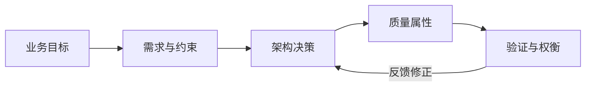
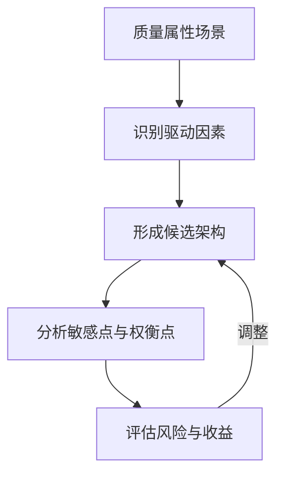
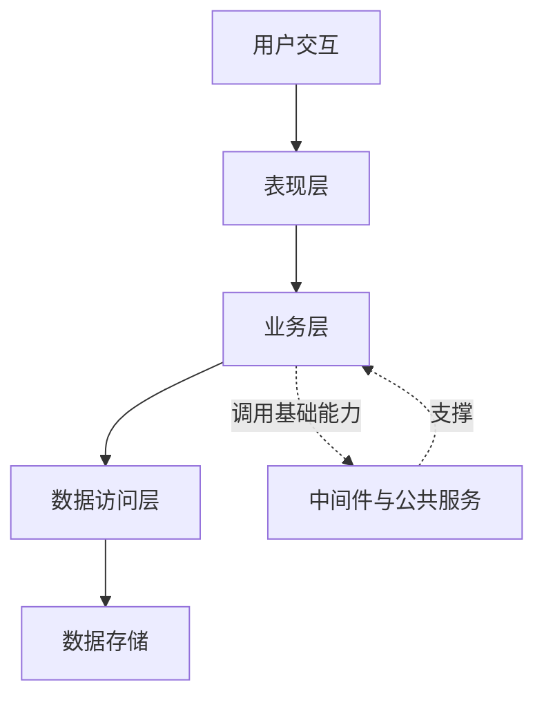
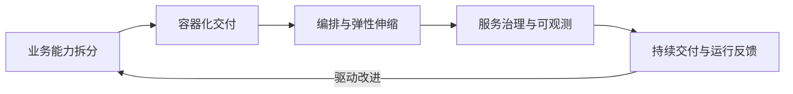
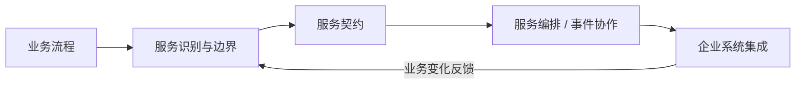
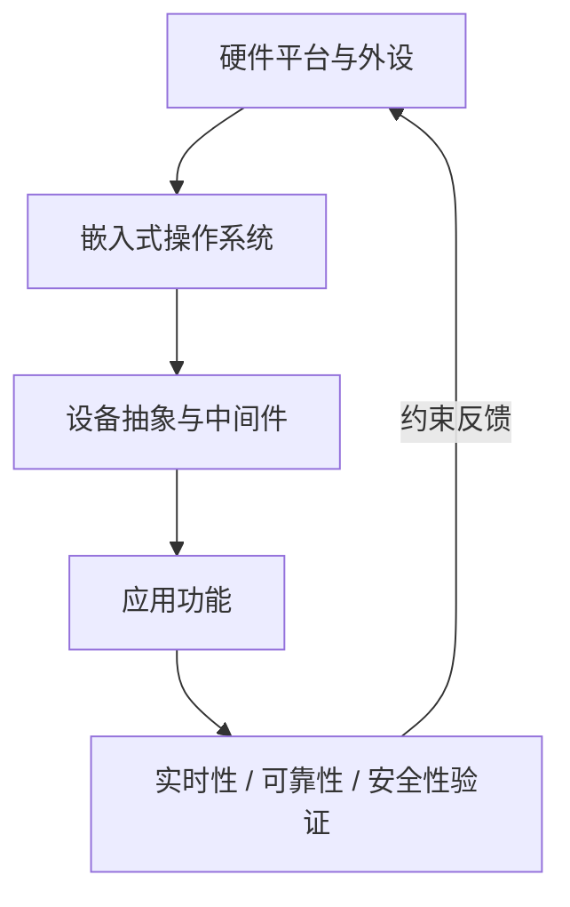
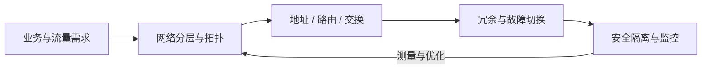
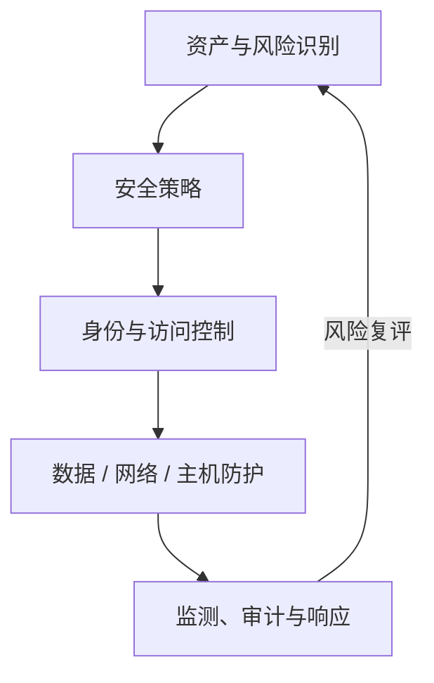
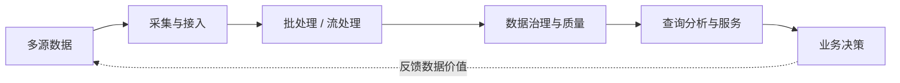

# 案例分析｜架构思维概览图

> 本页不是案例分析考点清单，而是帮助快速建立案例分析的思考框架。图中只保留关键概念和关系；完整范围请对照[官方考试大纲](./系统架构设计师考试大纲.md)中“考试科目2：系统架构设计案例分析”。

## 一、案例分析的通用主线

**读图重点：** 案例不是看到技术名词就写方案，而是从业务目标识别约束，以质量属性驱动决策，再用指标、测试和风险验证方案。

## 二、架构设计与评估：从场景到决策

*考纲映射：信息系统架构设计理论与实践。*

**读图重点：** 性能、可用性、安全性、可修改性等质量属性可能相互制约。答题要写清场景、设计措施、收益、代价和验证方式。

## 三、分层架构：职责分离与依赖方向

*考纲映射：层次式架构设计理论与实践。*

**读图重点：** 分层的价值不只是“分成几层”，而是隔离变化、明确职责和控制依赖。分析时关注跨层调用、事务边界、性能开销和可测试性。

## 四、云原生：应用拆分与平台化运行

*考纲映射：云原生架构设计理论与实践。*

**读图重点：** 云原生不是简单部署到云上，而是应用、交付、运行平台和运维反馈协同演进。案例要结合团队能力、状态管理、网络治理和成本约束。

## 五、面向服务架构：服务边界与集成

*考纲映射：面向服务的架构设计理论与实践。*

**读图重点：** 服务化的关键是稳定契约和合理边界。需要权衡服务粒度、耦合、治理成本、调用链延迟和跨服务一致性。

## 六、嵌入式系统：软硬件协同与实时约束

*考纲映射：嵌入式系统架构设计理论与实践。*

**读图重点：** 嵌入式架构需要软硬件协同设计。分析时优先识别实时截止期、资源上限、故障后果、安全等级和环境约束。

## 七、通信系统：分层组网与高可用

*考纲映射：通信系统架构设计理论与实践。*

**读图重点：** 网络方案从需求和流量模型出发，逐层落实拓扑、协议、冗余、安全和验证。不要只罗列协议名称，要解释它们解决的具体问题。

## 八、安全架构：纵深防御与持续治理

*考纲映射：安全架构设计理论与实践。*

**读图重点：** 安全是治理闭环，不是单点部署防火墙。答题要把威胁、控制措施、责任主体、审计证据和残余风险连起来。

## 九、大数据架构：批流处理与结果服务

*考纲映射：大数据架构设计理论与实践。*

**读图重点：** 选型重点在时效性、数据规模、处理复杂度、结果一致性和运维成本。理解 Lambda 的批流分工与 Kappa 的流处理主线，重点比较它们的适用条件和复杂度。

---

## 案例答题时的五个检查点

1. **目标与约束：** 业务目标、用户规模、时延、吞吐、预算、遗留系统、合规要求。
2. **事实与证据：** 区分题干事实、合理假设和需要监测/压测验证的判断。
3. **方案与权衡：** 至少说明关键备选方案、选择理由、收益、代价和适用边界。
4. **质量属性：** 把架构决策映射到性能、可用性、安全性、可修改性、一致性等属性。
5. **验证与风险：** 给出可度量指标、测试方法、监控手段、故障策略和遗留风险。

> 本页为概念导航，不替代完整考纲、教材和题目训练。具体案例应以题干给出的业务场景和约束为准。
