# 案例分析大纲｜架构专题图

按案例分析专题拆分为模块图，并对 ADM、网络设计和访问控制等过程型内容补充流程图/时序图。节点显式设置浅色填充和高对比文字，不依赖查看器默认主题。

## 内容导航

1. [内容导航](#part-1)
2. [1. 系统计划](#part-2)
3. [2. 信息系统架构的设计理论与实践](#part-3)
4. [3. 层次式架构的设计理论与实践](#part-4)
5. [4. 云原生架构设计理论与实践](#part-5)
6. [5. 面向服务的架构设计理论与实践](#part-6)
7. [6. 嵌入式系统的架构设计理论与实践](#part-7)
8. [7. 通信系统架构的设计理论与实践](#part-8)
9. [8. 安全架构的设计理论与实践](#part-9)
10. [9. 大数据架构设计理论与实践](#part-10)

---

<a id="part-1"></a>

## 内容导航

<a id="part-2"></a>

## 1. 系统计划

### 核心知识点总览

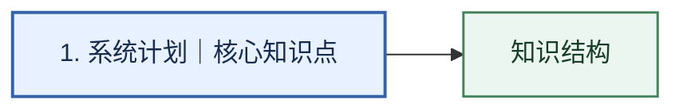

<a id="part-3"></a>

## 2. 信息系统架构的设计理论与实践

### 核心知识点总览

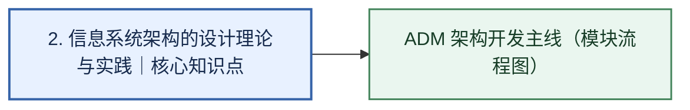

### 2.1 信息系统架构概述

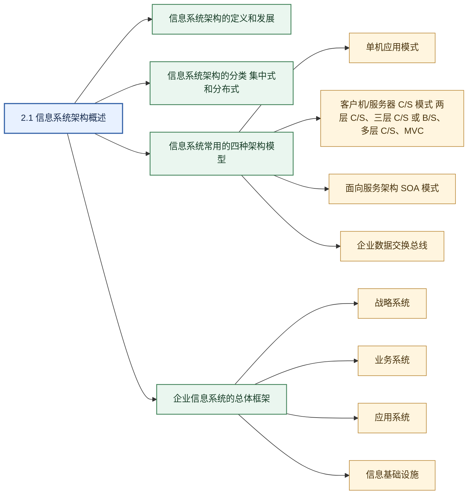

### 2.2 信息系统架构设计方法 ADM

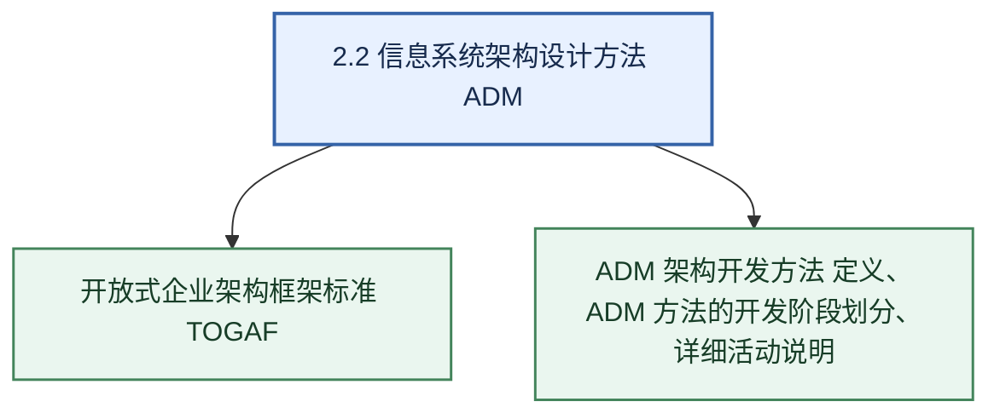

### 2.3 信息化总体架构方法

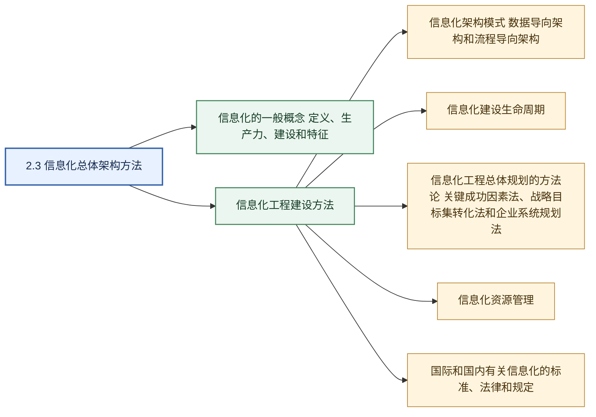

### 2.4 案例分析

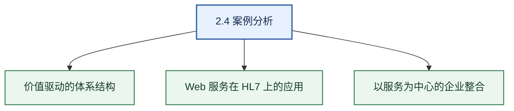

### ADM 架构开发主线（模块流程图）

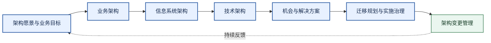

<a id="part-4"></a>

## 3. 层次式架构的设计理论与实践

### 3.1 层次式架构概述

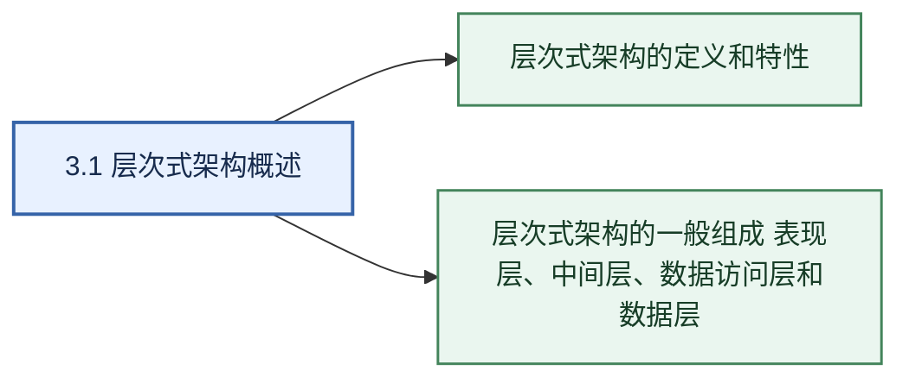

### 3.2 表现层框架设计

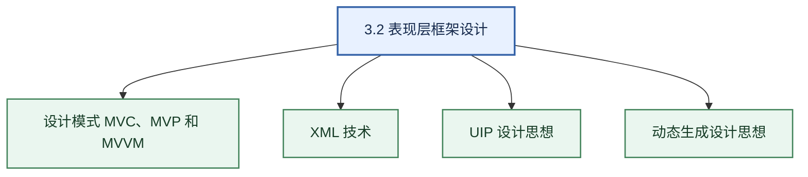

### 3.3 中间层架构设计

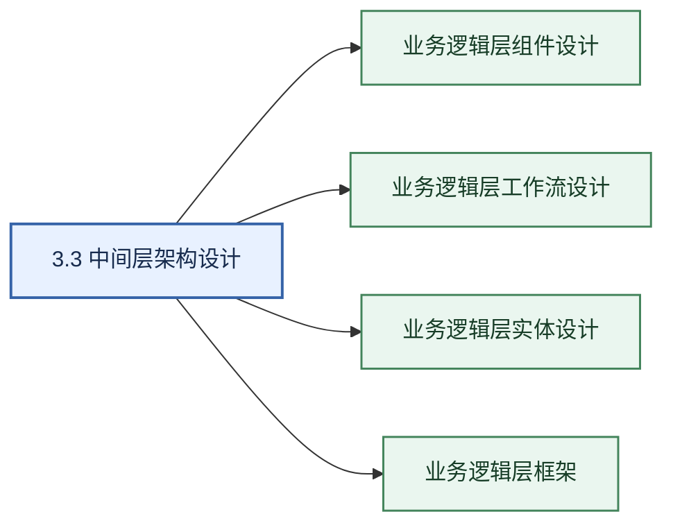

### 3.4 数据访问层设计

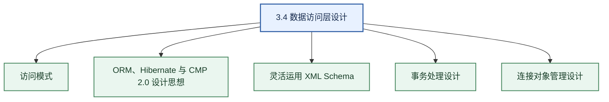

### 3.5 数据层架构规划与设计

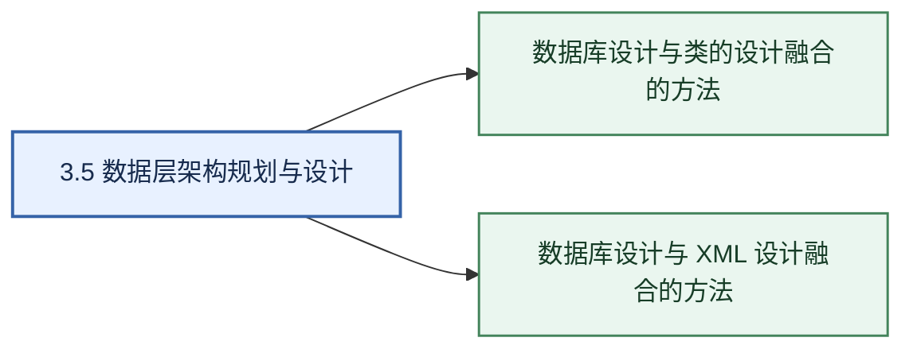

### 3.6 物联网的层次架构设计

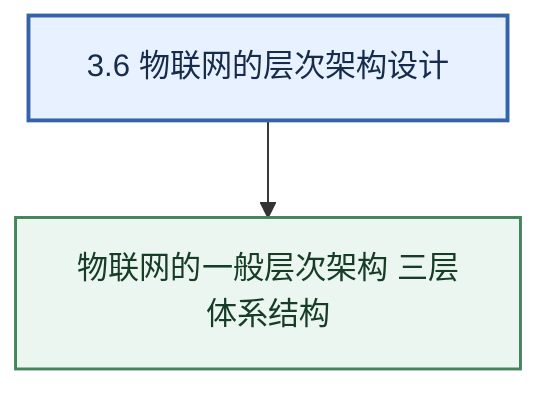

### 3.7 案例分析

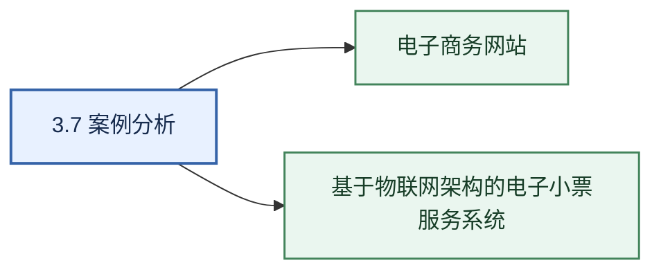

<a id="part-5"></a>

## 4. 云原生架构设计理论与实践

### 4.1 云原生架构概述

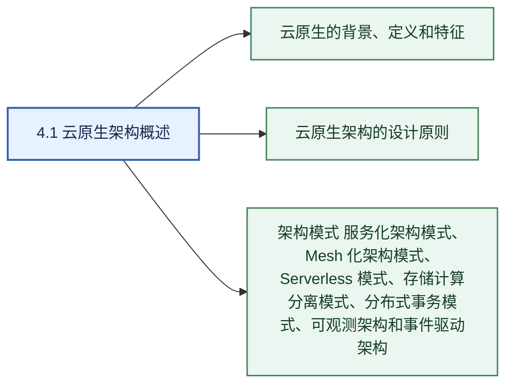

### 4.2 云原生架构相关技术

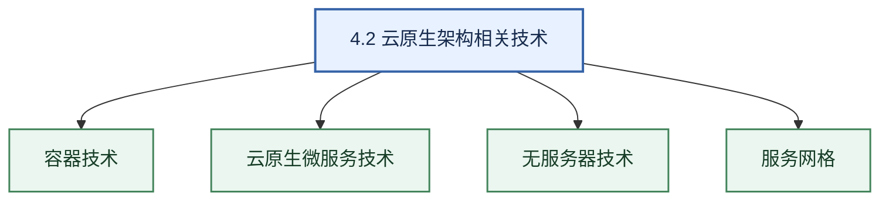

### 4.3 案例分析

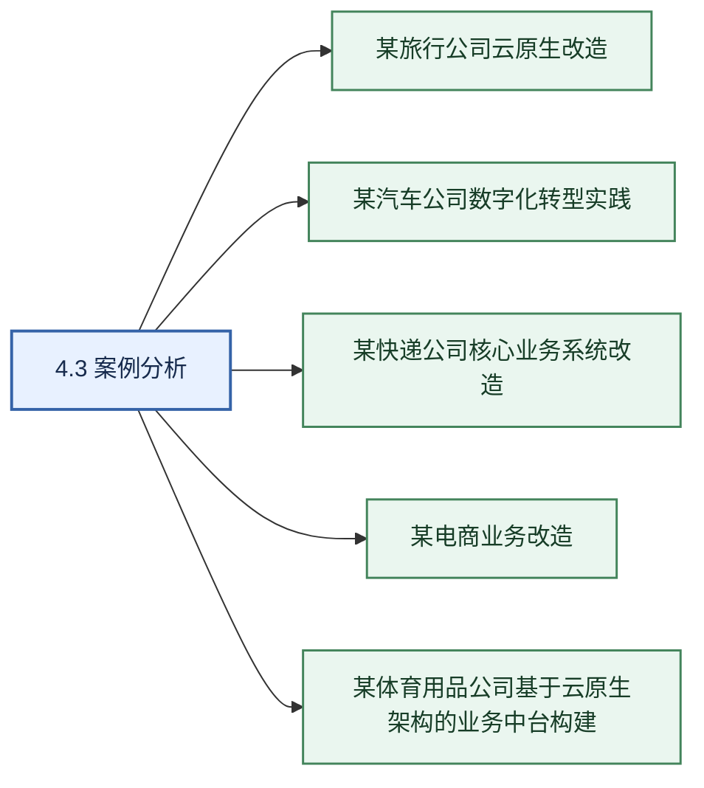

<a id="part-6"></a>

## 5. 面向服务的架构设计理论与实践

### 5.1 面向服务的架构概述

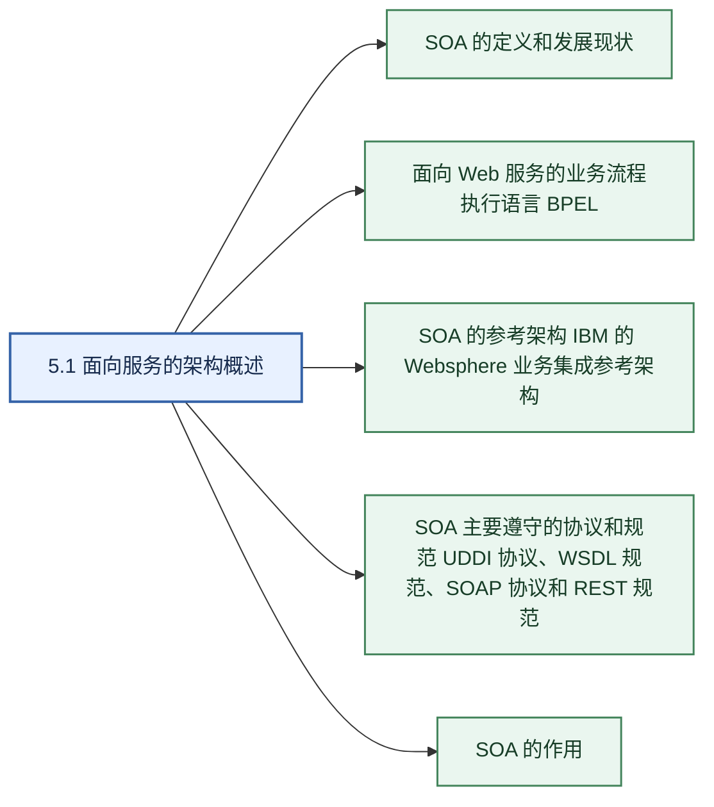

### 5.2 面向服务的架构设计

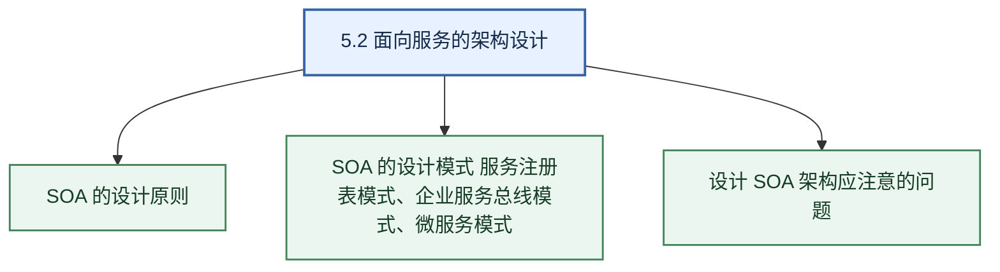

### 5.3 面向服务的架构实施过程

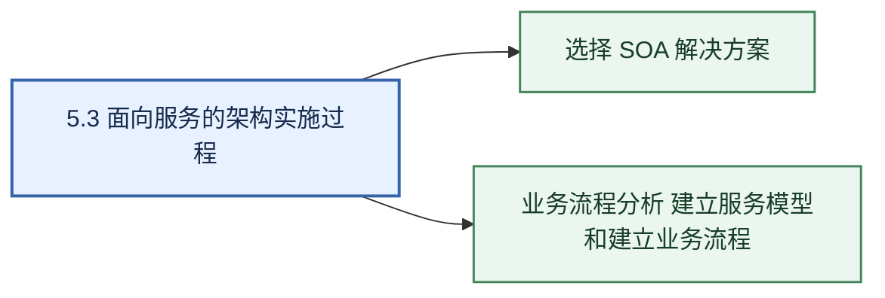

<a id="part-7"></a>

## 6. 嵌入式系统的架构设计理论与实践

### 6.1 嵌入式系统概述

```mermaid
flowchart LR
  R["6.1 嵌入式系统概述"]
  classDef root fill:#e8f1ff,stroke:#3563a8,color:#172b4d,stroke-width:2px;
  classDef group fill:#eaf6ef,stroke:#43845b,color:#173d27,stroke-width:1.5px;
  classDef item fill:#fff5df,stroke:#b7832f,color:#49330d,stroke-width:1px;
  class R root;
  N1["嵌入式系统的定义和发展现状"]
  R --> N1
  class N1 group;
  N2["嵌入式系统的硬件体系结构"]
  R --> N2
  class N2 group;
  N3["嵌入式微处理器及其分类"]
  N2 --> N3
  class N3 item;
  N4["存储器及其分类"]
  N2 --> N4
  class N4 item;
  N5["内、外总线及其分类"]
  N2 --> N5
  class N5 item;
  N6["看门狗电路"]
  N2 --> N6
  class N6 item;
  N7["嵌入式系统软件架构概述"]
  R --> N7
  class N7 group;
```

### 6.2 嵌入式系统软件架构的原理与特征

```mermaid
flowchart TD
  R["6.2 嵌入式系统软件架构的原理与特征"]
  classDef root fill:#e8f1ff,stroke:#3563a8,color:#172b4d,stroke-width:2px;
  classDef group fill:#eaf6ef,stroke:#43845b,color:#173d27,stroke-width:1.5px;
  classDef item fill:#fff5df,stroke:#b7832f,color:#49330d,stroke-width:1px;
  class R root;
  N1["嵌入式软件架构原理 层次化模式和递归模式"]
  R --> N1
  class N1 group;
  N2["嵌入式操作系统"]
  R --> N2
  class N2 group;
  N3["嵌入式操作系统的定义、特点和分类"]
  N2 --> N3
  class N3 item;
  N4["嵌入式操作系统的一般架构"]
  N2 --> N4
  class N4 item;
  N5["嵌入式操作系统的基本功能及典型调度算法"]
  N2 --> N5
  class N5 item;
  N6["典型嵌入式操作系统产品的比较"]
  N2 --> N6
  class N6 item;
  N7["嵌入式数据库"]
  R --> N7
  class N7 group;
  N8["嵌入式数据库的定义、特点和分类"]
  N7 --> N8
  class N8 item;
  N9["嵌入式数据库的一般架构 内存类、文件类和网络类"]
  N7 --> N9
  class N9 item;
  N10["嵌入式数据库的主要功能"]
  N7 --> N10
  class N10 item;
  N11["典型嵌入式数据库产品的比较"]
  N7 --> N11
  class N11 item;
  N12["嵌入式中间件"]
  R --> N12
  class N12 group;
  N13["嵌入式中间件的定义、特点和分类"]
  N12 --> N13
  class N13 item;
  N14["嵌入式中间件的一般架构 消息中间件和分布式对象中间件"]
  N12 --> N14
  class N14 item;
  N15["嵌入式中间件的主要功能"]
  N12 --> N15
  class N15 item;
  N16["典型嵌入式中间件产品 CORBA 和 DDS"]
  N12 --> N16
  class N16 item;
  N17["嵌入式系统软件开发环境"]
  R --> N17
  class N17 group;
  N18["嵌入式软件开发环境的定义、特点和分类"]
  N17 --> N18
  class N18 item;
  N19["嵌入式软件开发环境的一般架构 基于 Eclipse 框架的嵌入式软件开发环境的层次结构"]
  N17 --> N19
  class N19 item;
  N20["嵌入式软件开发环境的主要功能"]
  N17 --> N20
  class N20 item;
  N21["典型嵌入式软件的开发环境 基于 GCC 开源工具的软件开发环境、Workbench 软件开发环境、MULTI® 集成开发环境"]
  N17 --> N21
  class N21 item;
```

### 6.3 嵌入式系统软件架构设计方法

```mermaid
flowchart LR
  R["6.3 嵌入式系统软件架构设计方法"]
  classDef root fill:#e8f1ff,stroke:#3563a8,color:#172b4d,stroke-width:2px;
  classDef group fill:#eaf6ef,stroke:#43845b,color:#173d27,stroke-width:1.5px;
  classDef item fill:#fff5df,stroke:#b7832f,color:#49330d,stroke-width:1px;
  class R root;
  N1["基于架构的软件开发方法 ABSD"]
  R --> N1
  class N1 group;
  N2["属性驱动的软件设计方法 ADD"]
  R --> N2
  class N2 group;
  N3["实时系统的设计方法 DARTS"]
  R --> N3
  class N3 group;
```

### 6.4 案例分析

```mermaid
flowchart TD
  R["6.4 案例分析"]
  classDef root fill:#e8f1ff,stroke:#3563a8,color:#172b4d,stroke-width:2px;
  classDef group fill:#eaf6ef,stroke:#43845b,color:#173d27,stroke-width:1.5px;
  classDef item fill:#fff5df,stroke:#b7832f,color:#49330d,stroke-width:1px;
  class R root;
  N1["鸿蒙操作系统架构案例分析"]
  R --> N1
  class N1 group;
  N2["面向安全攸关系统的跨领域 GeneSys 系统架构"]
  R --> N2
  class N2 group;
  N3["物联网操作系统软件架构"]
  R --> N3
  class N3 group;
```

<a id="part-8"></a>

## 7. 通信系统架构的设计理论与实践

### 核心知识点总览

```mermaid
flowchart LR
  R["7. 通信系统架构的设计理论与实践｜核心知识点"]
  classDef root fill:#e8f1ff,stroke:#3563a8,color:#172b4d,stroke-width:2px;
  classDef group fill:#eaf6ef,stroke:#43845b,color:#173d27,stroke-width:1.5px;
  classDef item fill:#fff5df,stroke:#b7832f,color:#49330d,stroke-width:1px;
  class R root;
  N1["网络规划、设计与验证（时序图）"]
  R --> N1
  class N1 group;
```

### 7.1 通信系统的架构

```mermaid
flowchart LR
  R["7.1 通信系统的架构"]
  classDef root fill:#e8f1ff,stroke:#3563a8,color:#172b4d,stroke-width:2px;
  classDef group fill:#eaf6ef,stroke:#43845b,color:#173d27,stroke-width:1.5px;
  classDef item fill:#fff5df,stroke:#b7832f,color:#49330d,stroke-width:1px;
  class R root;
  N1["局域网网络架构 单核心架构、双核心架构、环型架构和层次局域网架构"]
  R --> N1
  class N1 group;
  N2["局域网网络协议的应用"]
  R --> N2
  class N2 group;
  N3["互为主备的交换或路由 VRRP、HSRP 和 GLBP"]
  N2 --> N3
  class N3 item;
  N4["二层网络 STP 和 LACP"]
  N2 --> N4
  class N4 item;
  N5["三层设备 OSPF、RIP 和 BGP"]
  N2 --> N5
  class N5 item;
  N6["广域网网络架构 单核心架构、双核心架构、环型架构、半冗余、对等子域和层次子域"]
  R --> N6
  class N6 group;
  N7["移动通信网网络架构 5GS 与 DN 互连、5G 网络边缘计算等"]
  R --> N7
  class N7 group;
  N8["存储网络架构 DAS、NAS 和 SAN"]
  R --> N8
  class N8 group;
  N9["软件定义网络架构 SDN"]
  R --> N9
  class N9 group;
```

### 7.2 网络构建的关键技术

```mermaid
flowchart TD
  R["7.2 网络构建的关键技术"]
  classDef root fill:#e8f1ff,stroke:#3563a8,color:#172b4d,stroke-width:2px;
  classDef group fill:#eaf6ef,stroke:#43845b,color:#173d27,stroke-width:1.5px;
  classDef item fill:#fff5df,stroke:#b7832f,color:#49330d,stroke-width:1px;
  class R root;
  N1["网络高可用设计 定义、架构和协议配置"]
  R --> N1
  class N1 group;
  N2["IPv4 与 IPv6 融合组网关键技术 双协议栈、隧道技术和地址翻译机制等"]
  R --> N2
  class N2 group;
  N3["SDN 技术"]
  R --> N3
  class N3 group;
```

### 7.3 网络构建和设计方法

```mermaid
flowchart LR
  R["7.3 网络构建和设计方法"]
  classDef root fill:#e8f1ff,stroke:#3563a8,color:#172b4d,stroke-width:2px;
  classDef group fill:#eaf6ef,stroke:#43845b,color:#173d27,stroke-width:1.5px;
  classDef item fill:#fff5df,stroke:#b7832f,color:#49330d,stroke-width:1px;
  class R root;
  N1["网络需求分析步骤 业务需求、用户需求、计算机平台需求和网络需求"]
  R --> N1
  class N1 group;
  N2["网络技术遴选 局域、广域、地址规划模型、路由协议、层次化网络模型设计和高可用设计"]
  R --> N2
  class N2 group;
  N3["绿色网络设计方法 目的、作用和设计原则"]
  R --> N3
  class N3 group;
```

### 7.4 网络安全相关技术

```mermaid
flowchart TD
  R["7.4 网络安全相关技术"]
  classDef root fill:#e8f1ff,stroke:#3563a8,color:#172b4d,stroke-width:2px;
  classDef group fill:#eaf6ef,stroke:#43845b,color:#173d27,stroke-width:1.5px;
  classDef item fill:#fff5df,stroke:#b7832f,color:#49330d,stroke-width:1px;
  class R root;
  N1["防火墙布设 包过滤型、应用层网关和代理服务型"]
  R --> N1
  class N1 group;
  N2["VPN 技术 IPSec、GRE、MPLS VPN 和 VPDN"]
  R --> N2
  class N2 group;
  N3["访问控制技术 认证、策略和审计"]
  R --> N3
  class N3 group;
  N4["网络安全隔离 子网隔离、VLAN 隔离、逻辑隔离和物理隔离等"]
  R --> N4
  class N4 group;
  N5["网络安全协议 SSL、SET 和 HTTPS"]
  R --> N5
  class N5 group;
```

### 7.5 案例分析

```mermaid
flowchart LR
  R["7.5 案例分析"]
  classDef root fill:#e8f1ff,stroke:#3563a8,color:#172b4d,stroke-width:2px;
  classDef group fill:#eaf6ef,stroke:#43845b,color:#173d27,stroke-width:1.5px;
  classDef item fill:#fff5df,stroke:#b7832f,color:#49330d,stroke-width:1px;
  class R root;
  N1["高可用网络构建分析"]
  R --> N1
  class N1 group;
  N2["园区网双栈构建分析"]
  R --> N2
  class N2 group;
  N3["5G 网络应用"]
  R --> N3
  class N3 group;
```

### 网络规划、设计与验证（时序图）

```mermaid
%%{init: {'theme':'base','themeVariables': {'background':'#ffffff','primaryColor':'#e8f1ff','primaryTextColor':'#172b4d','primaryBorderColor':'#3563a8','lineColor':'#64748b','actorBkg':'#e8f1ff','actorBorder':'#3563a8','actorTextColor':'#172b4d','signalColor':'#64748b','signalTextColor':'#172b4d','noteBkgColor':'#fff5df','noteTextColor':'#49330d','activationBkgColor':'#eaf6ef','activationBorderColor':'#43845b'}}}%%
sequenceDiagram
  autonumber
  participant B as 业务方
  participant N as 网络架构师
  participant P as 平台/系统团队
  participant V as 验证与运维
  B->>N: 业务需求与用户需求
  P->>N: 计算平台需求
  N->>N: 网络需求分析与技术遴选
  N->>N: 地址规划、路由协议与高可用设计
  N->>P: 输出网络架构与实施方案
  P->>V: 部署与联调
  V-->>N: 性能、安全与可用性验证
  N-->>B: 交付与优化建议
```

<a id="part-9"></a>

## 8. 安全架构的设计理论与实践

### 核心知识点总览

```mermaid
flowchart LR
  R["8. 安全架构的设计理论与实践｜核心知识点"]
  classDef root fill:#e8f1ff,stroke:#3563a8,color:#172b4d,stroke-width:2px;
  classDef group fill:#eaf6ef,stroke:#43845b,color:#173d27,stroke-width:1.5px;
  classDef item fill:#fff5df,stroke:#b7832f,color:#49330d,stroke-width:1px;
  class R root;
  N1["访问控制决策（时序图）"]
  R --> N1
  class N1 group;
```

### 8.1 安全架构概述

```mermaid
flowchart LR
  R["8.1 安全架构概述"]
  classDef root fill:#e8f1ff,stroke:#3563a8,color:#172b4d,stroke-width:2px;
  classDef group fill:#eaf6ef,stroke:#43845b,color:#173d27,stroke-width:1.5px;
  classDef item fill:#fff5df,stroke:#b7832f,color:#49330d,stroke-width:1px;
  class R root;
  N1["信息安全面临的威胁"]
  R --> N1
  class N1 group;
  N2["安全架构的定义和范围 产品安全架构、安全技术体系架构和审计架构"]
  R --> N2
  class N2 group;
  N3["信息安全相关的国内外标准及组织"]
  R --> N3
  class N3 group;
  N4["主要安全模型"]
  R --> N4
  class N4 group;
  N5["状态机模型 BLP 模型"]
  N4 --> N5
  class N5 item;
  N6["Bell-LaPadula 模型"]
  N4 --> N6
  class N6 item;
  N7["Biba 模型"]
  N4 --> N7
  class N7 item;
  N8["Clark-Wilson CWM 模型"]
  N4 --> N8
  class N8 item;
  N9["ChineseWall 模型"]
  N4 --> N9
  class N9 item;
```

### 8.2 系统安全体系架构规划框架

```mermaid
flowchart TD
  R["8.2 系统安全体系架构规划框架"]
  classDef root fill:#e8f1ff,stroke:#3563a8,color:#172b4d,stroke-width:2px;
  classDef group fill:#eaf6ef,stroke:#43845b,color:#173d27,stroke-width:1.5px;
  classDef item fill:#fff5df,stroke:#b7832f,color:#49330d,stroke-width:1px;
  class R root;
  N1["安全技术体系架构"]
  R --> N1
  class N1 group;
  N2["信息系统安全体系规划 技术体系、组织机构体系和管理体系"]
  R --> N2
  class N2 group;
  N3["信息系统安全规划框架"]
  R --> N3
  class N3 group;
```

### 8.3 信息安全整体架构设计 WPDRRC 模型

```mermaid
flowchart LR
  R["8.3 信息安全整体架构设计 WPDRRC 模型"]
  classDef root fill:#e8f1ff,stroke:#3563a8,color:#172b4d,stroke-width:2px;
  classDef group fill:#eaf6ef,stroke:#43845b,color:#173d27,stroke-width:1.5px;
  classDef item fill:#fff5df,stroke:#b7832f,color:#49330d,stroke-width:1px;
  class R root;
  N1["WPDRRC 体系架构模型概述 6 个环节和 3 大要素"]
  R --> N1
  class N1 group;
  N2["信息安全体系架构设计方法"]
  R --> N2
  class N2 group;
  N3["安全保障体系 确定安全策略、统一配置和管理防病毒系统、网络安全管理"]
  N2 --> N3
  class N3 item;
  N4["信息安全体系架构 物理安全、系统安全、网络安全、应用安全和安全管理"]
  N2 --> N4
  class N4 item;
  N5["面向企业安全控制系统的安全架构设计"]
  R --> N5
  class N5 group;
```

### 8.4 网络安全体系架构设计

```mermaid
flowchart TD
  R["8.4 网络安全体系架构设计"]
  classDef root fill:#e8f1ff,stroke:#3563a8,color:#172b4d,stroke-width:2px;
  classDef group fill:#eaf6ef,stroke:#43845b,color:#173d27,stroke-width:1.5px;
  classDef item fill:#fff5df,stroke:#b7832f,color:#49330d,stroke-width:1px;
  class R root;
  N1["OSI 的安全体系架构概述"]
  R --> N1
  class N1 group;
  N2["OSI 安全架构 7 层协议"]
  R --> N2
  class N2 group;
  N3["鉴别框架"]
  R --> N3
  class N3 group;
  N4["访问控制框架"]
  R --> N4
  class N4 group;
  N5["机密性框架"]
  R --> N5
  class N5 group;
  N6["完整性框架"]
  R --> N6
  class N6 group;
  N7["抗抵赖框架"]
  R --> N7
  class N7 group;
```

### 8.5 数据库系统的安全设计

```mermaid
flowchart LR
  R["8.5 数据库系统的安全设计"]
  classDef root fill:#e8f1ff,stroke:#3563a8,color:#172b4d,stroke-width:2px;
  classDef group fill:#eaf6ef,stroke:#43845b,color:#173d27,stroke-width:1.5px;
  classDef item fill:#fff5df,stroke:#b7832f,color:#49330d,stroke-width:1px;
  class R root;
  N1["数据库安全设计的评估标准"]
  R --> N1
  class N1 group;
  N2["数据库的完整性设计方法 设计原则、作用和示例"]
  R --> N2
  class N2 group;
```

### 8.6 系统架构的脆弱性分析

```mermaid
flowchart TD
  R["8.6 系统架构的脆弱性分析"]
  classDef root fill:#e8f1ff,stroke:#3563a8,color:#172b4d,stroke-width:2px;
  classDef group fill:#eaf6ef,stroke:#43845b,color:#173d27,stroke-width:1.5px;
  classDef item fill:#fff5df,stroke:#b7832f,color:#49330d,stroke-width:1px;
  class R root;
  N1["软件脆弱性的定义、特点和分类"]
  R --> N1
  class N1 group;
  N2["软件脆弱性的生命周期"]
  R --> N2
  class N2 group;
  N3["软件脆弱性的分析方法"]
  R --> N3
  class N3 group;
  N4["典型的软件架构脆弱性分析 分层、C/S、B/S、事件驱动、MVC、微内核和微服务"]
  R --> N4
  class N4 group;
```

### 8.7 案例分析

```mermaid
flowchart LR
  R["8.7 案例分析"]
  classDef root fill:#e8f1ff,stroke:#3563a8,color:#172b4d,stroke-width:2px;
  classDef group fill:#eaf6ef,stroke:#43845b,color:#173d27,stroke-width:1.5px;
  classDef item fill:#fff5df,stroke:#b7832f,color:#49330d,stroke-width:1px;
  class R root;
  N1["电子商务系统的安全性设计"]
  R --> N1
  class N1 group;
  N2["基于混合云的工业安全架构设计"]
  R --> N2
  class N2 group;
```

### 访问控制决策（时序图）

```mermaid
%%{init: {'theme':'base','themeVariables': {'background':'#ffffff','primaryColor':'#e8f1ff','primaryTextColor':'#172b4d','primaryBorderColor':'#3563a8','lineColor':'#64748b','actorBkg':'#e8f1ff','actorBorder':'#3563a8','actorTextColor':'#172b4d','signalColor':'#64748b','signalTextColor':'#172b4d','noteBkgColor':'#fff5df','noteTextColor':'#49330d','activationBkgColor':'#eaf6ef','activationBorderColor':'#43845b'}}}%%
sequenceDiagram
  autonumber
  participant I as 身份主体
  participant G as 安全网关
  participant P as 策略引擎
  participant R as 受保护资源
  I->>G: 发起访问请求
  G->>P: 提交身份、设备与请求上下文
  P->>P: 身份鉴别与访问策略判定
  P-->>G: 允许/拒绝及约束条件
  alt 允许访问
    G->>R: 按授权范围访问
    R-->>G: 返回受保护数据
    G-->>I: 返回结果并记录审计
  else 拒绝访问
    G-->>I: 拒绝请求并记录审计
  end
```

<a id="part-10"></a>

## 9. 大数据架构设计理论与实践

### 9.1 大数据处理系统概述

```mermaid
flowchart LR
  R["9.1 大数据处理系统概述"]
  classDef root fill:#e8f1ff,stroke:#3563a8,color:#172b4d,stroke-width:2px;
  classDef group fill:#eaf6ef,stroke:#43845b,color:#173d27,stroke-width:1.5px;
  classDef item fill:#fff5df,stroke:#b7832f,color:#49330d,stroke-width:1px;
  class R root;
  N1["传统数据处理系统存在的问题"]
  R --> N1
  class N1 group;
  N2["大数据处理系统面临的挑战"]
  R --> N2
  class N2 group;
  N3["大数据处理系统的定义、范围和特征"]
  R --> N3
  class N3 group;
```

### 9.2 典型的大数据架构

```mermaid
flowchart TD
  R["9.2 典型的大数据架构"]
  classDef root fill:#e8f1ff,stroke:#3563a8,color:#172b4d,stroke-width:2px;
  classDef group fill:#eaf6ef,stroke:#43845b,color:#173d27,stroke-width:1.5px;
  classDef item fill:#fff5df,stroke:#b7832f,color:#49330d,stroke-width:1px;
  class R root;
  N1["Lambda 架构"]
  R --> N1
  class N1 group;
  N2["Lambda 的来源、定义、应用场景和优缺点"]
  N1 --> N2
  class N2 item;
  N3["Lambda 的体系结构 Batch Layer 批处理层 、Speed Layer 加速层 、Serving Layer 服务层"]
  N1 --> N3
  class N3 item;
  N4["Kappa 架构"]
  R --> N4
  class N4 group;
  N5["Kappa 的来源、定义、应用场景和优缺点"]
  N4 --> N5
  class N5 item;
  N6["Kappa 的体系结构"]
  N4 --> N6
  class N6 item;
  N7["常见 kappa 架构的变形架构"]
  N4 --> N7
  class N7 item;
```

### 9.3 案例分析

```mermaid
flowchart LR
  R["9.3 案例分析"]
  classDef root fill:#e8f1ff,stroke:#3563a8,color:#172b4d,stroke-width:2px;
  classDef group fill:#eaf6ef,stroke:#43845b,color:#173d27,stroke-width:1.5px;
  classDef item fill:#fff5df,stroke:#b7832f,color:#49330d,stroke-width:1px;
  class R root;
  N1["某网在奥运转播中的大数据应用"]
  R --> N1
  class N1 group;
  N2["某网广告平台的应用与演进"]
  R --> N2
  class N2 group;
  N3["某证券公司大数据系统"]
  R --> N3
  class N3 group;
  N4["某电商智能决策大数据系统"]
  R --> N4
  class N4 group;
```

> 专题和知识点沿用原案例分析大纲；补充流程图帮助理解过程，不替代题干约束分析、质量属性权衡和验证指标。
