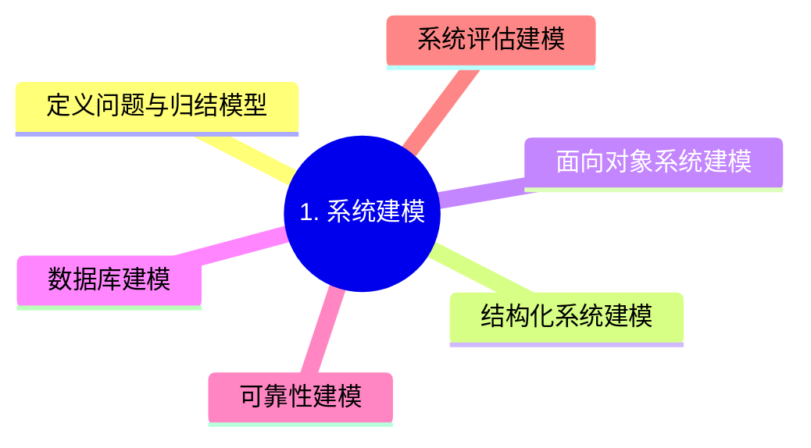
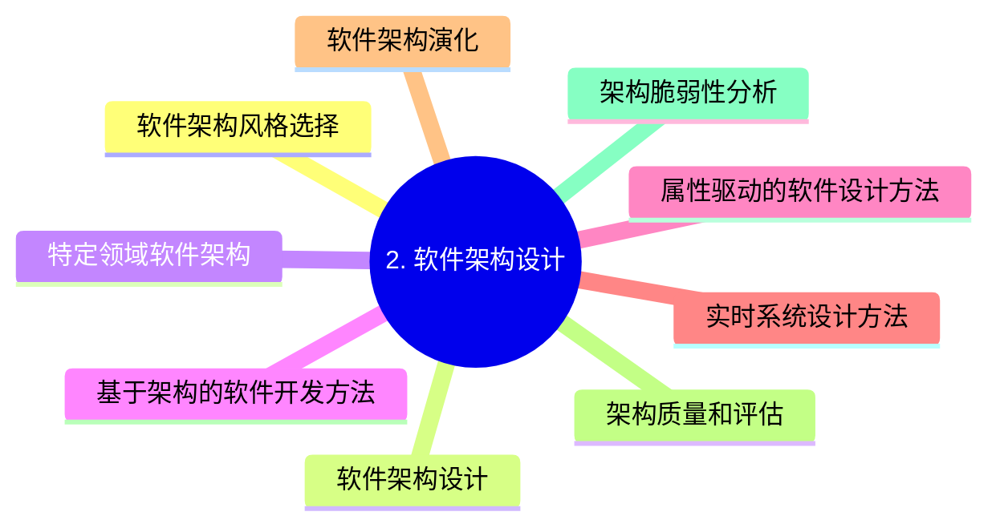
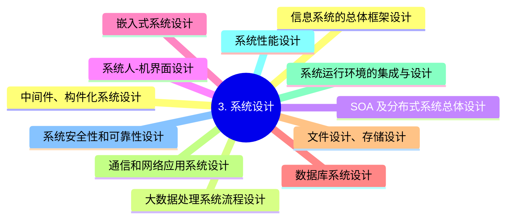
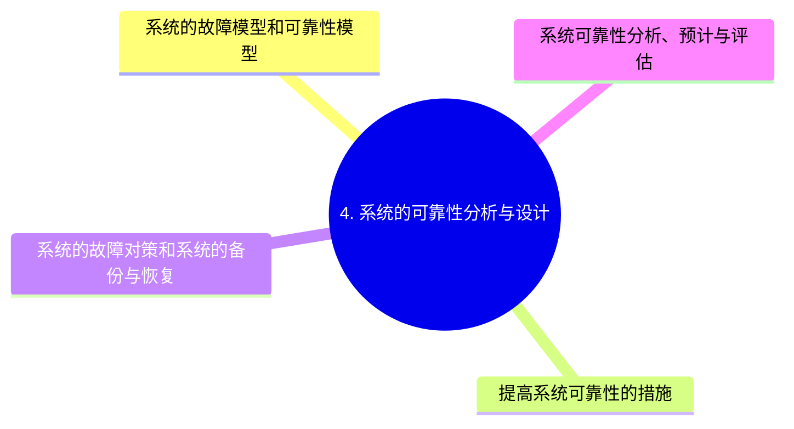
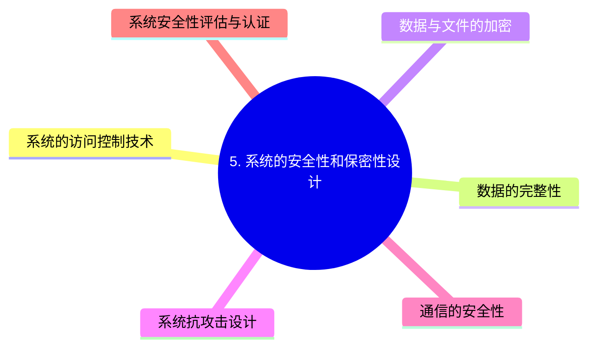

# 论文大纲分主题导图

论文大纲按五大主题分别展示，便于选题、项目素材归类和论文结构复用。

## 章节导航

1. [1. 系统建模](#chapter-1)
2. [2. 软件架构设计](#chapter-2)
3. [3. 系统设计](#chapter-3)
4. [4. 系统的可靠性分析与设计](#chapter-4)
5. [5. 系统的安全性和保密性设计](#chapter-5)

---

## 1. 系统建模

## 2. 软件架构设计

## 3. 系统设计

## 4. 系统的可靠性分析与设计

## 5. 系统的安全性和保密性设计

> 主题与知识点沿用原论文大纲脑图；写作时应以真实项目为基础，突出背景约束、架构决策、权衡及效果。
