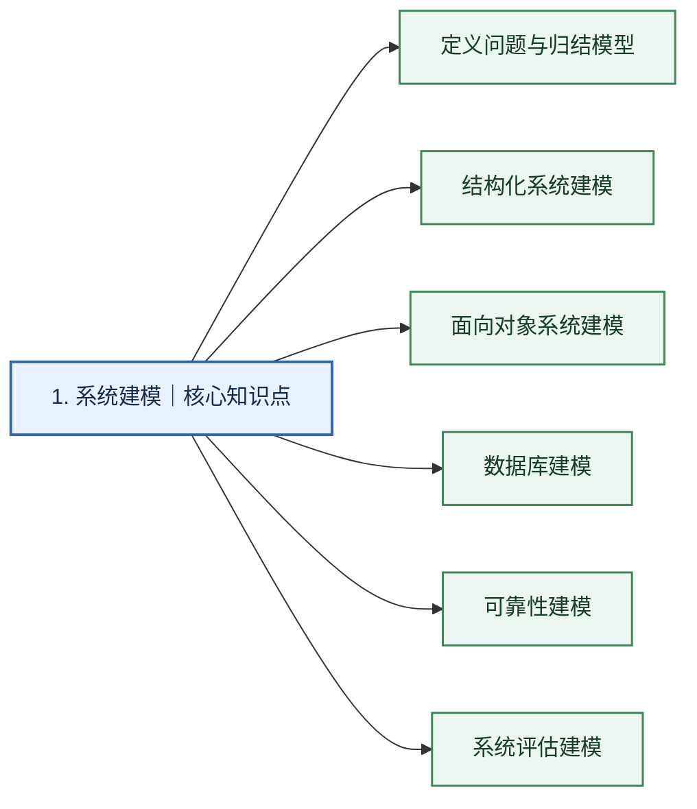
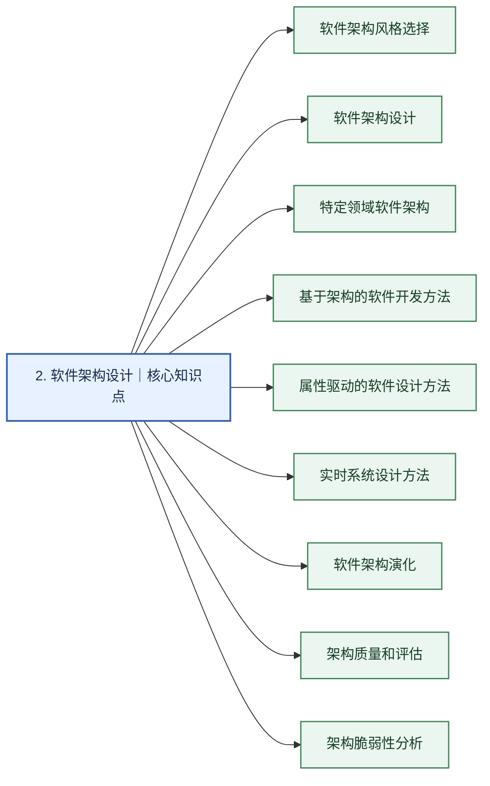
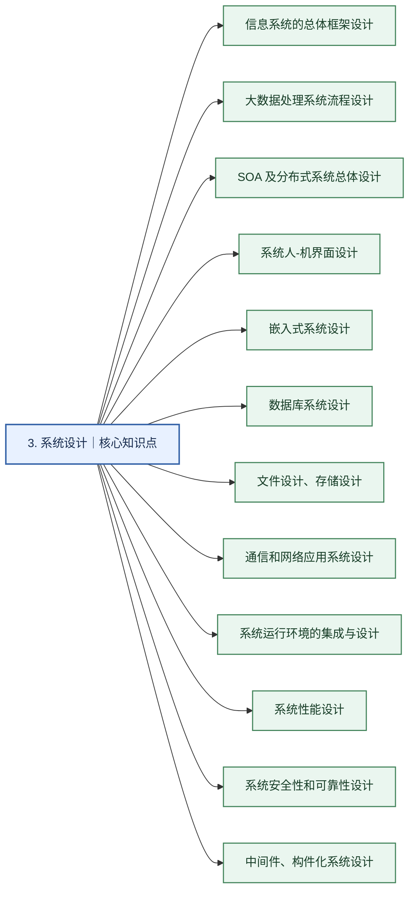
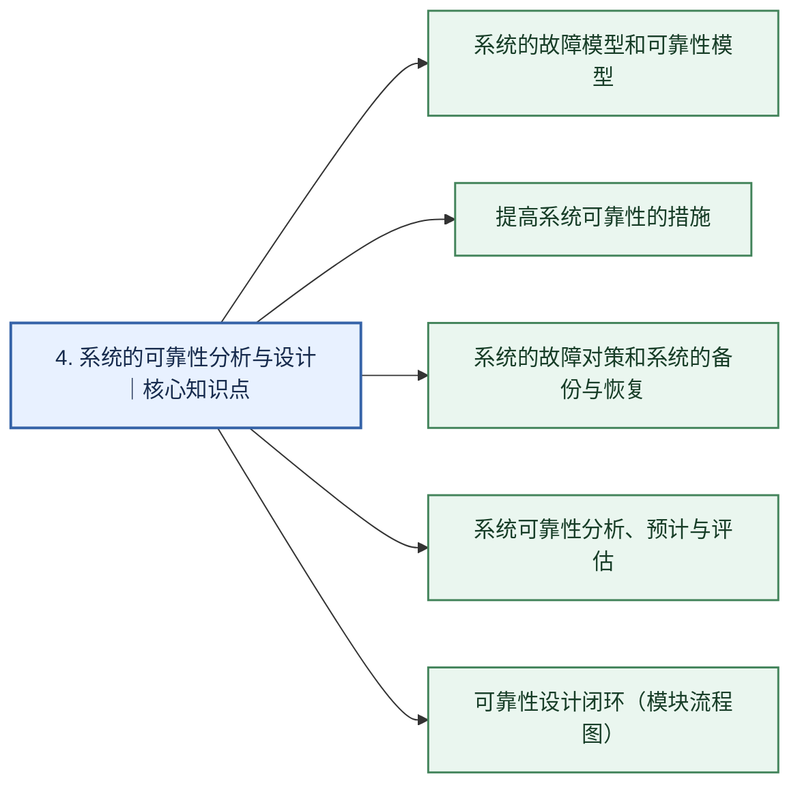
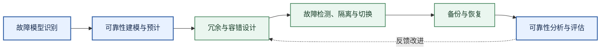
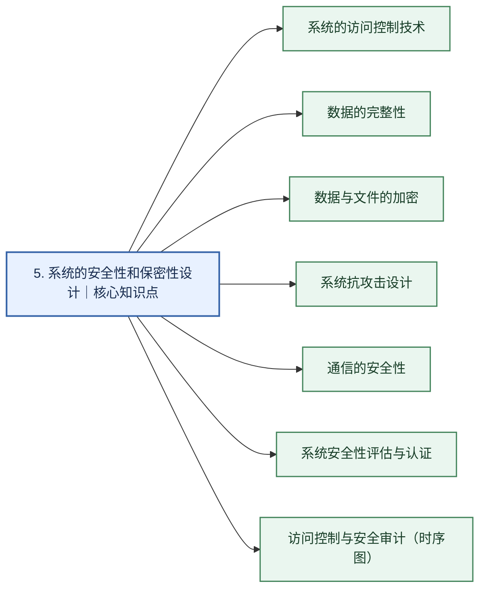
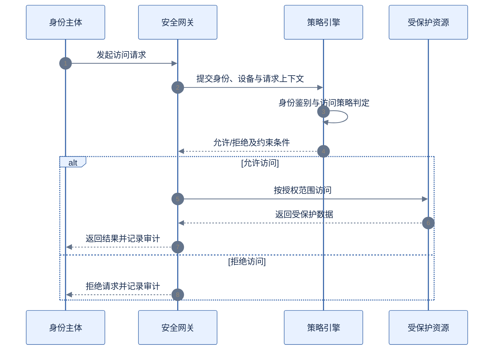

# 论文大纲｜主题结构图

按论文五大主题组织知识结构，采用模块流程图、时序图和分层知识图组合呈现，便于归集项目素材和组织论述。

## 内容导航

1. [内容导航](#part-1)
2. [1. 系统建模](#part-2)
3. [2. 软件架构设计](#part-3)
4. [3. 系统设计](#part-4)
5. [4. 系统的可靠性分析与设计](#part-5)
6. [5. 系统的安全性和保密性设计](#part-6)

---

## 内容导航

## 1. 系统建模

### 核心知识点总览

## 2. 软件架构设计

### 核心知识点总览

## 3. 系统设计

### 核心知识点总览

## 4. 系统的可靠性分析与设计

### 核心知识点总览

### 可靠性设计闭环（模块流程图）

## 5. 系统的安全性和保密性设计

### 核心知识点总览

### 访问控制与安全审计（时序图）

> 主题和知识点沿用原论文大纲；补充图用于辅助理解，论文应以真实项目背景、约束、决策、权衡和效果为依据。
