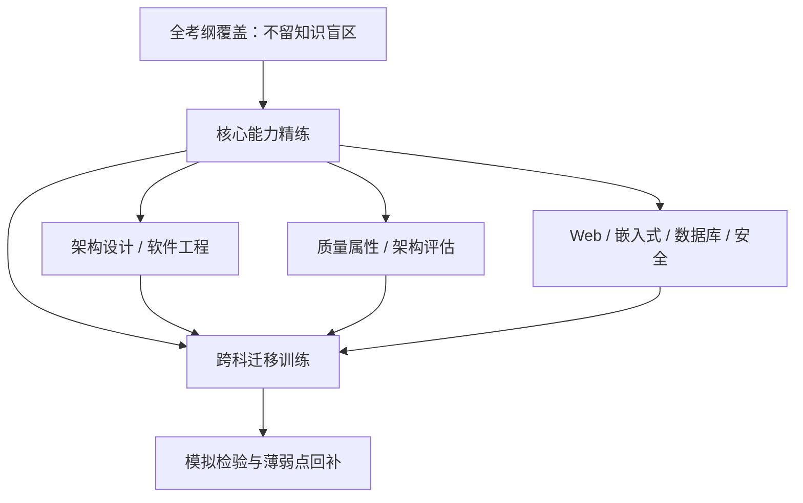

# 备考优先级｜投入策略概览

> 优先级用于安排复习投入，不代表官方大纲删减或命题承诺。所有官方考纲知识点仍须覆盖。

## 一、复习投入的层次

## 二、三科的投入重点

| 科目 | 重点突破 | 训练方式 |
|---|---|---|
| 综合知识 | 软件架构、软件工程及跨章节基础知识 | 全考纲覆盖、章节练习、错题回忆 |
| 案例分析 | 架构评估、Web、嵌入式、数据库、建模与安全 | 限时拆题、方案对比、质量属性分析 |
| 论文 | 架构设计、架构评估、云原生/微服务、可靠性与安全 | 真实项目素材、决策记录、限时成文 |

## 三、把同一知识主题贯穿三科

## 四、使用原则

- 核心主题要做到能解释、能比较、能设计、能评估。
- 其他考纲内容要做到有知识框架、能识别考点并完成基础题。
- 优先级根据阶段测验和错题分布动态调整，不凭主观感觉长期固定。
- 仓库已有考情汇总中的历史分值区间存在年度波动，只能作为投入参考，不能当作预测。

> 本页是学习策略地图；具体知识范围以[官方考试大纲](./系统架构设计师考试大纲.md)为准。
