# 知识点重要程度与备考优先级

本页采用“优先级分层图 + 权重依据表 + 三科映射”的组合形式。优先级依据仓库已有考情汇总，不是官方大纲对知识点的官方分级。

> 说明：分值区间和历年频率来自现有考试简介及冲刺资料汇总，存在年度波动；仅用于安排复习投入，不构成命题承诺。官方大纲仍须全面覆盖。

## 一、总体优先级分层图

```mermaid
flowchart TB
  A["备考知识体系"] --> H["最高优先级"]
  A --> M["高优先级"]
  A --> L["中等优先级"]
  A --> B["基础覆盖"]
  H --> H1["软件架构设计与架构评估"]
  H --> H2["软件工程与需求工程"]
  H --> H3["Web 架构、缓存、负载均衡"]
  H --> H4["嵌入式架构、实时性与可靠性"]
  H --> H5["微服务、云原生与论文项目素材"]
  M --> M1["系统安全与保密"]
  M --> M2["数据库与数据建模"]
  M --> M3["专业英语"]
  M --> M4["UML、DFD、ER、SysML"]
  L --> L1["系统工程与信息系统基础"]
  L --> L2["计算机网络与操作系统"]
  L --> L3["法律法规与标准化"]
  B --> B1["应用数学与经济管理"]
  B --> B2["计算机组成与性能"]
  B --> B3["未来技术基础"]
  classDef root fill:#e8f1ff,stroke:#3563a8,color:#172b4d,stroke-width:2px
  classDef highest fill:#e5f4eb,stroke:#398052,color:#173d27,stroke-width:2px
  classDef high fill:#fff2d9,stroke:#ad7a26,color:#4b330b,stroke-width:1.5px
  classDef medium fill:#f0eaff,stroke:#7656a8,color:#33204f,stroke-width:1.5px
  classDef base fill:#f1f4f8,stroke:#64748b,color:#263445,stroke-width:1.5px
  class A root
  class H,H1,H2,H3,H4,H5 highest
  class M,M1,M2,M3,M4 high
  class L,L1,L2,L3 medium
  class B,B1,B2,B3 base
```

## 二、按原始考情材料细化

| 科目 | 优先级 | 主题 | 现有资料中的依据/说明 |
|---|---|---|---|
| 综合知识 | 最高 | 软件架构设计 | 约 19–28 分或 17–25 分；架构4+1视图、构件、MVC、ABSD、风格/模式、质量属性、评估、ADL、中间件等 |
| 综合知识 | 最高 | 软件工程 | 约 9–21 分或 17–22 分；生命周期、过程模型、需求工程、OO/UML、设计、测试、维护、项目管理 |
| 综合知识 | 高 | 安全、数据库、专业英语 | 安全约 3–7 分；数据库约 2–5 分；专业英语约 5 分，详见原始汇总 |
| 综合知识 | 中 | 系统工程、网络、操作系统、嵌入式、标准化 | 分值有波动，需按官方大纲完整覆盖 |
| 案例分析 | 最高 | 软件架构、Web 应用、嵌入式 | 原考情材料均列为高频主题，需专项训练 |
| 案例分析 | 高 | 数据库、需求工程/系统建模 | 常与架构设计结合，重点练习建模、数据访问和方案分析 |
| 论文 | 最高 | 软件架构 | 架构风格、评估、微服务、SOA、云原生、演化、构件开发等 |
| 论文 | 高 | 新技术、可靠性与安全、数据库 | 作为可复用项目素材与备选专题持续准备 |

## 三、三科训练映射

| 科目 | 重点突破 | 必须形成的产出 |
|---|---|---|
| 综合知识 | 架构、软件工程精学；其他大纲知识点全面覆盖 | 章节知识卡、易混点对比表、错题本 |
| 案例分析 | 架构评估、Web、嵌入式；数据库/建模/安全交叉训练 | 需求约束表、架构图、方案对比表、质量属性分析 |
| 论文 | 架构风格与评估、微服务/云原生、可靠性与安全 | 项目背景、约束、架构决策、权衡、效果五类素材 |

## 四、案例题通用分析流程

## 五、复习投入建议

- 最高优先级做到“能解释、能比较、能设计、能评估”。
- 高优先级做到“能辨析、能应用”，中等优先级完成框架与典型题型覆盖。
- 基础覆盖内容不应完全放弃；按官方大纲检查遗漏。
- 将综合知识错题、案例失分点和论文素材关联到同一知识主题，形成三科联动。
