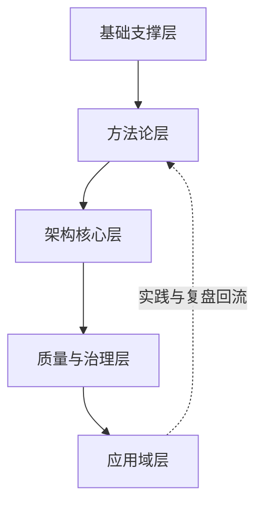

# 官方大纲知识概览图索引

## 这些图是做什么的

Mermaid 图用于帮助快速建立知识体系、看清核心概念之间的关系、理解架构分析主线；**不是官方大纲的图形化抄写版**。

- 官方大纲：完整、准确地列出考试范围，是查漏补缺的唯一完整清单。
- 知识概览图：提炼少量核心概念，突出组成、依赖、因果、流程、反馈和权衡。
- 知识讲解文档：解释概念、原理、公式、适用条件和典型考法。

因此，图中节点少于大纲考点是有意设计，不代表删减考试范围。

## 体系总图

*考纲映射：考试科目1 全部 13 章的层次归属。*

| 层次 | 覆盖的大纲章节 | 学习入口 |
|---|---|---|
| 基础支撑层 | 1 计算机系统基本知识、5 数据库设计基础知识、12 应用数学、13 专业英语 | [图 1 计算机系统](./01_综合知识大纲脑图.md#1-计算机系统从硬件资源到软件服务)、[图 4 软件与数据](./01_综合知识大纲脑图.md#4-软件与数据从需求到可运行系统) |
| 方法论层 | 4 软件工程基础知识、11 标准化与知识产权 | [图 4 软件与数据](./01_综合知识大纲脑图.md#4-软件与数据从需求到可运行系统) |
| 架构核心层 | 2 信息系统基础知识、3 信息安全技术基础知识、6 系统架构设计基础知识 | [图 2 信息系统](./01_综合知识大纲脑图.md#2-信息系统从业务数据到决策支持)、[图 3 信息安全](./01_综合知识大纲脑图.md#3-信息安全风险驱动的治理闭环)、[图 5 架构风格选型](./01_综合知识大纲脑图.md#5-架构风格选型按需求特征定风格) |
| 质量与治理层 | 7 系统质量属性与架构评估、8 软件可靠性技术、9 软件架构的演化和维护 | [图 6 质量保障闭环](./01_综合知识大纲脑图.md#6-质量保障闭环从设计到演化的同一条链) |
| 应用域层 | 案例分析与论文的主战场：层次式、云原生、面向服务、嵌入式、通信、安全、大数据 | [案例分析概览图](./02_案例分析大纲脑图.md) · [论文概览图](./03_论文大纲脑图.md) |

## 学习入口

- [00_考试全景总览.md](./00_考试全景总览.md)：三科能力如何共同服务于架构师考试目标。
- [01_综合知识大纲脑图.md](./01_综合知识大纲脑图.md)：7 张知识领域概览图——计算机系统、信息系统、信息安全、软件与数据、架构风格选型、质量保障闭环、新兴技术体系。
- [02_案例分析大纲脑图.md](./02_案例分析大纲脑图.md)：通用主线 + 9 类案例专题概览，含系统计划与新旧系统对比。
- [03_论文大纲脑图.md](./03_论文大纲脑图.md)：项目叙事、架构决策和质量属性论证链。
- [04_知识点重要程度脑图.md](./04_知识点重要程度脑图.md)：辅助安排复习投入，不替代全考纲覆盖。

## 制图规范（唯一依据）

本目录所有 Mermaid 图的制图规范，以仓库根目录 [AGENTS.md](../../../AGENTS.md)《Mermaid 知识概览图规范（强制）》为**唯一依据**，包括其 10 条设计原则与 4 条验收标准。

> 本文件此前自带一份“制图原则”副本，内容是 AGENTS.md 的弱化版并缺少“不得为图表数量拆图”“删除节点不得被误解为删考点”两条关键约束，两份规范并存易漂移，故予删除。修改制图规则时只改 AGENTS.md 一处。

### 补充约定：版式与可量化检查

以下是在 AGENTS.md 规范之上、便于机械检查的版式约定，不与其冲突：

1. **默认 `flowchart TD`**；`LR` 仅用于节点 ≤6 的单链流程。
2. **宽高比应落在 0.30–8.0**；超出该范围说明图退化成了扁横带或细长竖条（例如 15:1 的五格横条），必须重写为带分叉的结构。两条长度相近的并行链无论用 `TD` 还是 `LR` 都会退化，应改为汇流式（漏斗）结构。
3. 节点标签 ≤14 个汉字；分类集合用 `·` 分隔，避免自动折行。
4. 边标签 ≤6 个汉字；同一区域最多一条带标签的边，避免标签重叠。
5. 同一图内不得出现两条方向相反、语义重复的边。
6. 每张图标注 `考纲映射`，并给出可点击的大纲章节链接。
7. 边标签写在箭头之后（`A -.->|"标签"| B`）；`A -.|"标签"| B` 不是合法语法。

## 质量验收

提交前按 [AGENTS.md](../../../AGENTS.md)《Mermaid 知识概览图规范（强制）》的验收标准自检，并补充可量化的机械检查：

- [ ] 用 Mermaid 官方渲染器实际渲染通过（未实际渲染时只能标注“仅完成静态检查”，不能宣称预览验收通过）。
- [ ] 节点数 4–8；每张图只回答一个问题。
- [ ] 每张图至少含 1 条带语义标签的边，或 1 个真实分叉节点（消除纯链与纯并列）。
- [ ] 宽高比落在 0.30–8.0；无标签重叠；无方向相反、语义重复的边。
- [ ] 官方大纲每一章/节在图集中有入口，或在对应页面写明“为什么不单独成图”并给出大纲回链。
- [ ] 每张图标注 `考纲映射`。
- [ ] 每张图都能用一句话说清“它回答什么问题”。
- [ ] 新建或修改图后，同步更新本页、目录 README 和引用它的周计划。

### 待重构清单（存量图，尚未满足上述检查）

以下图是本轮重构之前的历史图，尚未按上述检查逐张改造，改造时按 P1/P2 顺序处理：

| 图 | 现状问题 |
|---|---|
| `00_考试全景总览` | 两个 subgraph 之间无连线、内容重复、节点折行；应合并或拆为“一图一主题” |
| `01` 综合知识（改造前） | 13 章 13 图，图集骨架等于大纲目录；已在本轮重构为 7 张 |
| `02` §一 通用主线 与 §三 信息系统架构 | 两图拓扑近乎同构，需合并去重 |
| `02` §二 信息安全、§八 通信系统、§九 安全架构、§十 大数据 | 均为单链且边标签过少，需补分支或措施映射 |
| `03` §一 论文核心叙事链 | 宽高比 13.8，退化为横条，需重写 |
| `03` §二 系统建模 | 宽高比 0.36，退化为竖条，需重写 |
| `04` §一 复习投入的层次 | 三个装饰性中间框与直接边重复，语义矛盾，需重写 |
| `04` §三 贯穿三科 | 节点数 3，且与 `00` 总览重复，需合并 |
