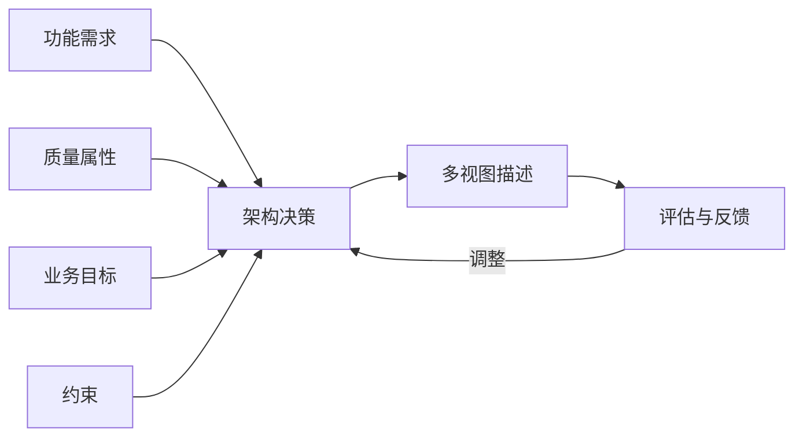
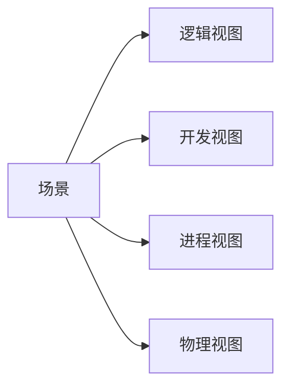
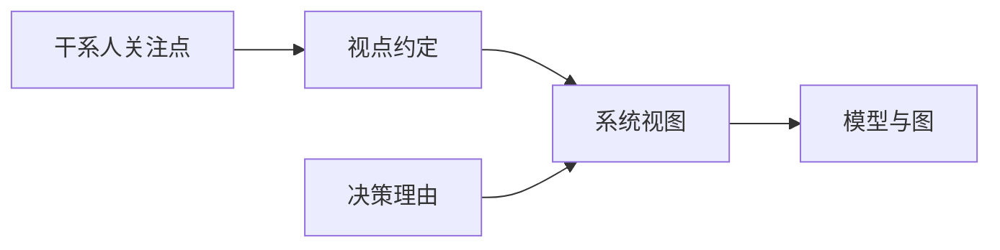

# 软件架构基础与架构描述

> 本页是 W01 的综合知识主文档：软件架构是什么、什么在驱动架构、如何用 4+1 视图和架构描述把决策讲清楚。建议按“概念解释→场景推导→动手实验→考试迁移”学习。架构风格比较见[架构风格与模式](架构风格与模式.md)；质量属性的完整评估方法见[质量属性与架构评估](质量属性与架构评估.md)；UML 图的表达边界见[UML 建模与设计模式](UML建模与设计模式.md)。

## 考纲定位

对应官方考试大纲（仓库所存 2022 年审定文本）中：

- 科目 1「6.1 软件架构概念」：定义与作用、数据设计与体系结构设计、架构生命周期，以及 Use Case 图、ADL、4+1 模型、UML、IEEE 1471—2000。
- 科目 1「4.1.4 统一过程模型（RUP）」中的“4+1”视图模型。同一概念只在本文展开。
- 科目 1「6.2」的 ABSD、视角与视图、用例和质量场景，本周只建立术语，不展开 ABSD 步骤。ABSD/DSSA 按周计划在后续周学习。

大纲条目是覆盖边界。下文图示只保留关系，不把大纲逐条画成节点。

## 先记住的结论

1. **软件架构描述的是用来推理系统的结构**，重点是构件的外部可见属性、构件之间以及构件与环境的关系，加上指导设计和演化的原则。它不负责记录每个类的私有算法。
2. **架构由驱动力决定，不由技术名词决定。** 功能需求、质量属性、业务目标和约束一起决定结构；没有优先级就没有架构决策。
3. **一张图不能代替架构。** 4+1 用逻辑、开发、进程、物理四类视图回答不同干系人的问题，再用场景把它们串起来并检验是否成立。
4. **视图不是图例。** IEEE 1471—2000 区分关注点、视点、视图和模型。视点是约定，视图是某个系统按该约定作出的描述。
5. **度量缺失就要标明缺失。** 质量属性场景必须尽量写到响应度量；题干没给数字时，应指出待确认，不能自行编造已实现的性能或可用性。

## 本周要建立的关系

大纲覆盖：6.1 的定义、驱动力和描述；4+1 作为组织这些决策的方式。

架构不是先选框架再补理由，而是驱动力收敛为决策，再用视图表达，并允许评估把决策打回去。

**怎么读：** 四个输入都可能互相冲突。例如“6 个月内上线”会限制能做的结构变化，“未认证不得借出”会限制接口位置。评估发现冲突后改的是决策，不是先改一张漂亮的部署图。

4+1 里的“+1”不是第五个独立系统，而是用场景检验另外四个视图是否讲的是同一个系统。

**怎么读：** 同一个“读者预约并借书”场景，逻辑视图看职责，开发视图看模块归属，进程视图看并发和同步点，物理视图看运行节点。四张图对不上，架构描述就还不能用。

架构描述回答的是“用什么约定、给谁看、看哪一组关注点”，而不是多画几种 UML。

**怎么读：** 先有关注点，才选择视点；视图里的方框必须能追溯到决策理由。只有图、没有理由，复审时无法判断能不能改。

## 架构概念卡片

本周综合知识交付物。盖住“一句话”列，能用自己的话讲出适用边界即算过关。

| 卡片 | 一句话 | 不适用时不要怎么说 |
|---|---|---|
| 软件架构 | 为推理系统所需要的结构：元素、关系、外部可见属性，以及设计和演化原则 | 不要把某个框架、某次部署或某张类图当成架构本身 |
| 外部可见属性 | 其他构件能观察到的接口、职责、性能与失败行为 | 不要把私有字段、内部循环写进架构描述充数 |
| 构件 | 承担职责的结构单元，粒度可以是子系统、服务或主要模块 | 不要默认构件等于一个 Java 类 |
| 连接件 | 构件之间的交互机制，如调用、消息、数据流 | 不要把连接件写成“有一条线”而不说明同步、失败和数据含义 |
| 约束 | 结构必须遵守的限制，如分层禁止反向调用、认证必须走统一身份 | 不要把约束和“我们打算试试”混为一谈 |
| 架构驱动力 | 足以改变结构的功能、质量属性、业务目标和约束 | 不要把按钮文案、局部变量命名当成驱动力 |
| 质量属性场景 | 刺激源、刺激、环境、制品、响应、响应度量 | 不要只写“要高性能” |
| 逻辑视图 | 功能职责如何划分、谁和谁协作 | 不要用它表达线程或机器 |
| 开发视图 | 代码与模块如何组织、如何分配给开发 | 不要把它理解成“已经编码完成” |
| 进程视图 | 运行时的进程、线程、同步和并发 | 不要把类继承画成进程 |
| 物理视图 | 软件元素如何映射到节点和网络 | 不要把数据库物理表设计当成物理视图 |
| 场景 | 用具体使用过程把四个视图串起来并检验 | 不要以为有用例图就自动完成了场景视图 |
| 视点 | 构造某一类视图的约定：给谁看、关心什么、用什么模型 | 不要把视点和某次画出来的图当成同一个东西 |
| 视图 | 按某个视点，对一个具体系统作出的描述 | 不要把视图等同于一种 UML 图 |
| 上下文 | 系统边界、外部角色和外部系统 | 不要把内部类画进上下文图 |
| ADL | 以构件、连接件和架构配置描述架构的语言 | 不要把 ADL 当成某一种画图工具的商品名 |

## 核心概念

### 1. 定义：考试里要能区分的几种说法

大纲要求掌握定义、发展历程和作用，并点名 IEEE 1471—2000。下面三种说法回答的问题不同，不要合成一句空话。

| 来源 | 它强调什么 | 答题时怎么用 |
|---|---|---|
| Bass 等人较早且软考材料常引用的表述 | 结构由软件元素、**外部可见属性**和元素间关系构成 | 用来排除“架构要描述全部内部算法”的选项 |
| Bass 等人后续更常见的表述 | 架构是**为了推理系统**所需要的那一组结构 | 用来解释为什么不同质量属性需要不同结构 |
| IEEE 1471—2000 | 架构是系统的基本组织，体现在构件、构件之间及与环境的关系，以及指导设计和演化的原则上 | 大纲点名该标准时，用它说明环境、原则和演化也属于架构 |

发展历程只需记住主线，不必背未经核验的年份清单：架构一开始常常只隐含在代码和模块划分里；随后人们把架构风格、多视图和架构描述语言独立出来，用来在编码前分析质量属性。Kruchten 的 4+1 视图模型发表于 1995 年 IEEE Software；大纲点名的架构描述标准是 IEEE 1471—2000。ISO/IEC/IEEE 42010 是后续常被讨论的架构描述标准，条款差异以正式标准文本为准，本文不引用未核验条款号。

架构的作用可以收成三句，对应“沟通、决策、复用”：

- 它是干系人讨论系统的共同载体，使业务、开发和运行关注同一组结构。
- 它固定早期且难以推翻的决策，例如系统边界、主要职责划分、运行时并发和部署映射。
- 它是可传递的抽象，使类似系统可以复用结构经验，而不是复用全部业务代码。

### 2. 数据设计与体系结构设计

大纲把架构设计分成数据设计和体系结构设计。二者都影响系统，但不能互相替代。

- **数据设计**把信息需求转换成实现所需的数据结构，关注实体、关系和持久化结构。
- **体系结构设计**确定主要结构元素、外部可见属性和协作方式，以及必须遵守的结构约束。
- 表结构合理，只说明数据设计有进展；进程怎么划分、失败时谁重试、软件落在哪台机器，仍要由体系结构设计回答。

### 3. 架构驱动力

驱动力是“会迫使结构发生变化的需求”。不是所有需求都有架构意义。判断标准：如果换一种结构，这项需求就无法满足或代价明显不同，它就是架构驱动力。

| 类型 | 问什么 | 例子 | 和相邻概念的差别 |
|---|---|---|---|
| 功能需求 | 系统必须完成什么职责 | 读者可以预约可借复本 | 只有跨构件的功能才通常影响架构 |
| 质量属性 | 以可观察的方式做得有多好 | 高峰期查询的响应时间目标 | “快、安全、好改”本身不是场景 |
| 业务目标 | 为什么现在做、成功看什么 | 在既定窗口内把柜面服务扩展到线上 | 业务目标常决定取舍，但不直接等于接口 |
| 约束 | 几乎不能自由选择的限制 | 必须使用市统一身份，团队只有 6 人 | 约束优先于偏好；现状技术不一定就是永久约束 |

使用现状时要分开三句话：题干写明的事实、为了讨论暂时接受的假设、还要向干系人或监控去取的证据。例如“当前是单体 Java Web + MySQL”是现状事实；“必须永远使用 MySQL”若题干没说，就只是假设。

业务目标之间也会冲突。上线窗口偏短时，应优先保留能复用的规则模块，而不是为了结构美观拆散团队还不会运维的单元。这是权衡，不是拖延重构。

### 4. 质量属性场景只写到能检验

六要素的定义和后续评估术语以[质量属性与架构评估](质量属性与架构评估.md)为准。本周只要求会从驱动力写出场景，并承认缺失的度量。

| 要素 | 写什么 |
|---|---|
| 刺激源 | 谁或什么触发 |
| 刺激 | 发生的事件 |
| 环境 | 正常、高峰、故障或已上线变更 |
| 制品 | 被作用的功能、构件或接口 |
| 响应 | 系统应表现出的行为 |
| 响应度量 | 时间、比例、范围或失败标准 |

题干没有度量时，正确做法是把该格标成“待确认”，并说明缺了它就无法判断方案是否达标。不要补一个看起来专业的数字。

### 5. 架构在生命周期中的位置

大纲给出的生命周期是：需求、设计、实现、构件组装、部署、后开发。架构不是设计阶段的一幅附图。

| 阶段 | 架构工作 | 本周要能区分的产出 |
|---|---|---|
| 需求 | 识别功能、质量属性、约束和架构上重要的场景 | 驱动力清单、质量属性场景 |
| 设计 | 划分结构元素、确定关系和约束，并文档化 | 上下文、4+1 视图、决策理由 |
| 实现 | 按已定的外部可见属性实现构件 | 不在实现期偷偷改接口语义 |
| 构件组装 | 把构件按配置连接起来 | 连接件的失败行为要能集成验证 |
| 部署 | 把软件映射到运行环境 | 物理视图与实际节点一致 |
| 后开发 | 在新的驱动力下演化结构 | 变化要说明影响哪些视图 |

ABSD 把需求、设计、文档化、复审、实现和演化串成方法。本周知道“文档化和复审是架构工作的一部分”即可，步骤细节不在本周验收范围。

## 4+1 视图

4+1 是 Kruchten 提出的视图模型。RUP 和不少 UML 材料把开发视图称为实现视图，指的是同一类关注点：软件模块如何组织。不要把它理解成“代码写完以后才有的视图”。

| 视图 | 主要干系人 | 要回答的问题 | 常见模型 | 不负责回答 |
|---|---|---|---|---|
| 逻辑 | 最终用户、分析人员 | 职责如何划分，功能由谁协作完成 | 类图、包的职责协作；不必穷举全部类 | 线程和机器 |
| 开发 | 开发人员、开发负责人 | 模块、分层和代码归属如何安排 | 包图、模块图、分层 | 运行时是否并发 |
| 进程 | 集成与运行关注性能、可用性的人 | 进程、线程、同步、并发和故障时的运行单元 | 进程协作、活动或序列中的运行单元 | 类的继承关系 |
| 物理 | 系统工程、运维 | 软件映射到哪些节点，网络依赖是什么 | 部署图 | 业务规则细节 |
| 场景 | 各类干系人共同使用 | 上述视图能否一起完成关键使用过程 | 用例图、关键序列；用例图不是全部 | 不能替代另外四个视图 |

画图顺序建议固定为：

1. **先画上下文。** 系统是一个黑盒，只保留外部角色和外部系统。上下文不是 4+1 的第五视图，但它定义“环境”，否则物理视图和接口会失真。
2. **再写 2～3 个关键场景。** 用场景选择要画进逻辑视图的职责，避免把所有名词都画上去。
3. **逻辑视图只保留架构上重要的职责。** 能独立变化、有独立质量属性或有外部接口的，才作为结构元素。
4. **开发视图说明这些职责落在哪些可开发模块。** 特别标出既有模块和新建适配模块。
5. **进程视图只增加运行时信息。** 同步调用、异步、重试、超时和共享状态；题干没规定的通信方式保持“待确认”。
6. **物理视图只增加节点映射。** 没有证据时，不要把“逻辑上有两个构件”画成“已经分成两台机器”。

一个场景串四视图的检查句式：

> 在场景 S 中，逻辑上由 A 调用 B；A 和 B 在开发视图中属于模块 M1、M2；运行时它们在同一请求线程中同步调用，失败由 A 向用户返回拒绝；两者当前部署在应用节点上，并依赖外部系统 E。

四句话里任何一句对不上，就还不能声称 4+1 已经画完。

## 架构描述

### 视点、视图和模型

IEEE 1471—2000 被大纲点名。掌握下面的对应关系即可，不要背未核验的条款号。

| 概念 | 含义 | 对 4+1 的例子 |
|---|---|---|
| 干系人 | 对系统有关注点的人、团队或组织 | 读者、馆员、开发、运维、身份管理部门 |
| 关注点 | 与开发、运行或其他关键利益有关的问题 | 能否借到、谁来改规则、高峰是否并发、落在哪台机器 |
| 视点 | 构造一类视图的约定，包括受众、关注点和允许的模型 | “进程视点规定用运行单元而不是类来描述并发” |
| 视图 | 某个系统依据视点作出的具体描述 | “本借阅系统的进程视图” |
| 模型 | 视图中的具体表示 | 一张序列图、一张部署图 |
| 决策理由 | 为什么这样划分，放弃了什么 | “短信是否异步尚未规定，故不画成消息队列” |

常见错误是把“视点”答成“视图”，或把“一张部署图”答成“完整架构描述”。部署图最多是物理视图中的一个模型。

### ADL 与 UML 不要混用

ADL（Architecture Description Language，体系结构描述语言）用较形式化的方式描述架构。考试常把 **构件、连接件、架构配置** 作为 ADL 的基本组成：配置表示构件实例和连接件实例如何连接成拓扑。

这和另一组口诀 **构件、连接件、约束** 不是同义词。约束说明允许怎样连接、禁止怎样连接；配置是一次具体连接结果。题干写 ADL 时优先答配置；题干问架构模型的组成概念时再看它是否在问约束。

UML 可以充当视图中的模型，但 UML 不是 ADL 的同义词。用例图服务场景，类图常服务逻辑视图，部署图常服务物理视图。图的种类不等于视图：一个视图可以包含多张图，一张图如果不能说明受众和关注点，也还不是合格视图。

### 什么算一份够用的架构描述

本周不要求写完整架构规格说明书。最低够用的描述包含：

- 干系人和他们的关注点。
- 系统上下文。
- 与关注点对应的视图，而不是同一种图的重复。
- 关键场景如何在视图之间追踪。
- 尚未决定的问题和缺少的证据。
- 被放弃的表达方式及原因。至少说明为什么不能只有部署图。

## 从一段需求到一组架构视图：贯穿式推导

前面的概念回答“是什么”。这一节演示“遇到题目时怎么做”。请先只读材料，不急着画图。

### 起点：把原始描述拆成证据

仍以图书馆线上借阅为例。把材料拆成四栏，而不是直接把名词搬进架构图：

| 原始材料 | 分类 | 能推出什么 | 不能推出什么 |
|---|---|---|---|
| 读者查询并预约可借复本 | 功能需求 | 系统需要查询与预约职责 | 不能推出一定要拆成两个微服务 |
| 周末 9:00–11:00，95% 查询在 2 秒内返回 | 质量属性目标 | 查询路径需要可度量的性能目标 | 不能证明当前已达标，也不能直接证明需要缓存 |
| 未认证不得创建借阅 | 安全约束/质量要求 | 创建动作前必须完成身份校验 | 不能推出具体认证协议、令牌格式 |
| 必须调用市统一身份 | 外部约束 | 系统边界外存在身份服务依赖 | 不能自建账号替代 |
| 规则变更不应牵动门禁和短信适配 | 可修改性目标 | 规则职责与外部适配应有清晰边界 | 不能推出一定采用插件框架 |
| 6 人、6 个月、复用既有规则模块 | 业务与实施约束 | 本期应控制重写范围，保留既有规则边界 | 不能把当前单体形态永久冻结 |

**推导动作：** 将每条材料标为“事实、目标、约束、未知”。架构师的第一项工作不是补技术，而是防止证据被误读。

### 第一步：从“快一点”写成质量属性场景

“查询要快”不是可验收需求。将其拆成六要素：

| 要素 | 本案例填写 |
|---|---|
| 刺激源 | 读者 |
| 刺激 | 发起预约查询 |
| 环境 | 周末 9:00–11:00，正常网络 |
| 制品 | 预约查询功能 |
| 响应 | 返回复本是否可预约的结果 |
| 响应度量 | 95% 请求在 2 秒内返回（馆方目标，尚非测量结果） |

接着追问两个问题：当前基线是多少？统计口径是端到端还是服务端？材料没有答案，就在需求澄清清单中保留，不能自行补值。

安全场景也要写成行为，而不是口号：“未通过市统一身份认证的访问者尝试创建借阅，系统拒绝创建”。若题目没有审计保留期，就不能写“日志保存 180 天”。

### 第二步：从边界开始画上下文

先把线上借阅系统画成黑盒。读者、馆员是外部角色；市统一身份、短信网关、RFID 门禁是外部系统。规则模块、数据库和 Java 类暂时都在黑盒内。

~~~mermaid
flowchart LR
  Reader["读者"] --> System["线上借阅系统"]
  Staff["馆员"] --> System
  System --> IdP["市统一身份"]
  System --> SMS["短信网关"]
  System --> RFID["RFID门禁"]
~~~

**为什么不把规则模块画在这里？** 因为上下文图回答“系统与环境如何交互”，而不是“系统内部如何分工”。把规则模块画出来，就已经打开黑盒，进入内部结构描述。

### 第三步：从职责推导逻辑视图

从动词和业务责任中抽取架构上重要的职责：

- 预约查询：查询复本状态并给出可预约结果。
- 借阅办理：编排预约或借出流程，保证未认证时不创建借阅。
- 借阅规则：复用既有模块，负责资格与借期判断。
- 身份认证适配：调用市统一身份，不承载借阅规则。
- 通知适配：把通知请求交给短信网关。
- 门禁适配：与 RFID 门禁交互。
- 借阅记录：保存预约和借出事实。

判断一个名词是否值得成为架构元素，可以问：它是否有独立职责、独立变化原因、外部接口或重要质量属性？若只是一个页面字段或私有方法，通常不必提升到架构层。

### 第四步：把逻辑职责映射到开发模块

逻辑视图说“做什么”，开发视图说“代码如何组织”。一种满足现有证据的模块划分是：

| 开发模块 | 承担的逻辑职责 | 边界理由 |
|---|---|---|
| 接入与界面 | 读者入口、馆员例外入口 | 入口变化不应侵入规则 |
| 应用服务 | 查询、预约、借阅流程编排 | 协调规则、认证和外部适配 |
| 既有规则模块 | 借阅规则 | 明确复用，避免本期重写 |
| 外部适配模块 | 身份、短信、RFID 适配 | 外部协议变化不应改写业务规则 |
| 持久化模块 | 借阅记录读写 | 集中数据访问边界 |

这是一种教学推导，不代表题干已经规定了具体包名或代码目录。它也不要求每个模块单独部署。

### 第五步：进程视图只增加运行时事实

将“结构职责”转换成“运行时如何协作”：

1. 读者发起借阅请求。
2. 应用服务取得市统一身份认证结果。
3. 认证失败则拒绝创建；认证通过后调用既有规则模块判断资格。
4. 通过规则后，系统执行借阅记录与门禁交互。

此处必须留一个设计问题：门禁调用失败时，借阅记录如何保持一致？题干没有给出事务边界、补偿策略或失败重试规则，因此标为“待设计”。短信是否异步也没有依据，不要在进程视图里擅自画队列消费者。

### 第六步：物理视图只表达部署映射

当前材料说明应用使用 MySQL 单实例，但没有说明应用和数据库是否同机。可以画“应用运行节点依赖 MySQL 单实例”的逻辑部署关系，并在图注中注明“节点是否物理分离待确认”。不能把两个方框自动解释成两台机器，更不能据此声称已经实现水平扩展。

### 第七步：用同一场景做四视图追踪

场景：周末读者查询可借复本、创建预约，到馆后自助借出。

| 视图 | 追踪句 | 自检问题 |
|---|---|---|
| 逻辑 | 预约查询给出结果；借阅办理调用认证、规则和门禁职责 | 职责是否完整，是否把线程混进来？ |
| 开发 | 查询和办理由应用服务组织；规则留在既有模块；外部系统由适配模块隔离 | 模块边界能否解释规则变更不牵动适配？ |
| 进程 | 创建借阅前取得认证结果，认证失败即停止；门禁失败策略待设计 | 是否把未知通信方式写成已定方案？ |
| 物理 | 应用运行单元依赖 MySQL 单实例，并访问外部系统 | 是否把逻辑依赖误写成分机部署或集群？ |

若四行出现了不同的业务流程，说明场景没有真正贯穿视图。若一个模块在开发视图不存在，却突然出现在进程视图中，也需要解释它从哪里来。

### 一个反例：为什么“先选技术”会误导

错误推导：“有高峰查询，所以采用 Redis；要对接短信，所以引入消息队列；系统要扩展，所以拆成微服务。”

问题在于这三个结论都缺少证据：
- 高峰目标没有当前基线、并发量和瓶颈分析，缓存只是候选方案。
- 短信同步/异步语义没有确定，队列不是必然选择。
- 可扩展性没有明确场景，团队只有 6 人且 6 个月上线，拆分还会增加运维和集成成本。

正确做法是先把待确认问题列出来，再根据测量结果和质量属性优先级比较方案。

### 学完后的闭卷复述

不看本文，用 3 分钟回答：
1. 为什么架构不是部署图？
2. 为什么上下文图先于内部视图？
3. 逻辑视图和开发视图分别回答什么？
4. 哪些运行时信息应进入进程视图？
5. 为什么物理视图不能把“应用依赖数据库”直接说成“已分机”？
6. 场景如何检查四个视图描述的是同一个系统？

## 适用场景、局限与权衡

4+1 适合干系人关注点明显不同的业务系统，尤其是既有功能划分，又有并发、外部系统和部署约束的系统。

它的局限：

- 视图越多，越容易各画各的。没有场景追踪时，四张图会描述四个不同系统。
- 对很小的单机脚本，完整 4+1 的成本可能高于收益。仍建议至少写出上下文和一项最关键的质量属性，避免无边界。
- 4+1 不代替架构风格选择，也不代替 ATAM 那种系统化评估。它回答“结构如何被不同人看见”。
- 逻辑视图画得过细会退化成详细设计。外部看不到的私有结构应删去。

权衡规则：

- 时间紧时先保证上下文、一个端到端场景和逻辑/物理两张图；进程视图不能空着的情况是：题干已经出现并发、超时、异步或可用性。
- 开发视图不能空着的情况是：存在既有代码、多人分工或明确的复用边界。
- 不为了“视图齐全”发明题干没有的中间件。

## 架构师视角

以约 4 年 Java 开发经验为例，本周的能力转换不是马上做完全局架构，而是把已经接触过的系统讲成可审查的结构。

1. **从接口而不是从类开始。** 先列出外部系统和跨模块调用，再决定哪些 Java 包值得出现在开发视图。
2. **把质量目标写成场景。** “优化一下查询”不能指导缓存、索引或扩容；没有度量就先去补度量定义。
3. **现状部署不是物理视图的结论。** 应用和数据库放在两台机器上，只说明部署现状。它既不等于应用可以水平扩展，也不自动说明逻辑职责已经分清。
4. **连接件要写失败。** 调用统一身份失败时是拒绝业务、允许降级，还是无限重试，这是架构内容；重试次数若未知就标待确认。
5. **理由和视图放在一起。** 论文和案例都不接受只有组件名单。每个结构元素至少对应一个驱动力。

## 易混点

| 易混 | 区分 |
|---|---|
| 架构与详细设计 | 架构保留外部可见属性和跨元素关系；方法内部算法属于详细设计 |
| 架构与框架 | 框架是可选实现手段；架构是结构决策。先有驱动力，再判断框架是否合适 |
| 架构风格与 4+1 | 风格约束元素类型和允许的关系；4+1 是描述这些决策的视图。选风格不是本周主线 |
| 逻辑视图与开发视图 | 逻辑看职责协作；开发看模块、分层和代码归属。一个逻辑职责可以拆到多个模块，一个模块也可以实现多个紧密职责 |
| 开发视图与“实现已完成” | 开发视图在设计期就存在，描述如何组织软件 |
| 进程视图与物理视图 | 进程是运行单元；物理是这些单元落在哪些节点。同一进程视图可以有不同部署 |
| 物理视图与数据库物理设计 | 前者是节点和网络；后者是存储结构、索引和文件 |
| 上下文与逻辑视图 | 上下文把本系统当黑盒；逻辑视图打开黑盒 |
| 视点与视图 | 视点是约定，视图是该约定在具体系统上的结果 |
| 视图与 UML 图 | 图是模型；视图还要说明干系人、关注点和决策 |
| 构件、连接件、约束与 ADL 配置 | 约束是规则，配置是具体拓扑。看题干用词 |
| 应用与数据库分机部署与水平扩展 | 分机只是部署分离。水平扩展还要多实例、负载分配，以及会话、状态和幂等策略 |
| 质量属性与质量场景 | 属性是类别，场景才可检验 |
| 业务目标与约束 | 目标表达愿望和成功标准；约束是选择空间的边界 |

-

## 场景化概念讲解：把定义放回工程问题

本节补足“概念为什么存在、在项目中怎么识别、用错会造成什么后果”。示例仍使用图书馆线上借阅原创教学案例。案例中的人员、周期和指标均为题目设定，不代表真实项目。

### 1. 软件架构、构件、连接件与架构配置

先看一个常见问题：读者提交借阅请求时，系统要检查身份、判断借阅规则、保存记录，并与 RFID 门禁交互。如果把所有代码都看成一个整体，团队很难回答“规则变化会影响哪些模块”“门禁失败时谁负责处理”“身份认证是否能被绕过”。

**软件架构**就是把这类对系统整体有重要影响的结构、关系、外部可见属性和设计原则显式化，供干系人推理、沟通和评估。

| 概念 | 在借阅场景中的例子 | 关键判断 |
|---|---|---|
| 构件（component） | 借阅办理、既有借阅规则模块、身份适配、门禁适配 | 是否承担相对完整的职责，是否有可识别的接口或变化边界 |
| 连接件（connector） | 应用服务调用规则模块、通过适配接口调用市统一身份、访问 MySQL | 不只画连线，还要说明调用/消息/数据访问语义及失败行为 |
| 架构配置（configuration） | 应用服务连接规则模块、身份适配、门禁适配和持久化模块的拓扑 | 哪些构件存在、如何连接、连接关系是否符合约束 |
| 约束（constraint） | 创建借阅前必须通过市统一身份；规则变更不应要求改写门禁适配 | 规定允许或禁止的结构/行为，不等于具体拓扑 |

**不要把构件等同于类。** 一个业务服务类可能只是一个构件的实现片段；多个类也可能共同实现一个架构构件。反过来，一个模块若只是十几个没有独立职责的工具类集合，也不必因为有目录就提升为架构构件。

连接件也不只是 UML 图上的箭头。同步调用要考虑超时、异常传播和重试；消息交互要考虑投递语义、顺序、重复消费和最终一致性；数据库访问要考虑事务边界和连接资源。题干没有给出这些语义时，应写“待设计”，而不是画一条无说明的线。

**反例：** 把“借阅规则模块”和“短信网关”画成两个方框，再用箭头连接，却没有说明谁发起调用、规则变化是否需要修改短信代码、短信失败是否影响借阅提交。这张图只能说明“有关系”，不能支撑架构评审。

**正确做法：** 为每个构件写职责和接口，为每个连接件写交互语义，为配置写出必须满足的约束；随后用关键场景检查它们是否能协作。

### 2. 架构驱动力：从一句业务描述提取结构影响

业务方通常不会说“我有一个可修改性驱动力”，而会说：

> 周末读者集中查预约，不能等太久；以后借阅规则可能调整，但不要每次都让门禁和短信对接一起改。

架构师要把自然语言转成可讨论的驱动力：

1. “集中查预约、不能等太久”提示性能关注点；继续追问高峰时段、统计口径、目标值和当前基线。
2. “规则可能调整”提示可修改性；继续追问变化频率、修改范围和允许停机窗口。
3. “门禁和短信一起改”是希望避免的变更传播；由此检查规则职责与外部适配是否有清晰边界。
4. 再把团队、工期、既有系统和外部标准等限制列为约束。

注意区分四种陈述：

- **功能需求：** 必须做什么，例如查询可预约复本。
- **质量属性：** 做得多好，例如 95% 查询在 2 秒内返回。
- **业务目标：** 为什么要做，例如在限定周期内提供线上服务。
- **约束：** 哪些选择不能随意改变，例如必须使用市统一身份。

“使用 Redis”“拆成微服务”属于候选设计，不是原始驱动力。只有在基线、瓶颈、团队运维能力和质量目标得到证据支持后，才比较这些方案。

### 3. 质量属性场景：把形容词改成可观察行为

“系统要安全”无法直接验收。把它改成：

- 刺激源：未通过市统一身份认证的访问者；
- 刺激：尝试创建借阅；
- 环境：系统正常运行；
- 制品：借阅创建入口；
- 响应：拒绝创建，不产生借阅记录；
- 响应度量：题干明确的最低要求是“不得创建”；审计记录、告警时限和保留期需要另行确认。

再看“系统要快”：若题目给出周末 9:00–11:00、95% 请求 2 秒内返回，这个数值是业务目标，不是现状测量。还要确认从浏览器发起到收到结果的端到端口径，还是仅统计服务端耗时。口径不同，验收结果可能不同。

质量属性场景的价值在于把“好不好”变成可以讨论、测量和验证的行为。六要素模板和更多属性示例见[质量属性与架构评估](质量属性与架构评估.md)。

### 4. 质量属性之间会冲突：不能把每个目标都单独最大化

同一项决策可能改善一个属性、损害另一个属性：

| 决策情境 | 可能收益 | 可能代价 | 评审时要问 |
|---|---|---|---|
| 增加身份校验步骤 | 强化安全边界 | 增加外部依赖和响应时延 | 身份服务不可用时是否允许业务继续？题干若要求未认证不得创建，就不能绕过认证 |
| 引入异步通知 | 降低主请求等待时间 | 增加最终一致性、消息重复和排障复杂度 | 通知是否允许延迟？失败后谁补偿？ |
| 拆分独立部署服务 | 可独立发布和扩缩 | 网络故障、数据一致性、运维与测试成本增加 | 是否有独立扩缩、团队自治或发布节奏的证据？ |
| 强化模块隔离 | 降低变更传播 | 接口和抽象层增加，短期开发成本上升 | 变化是否频繁且跨边界？ |

权衡不是“安全和性能二选一”，而是先明确不可妥协的约束，再为可权衡的属性设定优先级、场景和验证方式。

### 5. 4+1 视图：同一个职责在不同视图中长什么样

以“身份认证”职责为例：

| 视图 | 描述身份认证时关注什么 | 不应混入什么 |
|---|---|---|
| 逻辑视图 | 身份认证是一个职责，借阅办理必须依赖认证结果 | Java 包名、线程池大小 |
| 开发视图 | 身份适配代码归属哪个模块，依赖方向如何约束 | 服务器 IP、运行时线程 |
| 进程视图 | 借阅请求如何调用认证，认证失败如何终止创建，超时如何处理 | 代码目录结构 |
| 物理视图 | 应用运行单元如何通过网络访问市统一身份系统 | 类继承和业务方法细节 |
| 场景（+1） | 未认证用户尝试创建借阅，四种描述是否共同支持“拒绝创建” | 把场景当成第五种部署结构 |

**视图之间不是四套互不相关的架构。** 逻辑职责要映射到开发模块；开发模块中的运行单元要在进程描述中出现；运行单元再映射到物理节点。某个职责若在逻辑视图存在，却在开发视图找不到实现归属，需要解释；进程视图突然出现一个队列消费者，而开发视图没有对应模块，也需要解释。

经典 4+1 的四类结构视图是逻辑、开发/实现、进程、物理视图；“+1”是用于驱动和检验这些视图的场景。上下文图用于界定系统环境，通常作为架构描述的入口，但不应误称为 4+1 的第五个结构视图。

### 6. 视点、视图、模型：从干系人的问题倒推文档

假设开发负责人问：“哪些模块可以并行开发？哪些模块不能反向依赖？”这属于开发关注点。

- **干系人：** 开发负责人。
- **关注点：** 模块边界、依赖方向、代码归属和团队协作。
- **视点：** 约定用模块图/包图表达模块、依赖和分层规则，并说明受众和建模约定。
- **视图：** 针对当前借阅系统，按该视点形成的实际模块结构描述。
- **模型：** 该视图中使用的包图、组件图、依赖表等具体表达。

换一个干系人——运维人员关心运行节点和网络依赖——就需要另一种视点和视图。不是把同一张图改个标题就能满足所有人。

一个可审查的架构描述至少要让读者知道：这张视图给谁看、回答什么问题、采用什么模型、有哪些关键决策和未决事项。

### 7. ADL 与 UML：表达目标不同，不是互斥工具

UML 是通用建模语言，可用组件图、部署图、类图、序列图等表达架构的不同侧面。ADL 更专注于架构层次的构件、连接件、配置及相关约束，强调结构关系和可分析的架构语义。

例如，组件图可以展示“借阅办理依赖规则模块和身份适配”；部署图可以展示“应用运行单元访问数据库”；序列图可以展示“先认证、后创建借阅”的交互顺序。若需要形式化描述构件类型、连接件约束、配置合法性或自动分析，ADL 的表达目标更直接。

不要答成“UML 不能表达架构”或“所有 UML 图都是 ADL”。二者可以互补，关键是模型是否回答了当前干系人的问题。更多图种与 ADL 对比见[UML 建模与设计模式](UML建模与设计模式.md)。

### 8. 小练习：先判断问题，再选概念

1. 题干说“每次修改借阅规则都要同步改短信代码”。优先识别什么问题？  
   参考：可修改性/变更传播问题；先检查职责和接口边界，不直接认定要上插件或微服务。
2. 图中有“应用服务→身份适配”的箭头，但没有说明同步还是异步、失败如何处理。缺少什么？  
   参考：连接件语义。连线不等于交互契约。
3. 开发负责人问“模块代码归属和依赖方向”，应优先查看哪种视图？  
   参考：开发视图；可用包图、组件图或依赖表建模。
4. 运维问“软件落在哪些节点”，应查看哪种视图？  
   参考：物理视图；部署图是常用模型之一。
5. UML 部署图是否等于完整架构描述？  
   参考：不是。它主要表达部署映射，不能替代逻辑职责、模块组织、运行时行为和决策理由。

### 本节闭卷验收

不看文档，任选一个实际参与过的系统，完成以下五句：

- 一个会影响架构的需求是……，因为……
- 一个架构构件是……，它不等同于……类，因为……
- 两个构件之间的连接件是……，其调用/失败语义是……
- 某个干系人的关注点是……，适合用……视图表达。
- 一个尚未验证的质量属性目标是……，我需要通过……获得证据。

若只能写出产品名或技术栈，说明还没有从“技术使用”提升到“架构论证”。

## 考试考法与答题要点

综合知识选择题常见问法：

- 哪句定义正确，干扰项通常把内部实现细节、某种具体产品或“只有部署”说成架构。
- 4+1 中“+1”是什么，或某个视图面向谁、关心什么。
- 给一个制品，判断它属于哪种视图。包图偏开发，部署图偏物理，线程与同步偏进程。
- IEEE 1471 的视点与视图。
- ADL 的组成是构件、连接件和配置。
- 判断一项陈述是功能、质量属性、业务目标还是约束。

答题时先看主语。问“面向开发人员的软件组织”选开发视图；问“运行时并发”选进程视图。不要看到 UML 就选逻辑视图。

案例与论文的问法不在本文展开答案。本周配套：

- [架构驱动力与质量属性场景识别（教学案例）](../../03_案例分析/架构基础与视图/架构驱动力与质量属性场景识别-教学案例.md)
- [从需求推导架构视图（教学案例）](../../03_案例分析/架构基础与视图/从需求推导架构视图-教学案例.md)
- [真实项目候选与 4+1 视图草图](../../04_论文/项目背景素材/真实项目候选与4+1视图草图.md)

## 自测题

以下 10 题均为**原创教学题，不是历年真题**。周计划中的更大题量，其余应来自可核验的教材习题或正式真题，并在错题中记录真实来源。不要把这些题改标为真题。

每题先独立作答，再看解析。错题按当天、次日、第 3 天、第 7 天回看，记录模板见[错题与薄弱点](../../05_错题与薄弱点/README.md)。

### 题 1

关于软件架构，下列说法正确的是（ ）。

A. 架构应完整描述每个类的私有算法，否则无法指导实现  
B. 架构关注结构元素、外部可见属性、关系，以及指导和演化设计的原则  
C. 只要选定 Spring Boot，架构设计就已完成  
D. 架构就是系统当前的部署图

**答案：B。**  
A 把详细设计塞进架构。C 把框架当成架构，框架没有说明质量属性和约束如何被满足。D 只覆盖物理视图的一种模型。B 同时容纳 Bass 表述中的外部可见属性和 IEEE 1471 对原则、环境的强调。

### 题 2

某图书馆系统“必须调用市统一身份认证，不允许自建账号”。该陈述主要属于（ ）。

A. 可有可无的界面偏好  
B. 架构约束  
C. 进程视图中的线程模型  
D. 数据库物理设计

**答案：B。**  
它限制了认证职责的位置和外部依赖，改变结构，所以是约束，不是文案偏好。它没有规定线程，也没有规定索引。

### 题 3

4+1 视图模型中的“+1”主要是指（ ）。

A. 再增加一个数据库视图  
B. 用场景把四个视图联系起来并加以检验  
C. 必须再画一张 ER 图  
D. 第五台服务器

**答案：B。**  
场景不是额外的一台机器或一种数据库模型。用例图可以用于表达场景，但“+1”不是“必须再交一张用例图”这么机械。

### 题 4

开发人员需要确认既有借阅规则模块、新建的身份适配模块分别放在哪个代码边界。应优先看（ ）。

A. 逻辑视图  
B. 开发视图  
C. 物理视图  
D. 数据设计中的索引

**答案：B。**  
代码归属、模块和分层是开发视图。逻辑视图只说明规则与认证的职责关系，不说明工程目录如何划分。

### 题 5

“预约请求进入后，规则判断与写借阅记录在同一请求线程内同步完成；调用门禁超时则向读者返回失败。”这段描述主要属于（ ）。

A. 逻辑视图  
B. 进程视图  
C. 开发视图  
D. 数据设计

**答案：B。**  
线程、同步和超时是运行时问题。逻辑视图会说“规则判断负责决定能否借”，但不会把线程模型当作自己的主题。

### 题 6

下列哪项最适合出现在系统上下文中？

A. `LoanService` 的私有方法 `calcFine()`  
B. 短信网关这一外部系统  
C. 某个循环的时间复杂度  
D. 应用服务器的 JVM 参数

**答案：B。**  
上下文只保留系统边界之外的参与者和系统。A、C 是内部或详细设计；D 是运行配置，至多出现在物理视图的节点说明里，且只有当它具有架构意义时才保留。

### 题 7

按 IEEE 1471—2000 的概念，下列对应正确的是（ ）。

A. 视点是某个系统已经画好的部署图  
B. 视图是构造视图的通用约定  
C. 视点规定受众、关注点和模型种类，视图是该约定对具体系统的描述  
D. 模型就是完整的架构描述

**答案：C。**  
A、B 把视点和视图说反了。D 夸大了模型：架构描述还包含干系人、关注点、视图和理由。

### 题 8

题干问“ADL 的基本组成”。较贴切的答案是（ ）。

A. 类、属性、方法  
B. 构件、连接件、架构配置  
C. 刺激源、刺激、响应度量  
D. 主程序、子程序、全局数据

**答案：B。**  
A 是面向对象实现单元。C 是质量属性场景要素。D 是传统结构化程序形态，不能概括 ADL。若题目问的是“约束”，要看它是否在问规则而不是拓扑；本题明确问 ADL 的基本组成，答配置。

### 题 9

质量属性场景已经写了“高峰期读者查询预约”。还缺哪一项，场景就还不能用来检验架构？

A. 使用了哪一种 UML 工具  
B. 可检查的响应度量  
C. 开发者的姓名  
D. 服务器品牌

**答案：B。**  
没有响应度量就无法判断“返回结果”是否合格。工具、姓名和品牌不是场景六要素。若业务尚未提供度量，应显式标为待确认，而不是编造秒数。

### 题 10

现状是“Java Web 应用与 MySQL 部署在不同主机”。可以确定的结论是（ ）。

A. 已经完成应用水平扩展  
B. 逻辑职责一定已经按领域拆清  
C. 至少存在应用与数据库的部署分离  
D. 读写分离已经解决写入瓶颈

**答案：C。**  
分主机只证明部署分离。水平扩展还需要多个应用实例和负载分配，并处理状态。逻辑职责是否清晰，部署图没有证据。读写分离根本没有出现在题干中，也不能被说成已经解决写入瓶颈。

## 术语对照

供周五术语复习。目标是看见英文能对上视图和描述概念，不是翻译整篇论文。

| English | 中文 | 不要理解成 |
|---|---|---|
| software architecture | 软件架构 | framework 框架本身 |
| architecturally significant | 对架构有意义的 | 所有需求都同等重要 |
| stakeholder | 干系人 | 只有甲方领导 |
| concern | 关注点 | 缺陷或投诉 |
| viewpoint | 视点 | 已经画好的那张图 |
| view | 视图 | 某一种 UML 图的别名 |
| logical view | 逻辑视图 | 数据库逻辑模型 |
| development / implementation view | 开发视图 / 实现视图 | 项目已经开发结束 |
| process view | 进程视图 | 业务流程流程图 |
| physical / deployment view | 物理视图 / 部署视图 | 数据库物理设计 |
| scenario | 场景 | 随便举的一个例子 |
| component | 构件 | 必然是一个类 |
| connector | 连接件 | 图上的一条无语义连线 |
| constraint | 约束 | 配置拓扑 |
| configuration | 配置 | 约束规则 |
| quality attribute | 质量属性 | 功能清单 |
| context | 上下文 / 系统边界 | 内部组件图 |

## 参考来源

- 仓库所存《系统架构设计师考试大纲》（2022 年审定通过）科目 1 的 4.1.4 与 6.1。页内知识点与大纲条目对应；教材页码未核验，不填写。
- IEEE 1471—2000 的干系人、关注点、视点、视图和架构定义，按该标准被大纲点名后的公开概念使用。条款编号未逐条核验。
- Kruchten 4+1：P. Kruchten, “The 4+1 View Model of Architecture,” IEEE Software, 1995。视图中文译名在 RUP 材料中可能把 Development 称为实现视图。
- Bass、Clements、Kazman 关于“外部可见属性”和“用于推理的结构”的两种常见表述。未指定中文教材版次和页码。
- ADL 的构件、连接件、配置，以及构件、连接件、约束这一组易混概念，按软考架构描述的常规考法整理，不是某一份真题的引用。
- 质量属性场景六要素沿用本仓库[质量属性与架构评估](质量属性与架构评估.md)已有模板，评估方法细节不在本文。

未核验项：官方教材对应章节页码、ISO/IEC/IEEE 42010 与 IEEE 1471—2000 的条款差异、具体考试批次的题型分数。需要引用这些内容时先查正式文本。

## 更新记录

- 2026-11-23：新建。作为 W01 主文档，写入定义、驱动力、4+1、IEEE 1471 架构描述、ADL 易混点和 10 道原创教学题。不编造真题、指标和教材页码。
- 2026-11-23：补充场景化概念讲解，覆盖构件/连接件/配置、驱动力识别、质量属性冲突、4+1 跨视图映射、视点/视图/模型及 ADL/UML，并增加闭卷迁移练习。

