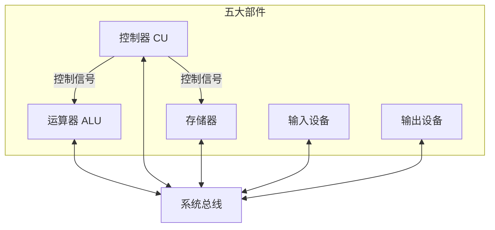
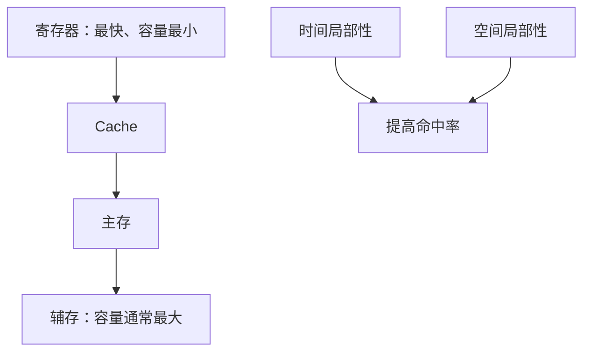

# 计算机组成原理

## 考纲定位

对应官方考试大纲「计算机硬软件与网络的基础知识」中的计算机硬件与系统部分。系统架构设计师需要掌握计算机系统组成、指令与 CPU、存储层次、性能评价等基础，并能从硬件约束出发思考架构决策（容量、并发、延迟、吞吐）。

具体范围以现行官方考试大纲为准；官方大纲版本、教材章节页码需以正式资料核验，未核验前不猜测填写。

## 本主题知识地图

W01 先建立框架，不要求一周掌握全部细节。建议按以下结构递进学习：

1. **计算机系统组成**：冯·诺依曼结构、五大部件、总线；可对比哈佛结构。
2. **数据表示与运算基础**：进位计数、数制转换、定点/浮点数、补码、精度与溢出（后续按大纲和教材补充）。
3. **指令系统**：指令格式、操作码、寻址方式、指令执行周期。
4. **CPU 与流水线**：运算器/控制器、寄存器、时钟、CPI、流水线阶段及结构/数据/控制冲突。
5. **存储系统**：寄存器、Cache、主存、辅存；局部性、命中率、缺失代价、虚拟存储相关概念。
6. **性能评价**：执行时间、吞吐率、响应时间、主频、CPI、MIPS 等指标的含义与局限；阿姆达尔定律。
7. **架构关联**：CPU、内存、磁盘 IOPS、网络带宽如何影响并发模型、缓存、批处理和容量规划。

## 核心概念

### 1. 计算机系统组成（冯·诺依曼结构）

现代通用计算机的基本结构通常以冯·诺依曼体系为基础：

- **运算器（ALU）**：执行算术与逻辑运算。
- **控制器（CU）**：解释指令、发出控制信号，协调各部件工作。
- **存储器**：存放程序与数据。
- **输入设备 / 输出设备**：与外部交换信息。
- **总线（Bus）**：连接各部件，通常分为数据总线、地址总线、控制总线。

**关键特征**：程序与数据以二进制形式存放在存储器中，CPU 按指令流程取指、译码和执行。

### 2. 指令系统

- **指令格式**：操作码 + 地址码（操作数地址或立即数）。
- **寻址方式**：立即、直接、间接、寄存器、基址/变址、相对寻址等；在灵活性、速度和指令长度之间权衡。
- **指令执行过程**：经典流水线可分为取指（IF）→ 译码（ID）→ 执行（EX）→ 访存（MEM）→ 写回（WB）；具体处理器实现可能不同。

### 3. CPU 与流水线

- **时钟周期**是 CPU 时钟的基本时间单位；指令通常需要多个周期。
- **流水线（Pipeline）**将指令执行拆分为多个阶段，使多条指令重叠执行，主要提升吞吐率。
- **流水线冲突**：
  - **结构冲突**：多条指令争用同一硬件资源。
  - **数据冲突**：后续指令依赖前序指令结果（RAW、WAR、WAW）。
  - **控制冲突**：分支、跳转导致已取指令可能失效。

流水线冲突会引入停顿/气泡，实际加速比受冲突、分支预测和流水线深度影响。

### 4. 存储层次

典型层次由快到慢、容量由小到大：

**寄存器 → Cache → 主存（内存） → 辅存（磁盘/SSD）**

- **时间局部性**：刚访问的数据可能很快再次访问。
- **空间局部性**：某地址被访问后，其邻近地址可能很快被访问。
- **命中率（Hit Rate）**与平均访问时间有关：

平均访问时间近似为：命中时间 + (1 − 命中率) × 缺失代价。

注意不同教材对“缺失代价”的定义可能不同；做题时先确认是否已包含下一级访问时间，避免重复计算。

### 5. 性能指标

| 指标 | 含义 | 注意事项 |
|---|---|---|
| 主频 | 时钟频率 | 不是整体性能的充分指标 |
| CPI | 每条指令平均时钟周期数 | 受指令类型、流水线、缓存等影响 |
| 指令数 | 程序执行的指令条数 | 与算法、编译器和指令集有关 |
| CPU 执行时间 | 指令数 × CPI × 时钟周期时间（简化模型） | 需明确统计口径 |
| 吞吐率 | 单位时间完成的工作量 | 不等于单任务响应时间 |
| 响应时间 | 从请求提交到得到结果的时间 | 更贴近单次请求体验 |

**阿姆达尔定律（Amdahl's Law）**：整体加速比受未加速部分限制。若可加速部分比例为 P、该部分加速倍数为 S，则整体加速比为 1 / ((1 − P) + P/S)。

## 原理、适用条件与常见误区

- 存储层次依赖程序局部性；随机访问或工作集远超 Cache 容量时，命中率可能下降。
- 流水线提升指令重叠执行的吞吐能力，但依赖、资源争用和分支会降低收益。
- 性能优化应区分 CPU 计算、内存访问、磁盘 I/O、网络和锁竞争，不可只凭主频判断。
- 阿姆达尔定律提醒架构师先识别端到端瓶颈，不要只优化局部热点。

## 架构师视角

1. **硬件约束影响软件架构**：内存容量、Cache、磁盘 IOPS、网络带宽会影响并发模型、缓存策略、分片和批处理。
2. **关注端到端性能**：单点硬件参数不能代表系统响应时间与吞吐。
3. **利用数据局部性**：热点数据集中、顺序访问和合理数据布局有助于降低访问成本。
4. **识别瓶颈传递**：硬件资源饱和会体现为线程阻塞、排队和接口超时；需结合监控和压测验证。
5. **容量规划**：在内存数据库、多级缓存、冷热分离和持久化存储之间权衡成本与性能。

## 易混点

| 易混概念 | 正确理解 |
|---|---|
| 主频 vs 性能 | 主频只是因素之一，还要考虑指令数、CPI、缓存和 I/O |
| 吞吐率 vs 响应时间 | 吞吐率是单位时间完成量，响应时间是单次请求耗时 |
| 命中率 vs 平均访问时间 | 命中率影响平均访问时间，但还需看命中时间和缺失代价 |
| 流水线级数 vs 实际加速比 | 级数增加不保证实际加速比线性增加 |
| 冯·诺依曼 vs 哈佛结构 | 前者程序与数据共用存储体系，后者通常分离指令与数据存储/通路 |
| 时间局部性 vs 空间局部性 | 时间：同一数据再次访问；空间：邻近地址被访问 |

## 自测与参考要点

1. **画出冯·诺依曼结构**：包含运算器、控制器、存储器、输入和输出设备，并标出总线。
2. **写出平均访问时间公式**：命中时间 + 缺失概率 × 缺失代价；解释缺失代价口径。
3. **说出流水线三类冲突**：资源争用、数据依赖、分支控制，并各举例。
4. **为什么主频提高不保证性能线性提高？**：程序执行时间还受指令数、CPI、缓存缺失和 I/O 等影响。
5. **阿姆达尔定律的启示？**：未加速部分限制整体收益，优化前要找端到端瓶颈。
6. **存储层次如何影响高并发设计？**：局部性影响缓存命中，内存容量和访问延迟影响并发规模，持久化 I/O 影响写入吞吐。

## 与后续知识的联系

- **操作系统**：进程调度、虚拟内存和页面置换与 CPU、内存层次密切相关。
- **计算机网络**：端到端延迟还包含主机处理和协议栈开销。
- **架构设计与质量属性**：性能评估需同时看响应时间、吞吐和资源约束。
- **云与容量规划**：实例规格、缓存层级、持久化存储选型是性能与成本权衡。

## 来源与更新

- 主要依据：系统架构设计师考试大纲中计算机系统基础相关要求、计算机组成原理通用教材知识。
- 官方大纲版本、教材章节页码：待对照现行官方资料核验，不得凭经验猜写。
- 本次更新：补充知识地图、数据表示后续范围、公式口径说明和架构关联。
- 最后更新：2026-11-20。
