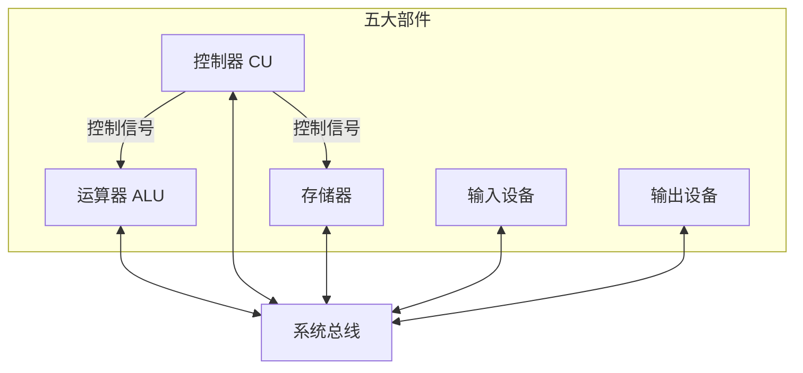
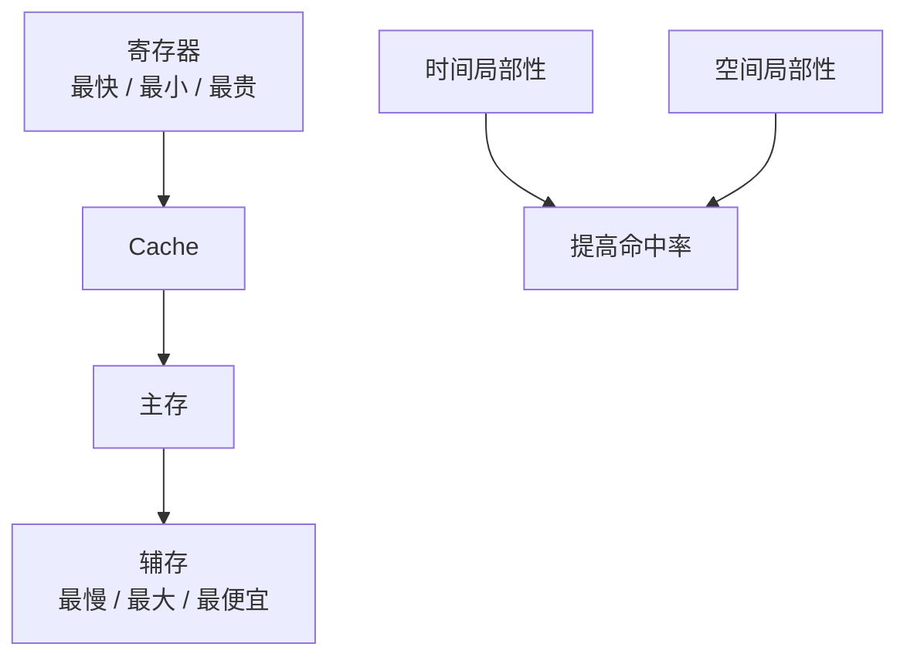

# 计算机组成原理

## 考纲定位

对应官方考试大纲「计算机硬软件与网络的基础知识」中的计算机硬件与系统部分。系统架构设计师需要掌握计算机系统组成、指令与 CPU、存储层次、性能评价等基础，并能从硬件约束出发思考架构决策（容量、并发、延迟、吞吐）。

具体范围以现行官方考试大纲为准。

## 核心概念

### 1. 计算机系统组成（冯·诺依曼结构）

现代通用计算机的基本结构仍基于冯·诺依曼体系：

- **运算器（ALU）**：执行算术与逻辑运算。
- **控制器（CU）**：解释指令、发出控制信号，指挥各部件协调工作。
- **存储器**：存放程序与数据（主存）。
- **输入设备 / 输出设备**：与外部交换信息。
- **总线（Bus）**：连接各部件的公共通道，通常分为数据总线、地址总线、控制总线。

**关键特征**：程序与数据均以二进制形式存放在同一存储器中；CPU 通过指令计数器顺序取指执行。

### 2. 指令系统

- **指令格式**：操作码 + 地址码（操作数地址或立即数）。
- **寻址方式**：立即寻址、直接寻址、间接寻址、寄存器寻址、基址/变址寻址、相对寻址等。不同寻址方式在灵活性、速度、指令长度之间做权衡。
- **指令执行过程**（经典五阶段）：取指（IF）→ 译码（ID）→ 执行（EX）→ 访存（MEM）→ 写回（WB）。

### 3. CPU 与流水线

- **时钟周期 / 指令周期**：时钟周期是 CPU 工作的基本时间单位；一条指令通常需要多个时钟周期完成。
- **流水线（Pipeline）**：把指令执行过程分成多个阶段，多条指令重叠执行，提升吞吐率。
- **流水线冲突**：
  - **结构冲突**：多条指令同时争用同一硬件资源（如同一存储器端口）。
  - **数据冲突**：后续指令依赖前面指令的结果（RAW、WAR、WAW）。
  - **控制冲突**：分支、跳转导致后续已取指令可能无效。

流水线能提高吞吐，但冲突会引入气泡（stall），实际加速比受冲突与流水线深度影响。

### 4. 存储层次

从快到慢、从贵到便宜、从容量小到大的典型层次：

**寄存器 → Cache → 主存（内存） → 辅存（磁盘/SSD）**

- **局部性原理**是 Cache 有效的基础：
  - **时间局部性**：刚被访问的数据很可能很快再次被访问。
  - **空间局部性**：相邻地址的数据很可能被一起访问。
- **命中率（Hit Rate）**与**平均访问时间**直接相关：

  平均访问时间 ≈ 命中时间 + (1 − 命中率) × 缺失代价

命中率越高，平均访问时间越接近 Cache 速度。

### 5. 性能指标

常用指标及其关系：

| 指标 | 含义 | 说明 |
|------|------|------|
| 主频 | 时钟频率 | 单位时间内时钟周期数，不等于整体性能 |
| CPI | 每条指令平均时钟周期数 | 受指令类型、流水线效率、Cache 命中率影响 |
| 指令数 | 程序执行的指令条数 | 与算法、编译器、指令集相关 |
| 程序执行时间 | 约等于 指令数 × CPI × 时钟周期时间 | 最直接的性能度量之一 |
| 吞吐率 | 单位时间完成的工作量 | 常与响应时间存在权衡 |
| 响应时间 | 从提交到得到结果的时间 | 用户感知性能 |

**阿姆达尔定律（Amdahl's Law）**：系统加速比受限于串行部分占比。即使某部分被大幅加速，整体提升仍受未加速部分限制。

## 原理与适用条件

- **存储层次有效的前提**：程序具有良好的局部性。随机访问或工作集远超 Cache 容量时，命中率下降，性能急剧退化。
- **流水线适用条件**：指令流相对规整、分支可预测、功能部件可并行。深度流水线在分支频繁或依赖严重时收益下降。
- **性能优化方向**：减少指令数（算法/编译优化）、降低 CPI（更好流水线、更高命中率）、提高主频（受功耗与工艺限制）。三者需综合权衡，不能只盯主频。

## 架构师视角

1. **硬件约束决定软件架构边界**  
   内存容量、Cache 大小、磁盘 IOPS、网络带宽直接影响并发模型、缓存策略、分库分表、异步化与批处理设计。

2. **不能用单一硬件指标代表系统性能**  
   高主频 CPU 在 Cache 缺失率高或 I/O 密集场景下可能表现平庸。架构设计应关注端到端延迟与吞吐，而非单点参数。

3. **局部性是缓存与数据布局的核心**  
   合理的数据局部性（顺序读、热点数据集中）能显著降低平均访问时间；反之，随机读写和跨节点访问会放大延迟。

4. **冲突与瓶颈会向上传递**  
   存储层次缺失、总线争用、磁盘队列堆积最终体现为应用层超时、线程阻塞和可用性下降。架构评估需把硬件资源作为约束条件纳入。

5. **容量规划与弹性**  
   理解寄存器/Cache/主存/辅存的成本与速度差异，有助于在内存数据库、多级缓存、冷热分离、对象存储等方案之间做合理选型。

## 易混点

| 易混概念 | 正确理解 |
|----------|----------|
| 主频 vs 性能 | 主频只是影响因素之一，还需看 CPI、指令数、存储层次效率 |
| 吞吐率 vs 响应时间 | 高吞吐不代表单请求响应快；两者常需权衡（如批处理提高吞吐但增加延迟） |
| Cache 命中率 vs 平均访问时间 | 命中率是手段，平均访问时间才是结果；高命中率才有意义 |
| 流水线加速比 | 理想加速比等于流水线级数，实际受冲突与气泡限制，远低于理想值 |
| 冯·诺依曼 vs 哈佛结构 | 冯·诺依曼程序与数据共用存储器；哈佛结构指令与数据分离，常见于嵌入式/DSP |
| 时间局部性 vs 空间局部性 | 时间：同一数据再访问；空间：相邻地址被访问 |

## 自测

1. 画出冯·诺依曼计算机的基本组成，并标出数据流与控制流。
2. 写出平均访问时间的近似公式，并说明命中率如何影响它。
3. 流水线有哪三类冲突？各举一个软件或硬件层面的例子。
4. 为什么说“提高主频不一定能线性提高程序性能”？
5. 阿姆达尔定律对系统加速比的核心约束是什么？对架构优化有何启示？
6. 在设计高并发系统时，存储层次的哪些特性会直接影响你的缓存与数据分片策略？

（建议闭卷回答后对照本文与教材核验。）

## 与后续知识的联系

- **操作系统**：进程调度、虚拟内存、页面置换直接建立在存储层次与局部性之上。
- **计算机网络**：端到端延迟包含主机处理时间，CPU 与存储效率会影响协议栈与应用层性能。
- **架构设计与质量属性**：性能（响应时间、吞吐）、可用性（资源耗尽导致的故障）评估都需要硬件约束作为输入。
- **容量规划与云原生**：实例规格选择、缓存层级、持久化存储类型本质上是在不同存储层次与成本之间做权衡。

## 来源与更新

- 主要依据：系统架构设计师考试大纲（计算机系统基本知识部分）、经典计算机组成原理教材通用知识点。
- 官方大纲版本与具体页码：待对照最新官方大纲后补充。
- 本文状态：完整版初稿。
- 最后更新：2026-11-20。
- 复习记录：待填写。
