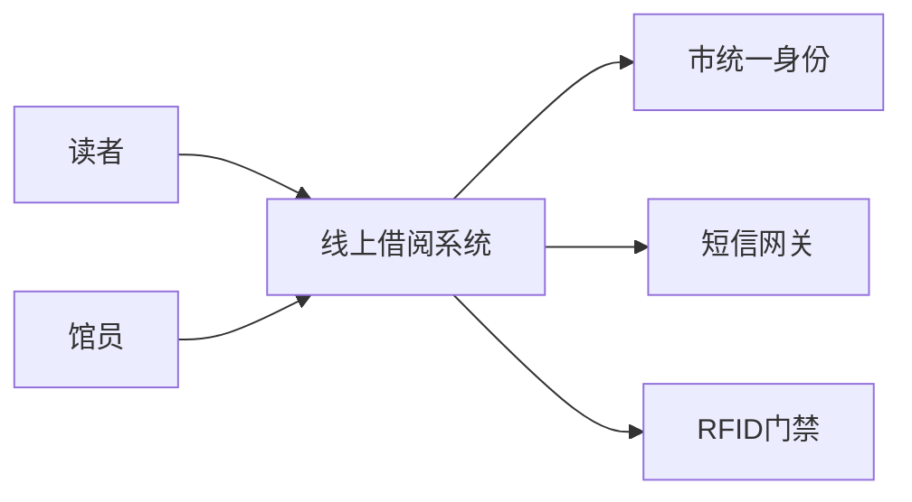
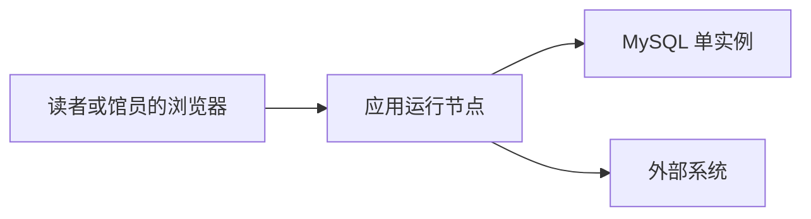

# 从需求推导架构视图（教学案例）

> **题目类型**：原创教学案例，不是历年真题。  
> **适用阶段**：W01。限时建议 45 分钟。请先完成[驱动力案例](架构驱动力与质量属性场景识别-教学案例.md)，本题使用同一背景。  
> **核心考点**：从系统边界画出上下文，再导出逻辑、开发、进程、物理视图，并用一个场景把它们串起来。  
> **边界**：本题不选择架构风格，不设计缓存，也不把模拟图当成已经上线的部署。

## 题目

仍使用图书馆线上借阅的材料：单体 Java Web、MySQL 单实例、规则在既有应用模块中、6 人 6 个月、必须对接市统一身份、短信网关和 RFID 门禁，未认证不得创建借阅，规则变更不应要求改写门禁和短信适配。应用与数据库是否同机、短信是否异步，材料均未说明。

请回答：

1. 画出系统上下文，列出边界内和边界外的元素。说明为什么不把 Java 类放进上下文。
2. 给出逻辑、开发、进程、物理四个视图各自应包含的结构元素，并说明每个元素对应哪一条驱动力。
3. 用“读者在周末查询、预约并到馆借出”这一场景，写出四句追踪：逻辑职责、模块归属、运行时调用、节点映射。
4. 如果交付物只有一张应用服务器和数据库服务器的部署图，会丢失哪些已经由材料支持的架构决策？

## 考点定位

- 大纲：4+1 模型、Use Case 所支撑的场景、架构描述中的视图。IEEE 1471 的视点与视图若能顺带说清可以加分，但不是必答术语。
- 得分不来自 UML 符号是否标准，来自元素是否放对视图、未知是否保持未知。
- 详细作图规范不必追求画法考试的图符满分。箭头要有含义。

## 事实、假设与不做的事

**事实：** 系统需要读者和馆员两类使用者；外部依赖三个；规则模块已经存在于应用内；认证失败必须拒绝创建借阅。

**假设（必须标注）：** 下图把应用和数据库画成两个节点，只是为了表达数据依赖，不表示已经分机，更不表示应当分机。短信在进程视图中先标成“调用方式待确认”。

**不做：** 不引入消息中间件、不拆微服务、不写 QPS。

## 参考答案

### 1. 系统上下文

边界内只有“线上借阅系统”这一个黑盒。读者、馆员是外部角色。三个对接系统在边界外，即使由本团队调用，也不属于本系统的内部结构。

Java 类、规则模块和数据库表都在黑盒之内。放进上下文会使边界消失，后续就无法判断哪些变化不应该影响门禁和短信。

本图是上下文，不是逻辑视图，也不是 4+1 的场景视图。它只解决环境。

### 2. 四个视图的元素

**逻辑视图：职责与协作**

| 元素 | 职责 | 对应驱动力 |
|---|---|---|
| 预约查询 | 按复本状态给出可预约结果 | 线上预约功能；查询响应目标作用在这个职责上 |
| 借阅办理 | 创建预约或借出，并在未认证时拒绝 | 自助借还；认证安全 |
| 借阅规则 | 判断资格、借期等规则 | 复用既有规则；规则可单独变化 |
| 身份认证适配 | 把认证委托给市统一身份 | 不得自建账号 |
| 通知 | 把需要告知读者的结果交给短信网关 | 必须对接短信；不承载借阅规则 |
| 门禁集成 | 把允许借出的结果交给 RFID 门禁 | 到馆自助借出 |
| 借阅记录 | 保存预约和借出事实 | 借阅事实需要持久；敏感信息落在这里 |

逻辑视图不写线程，不写主机，不写包名。

**开发视图：模块归属**

| 模块 | 包含的逻辑职责 | 为什么这样放 |
|---|---|---|
| 接入与界面 | 读者入口、馆员例外入口 | 入口变化不应改规则 |
| 应用服务 | 预约查询、借阅办理的流程编排 | 把外部调用和规则调用编排在一处 |
| 既有规则模块 | 借阅规则 | 材料要求复用，不在本期重写 |
| 外部适配 | 身份认证适配、通知、门禁集成 | 规则变更不应改写这些适配 |
| 持久化 | 借阅记录的保存与读取 | 把数据访问限制在明确边界 |

这是开发视图而不是“代码已经写完”。6 人团队可以用模块边界分工，而不必先拆成独立部署单元。

**进程视图：运行单元与失败行为**

材料足以支持的运行时结论只有这些：

- 读者的查询和办理请求由应用内的请求处理执行。
- 办理借阅前必须同步得到身份认证结果；认证失败则请求在创建借阅前结束。这里的“同步”指业务上不能跳过认证结果，不是指定某一种 RPC 产品。
- 规则判断在创建借阅记录之前完成。
- 门禁调用失败时不能把“已借出”写成既成事实。具体是先写记录再补偿，还是门禁成功后再写记录，材料没规定，标为待设计，不假装已有方案。
- 短信发送与查询请求是否共用同一线程，材料没规定。

不要在本视图加入队列消费者。那是未被材料支持的新结构。

**物理视图：节点映射**

可以确定的只有：存在应用运行节点、一块 MySQL 单实例，以及到三个外部系统的网络依赖。外部系统不由本系统部署。应用节点和数据库节点在图上分开，只表示软件依赖；是否同一台主机仍待确认。因此本图**不能**解读为水平扩展、读写分离或已完成的分机方案。

### 3. 用一个场景串起来

场景：周末高峰，已登录读者查询到可借复本，创建预约，到馆后自助借出。未认证用户在任何创建步骤被拒绝。

1. **逻辑：** 预约查询给出结果；借阅办理调用身份认证适配和借阅规则；通过后写借阅记录，并调用门禁集成；通知只负责告知。
2. **开发：** 查询和办理在应用服务；规则仍在既有规则模块；身份、短信、门禁在外部适配；记录在持久化模块。
3. **进程：** 创建动作在同一请求中先取得认证结果和规则结果。认证失败立即返回，不写借出。门禁失败时的记录策略待设计。短信不占用这个结论。
4. **物理：** 上述应用内模块当前都映射到应用运行节点，记录进入 MySQL 单实例，认证、短信和门禁通过网络访问外部系统。

四句里的元素能够互相对上。若进程视图出现了开发视图中不存在的队列服务，追踪就失败。

### 4. 只有部署图会丢失什么

一张“应用服务器—数据库服务器”的图最多支持物理依赖，而且在分机事实未确认时还会过度表达。它丢失了材料已经支持的决策：

- 身份认证在创建借阅之前，失败即拒绝。这是安全约束，不在机器连线上。
- 规则模块被复用，并与门禁、短信适配分开。这是可修改性决策，属于逻辑和开发视图。
- 借阅记录是敏感的业务事实，门禁调用失败时不能随便记成已借出。这是进程和数据责任。
- 外部系统是环境的一部分。把它们画成可选插件会掩盖“不得自建账号”等约束。
- 6 人 6 个月这一业务约束解释了为什么本期不重写规则。部署图没有这个理由。

所以部署图可以是物理视图中的一个模型，但不是架构描述。

## 五步法映射

1. **需求：** 预约、自助借出、认证、规则复用。
2. **约束与证据：** 三个外部系统、团队与窗口；同机与否、短信方式、门禁失败时的记录顺序缺失。
3. **比较：** 比较的是描述方式：只有部署图，还是上下文加四个视图。不是比较微服务和单体。
4. **决策：** 用上下文和 4+1 表达已经成立的职责分离；未知保持在进程视图的待设计项。
5. **质量属性：** 查询职责对应性能目标，认证顺序对应安全，适配与规则分离对应可修改性。物理视图不假装已经满足 2 秒。

## 得分点

| 得分点 | 表现 |
|---|---|
| 上下文是黑盒 | 外部角色和三个系统在外，类不在内 |
| 视图没有串味 | 线程不出现在逻辑视图，包归属不出现在物理视图 |
| 元素能追溯驱动力 | 规则模块对应复用和可修改性，认证适配对应统一身份 |
| 未知保持未知 | 同机部署、短信异步、门禁失败后的写记录顺序没有被写成定案 |
| 场景能追踪 | 四句话指的是同一条借阅路径 |
| 指出部署图的缺口 | 至少说出安全顺序和规则/适配分离被遗漏 |

每项 0–2 分，满分 12。对照后把遗漏的视图写进错题，下一次遮住答案重画，而不是背方框名称。

## 个人复盘栏

- 我的逻辑视图是否退化成了类清单？
- 我是否为了画面完整而加入消息队列？
- 我是否把“两个方框”解释成了“已经水平扩展”？

论文训练不要把本图写成个人项目经历。若要用同一背景练习表述，只能使用[模拟项目草图](../../04_论文/项目背景素材/真实项目候选与4+1视图草图.md)，并保留“模拟”标记。

## 来源与更新

- 类型：原创教学案例，与驱动力案例共用虚构的图书馆背景。
- 创建日期：2026-11-23。
- 图仅完成 Mermaid 静态语法检查，未在渲染器中逐张预览。
