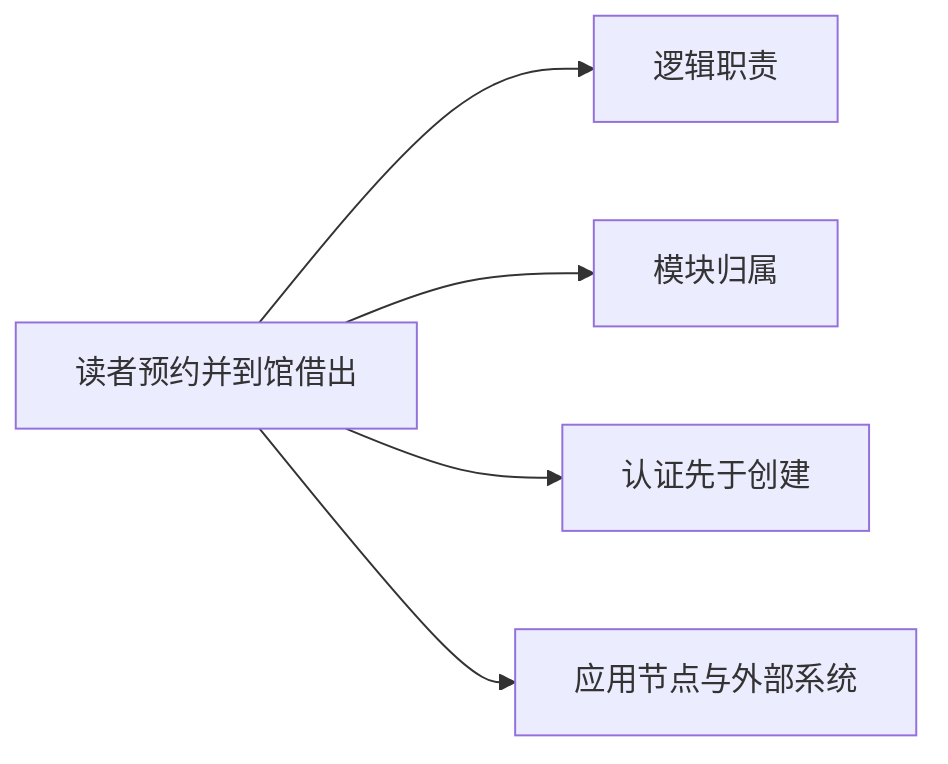

# 真实项目候选与 4+1 视图草图

> 本页服务 W01 论文任务：整理真实项目候选，并练习系统上下文和 4+1 视图。  
> 前半是空白盘点，只能填写本人真实参与的内容。后半是**模拟项目**，用来对照画法，禁止写入论文当作个人经历。

## 先怎么选真实项目

约 4 年 Java 开发经验，优先选一个自己改过代码、查过故障或参加过设计讨论的系统或子系统。不要求它“足够大型”。论文需要的是真实职责，不是头衔。

适合作为候选的信号：

- 能说清系统边界外有哪些人和其他系统。
- 能说清自己改过的模块，以及没改过的模块。
- 能区分“团队的决策”和“我提出或执行的那一部分”。

不适合本周硬写的情况：

- 只使用过某个中间件，但不知道为什么选型。
- 指标来自听说、投标材料或无法说明的监控截图。
- 为了贴近架构师岗位，把参与开发写成“独立负责整体架构”。

本周交付两页以内即可：最多 3 个候选的盘点表，加上其中 1 个候选的上下文和四个视图草图。没有把握的格子留空。

## 候选盘点表

复制到个人笔记后填写。不要把模拟示例的图书馆项目填进这张表。

| 项 | 候选 A | 候选 B | 候选 C |
|---|---|---|---|
| 项目名称（可脱敏） |  |  |  |
| 性质 | 真实 | 真实 | 真实 |
| 时间范围 |  |  |  |
| 我的角色 |  |  |  |
| 我实际做过的事 |  |  |  |
| 我没有做过、不能写成个人决策的事 |  |  |  |
| 一句话说明系统 |  |  |  |
| 外部角色与外部系统 |  |  |  |
| 已知约束 |  |  |  |
| 能量化且能说明出处的指标 |  |  |  |
| 本周能画的视图 |  |  |  |
| 仍缺少的证据 |  |  |  |

选择一个候选继续画图。选择理由写成：“我能对这个系统的边界和自己的改动负责”，而不是“它更像微服务”。

## 真实草图要包含的内容

1. 上下文：系统黑盒、外部角色、外部系统。
2. 逻辑视图：只保留自己能解释职责的结构元素。
3. 开发视图：标出自己改过的模块和只调用过的模块。
4. 进程视图：只写自己确认过的同步、超时或失败行为；没确认就写“未知”。
5. 物理视图：只写自己确认过的节点。没见过部署就不画两台机器。
6. 一个自己真正做过或真正维护过的场景，用四句话把四个视图串起来。
7. 决策理由：为什么职责这样分。若决策是别人做的，写成“我了解到的团队决策”，不要改成第一人称发明。

指标栏允许的写法只有三种：监控或日志的出处、明确的需求目标并注明“目标不是实测”、留空。不允许为了论文完整度补数字。

## 模拟项目示例：市图书馆线上借阅

**项目性质：模拟项目。** 背景与 W01 两道教学案例相同，数字和职责都是训练设定。下文的“我”是练习用的叙述者，不是仓库使用者的经历。

### 背景与职责范文

模拟项目中，叙述者是 6 人小组里的 Java 开发，负责把既有借阅规则模块接到新的线上办理流程，并实现市统一身份的适配调用。叙述者没有单独决定数据库产品，也没有测量过周末查询延迟。6 个月上线和 95% 请求 2 秒内返回，是题目给定的目标。

这段范文可用的原因：角色小于“总架构师”，职责落在可检查的模块上，指标被标成目标。它不可用的地方同样明确：图书馆、人数和目标都是虚构的，不能换成真实公司名称后提交。

### 上下文与四个视图

上下文、四个视图的元素和场景追踪，与[从需求推导架构视图](../../03_案例分析/架构基础与视图/从需求推导架构视图-教学案例.md)中的参考答案一致。论文练习不要另画一套互相矛盾的结构。这里只保留描述关系，避免把案例答案再抄一遍。

**怎么读：** 场景是追踪线。逻辑上规则与适配分离，开发上规则留在既有模块，运行时认证失败不创建借阅，物理上外部身份系统不在本系统边界内。短信是否异步、应用是否与数据库同机，在模拟材料中仍然未知。

### 可复用的决策段落

模拟叙述可以这样写决策，而不是罗列框架：

> 本期没有把借阅规则、门禁和短信放进同一个模块。规则需要继续沿用，并且规则变更不应迫使门禁和短信适配一起发布；身份认证则必须发生在创建借阅之前，否则无法满足“未认证不得借出”。因此开发视图把既有规则模块和外部适配分开，进程视图要求办理请求先取得认证结果。团队只有 6 人、窗口只有 6 个月，所以没有把规则模块拆成新的部署单元。查询 2 秒只是验收目标，在没有基线测量前，这个视图不包含缓存或额外中间件。

范文好处：每个结构都能指回驱动力，放弃的做法有原因，未知没有被填满。边界：这是模拟决策。真实论文必须替换成自己项目里同样可追溯的句子；对不上真实代码和真实约束时，删掉句子，不要改名保留。

### 效果与不足怎么写才诚实

模拟项目没有上线结果。效果栏只能写“计划如何验证”，例如：用周末查询的响应时间分布对照 2 秒目标，用认证失败用例确认不会产生借阅记录，用一次规则变更检查适配模块是否需要改动。不能写“上线后性能提升 50%”。

不足也要保留：门禁调用失败后，记录与门禁状态谁先谁后，材料没有设计完成；短信调用方式未定。论文里承认未完成，比编造补偿事务更符合评分对真实性的要求。

## 本周验收

- 盘点表至少有 1 个真实候选；若确实没有可公开的真实项目，整页标注模拟，并写明缺失的是真实经历而不是技术名词。
- 选定候选有上下文和四个视图；空白处标未知。
- 有一段不超过 300 字的决策段落，里面能指出一个没有采纳的做法。
- 对照[模拟 ADR](../架构决策素材/用多视图描述架构-模拟ADR.md)检查段落是否把“多视图”本身说清楚。

## 来源与更新

- 创建日期：2026-11-23。
- 模拟部分来自 W01 原创教学背景，不是个人履历，也不是已实施项目。
- 图仅做 Mermaid 静态语法检查，未在渲染器中预览。

## 用真实经历检验概念，而不是套用模拟答案

在真实项目草图中，建议对每个重要元素增加一行“证据—概念—个人参与”：

| 证据 | 对应概念 | 应写清的内容 |
|---|---|---|
| 一次实际需求变更 | 架构驱动力/可修改性 | 变化从哪里来、影响了哪些模块、你实际参与了什么 |
| 一次真实接口调用 | 连接件 | 同步/异步、超时、失败和重试中哪些是你亲自确认的 |
| 一张真实模块图 | 开发视图 | 模块边界和依赖方向，不能只贴代码目录 |
| 一次真实运行问题 | 进程视图 | 请求/线程/进程如何协作，故障现象和证据是什么 |
| 一份真实部署资料 | 物理视图 | 节点、网络和制品映射；没确认的主机关系留空 |

不要把图书馆教学案例中的“6 人、6 个月、2 秒目标”迁移到真实项目。真实项目中的每个指标都必须能说明来源；团队决策与个人决策也要分开陈述。
